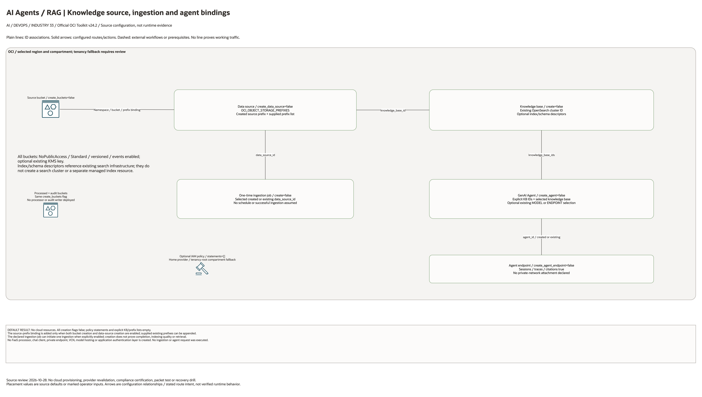

# AI Agents RAG Landing Zone Architecture

## Deployment Purpose

This blueprint creates the deployable landing-zone shape for an OCI GenAI Agent
RAG workload. It gives teams a documented path from approved source documents
to a knowledge base, indexed retrieval, agent endpoint access, and audit handoff.
All expensive or externally visible resources are disabled by default.

## Architecture At A Glance

| Layer | Components |
| --- | --- |
| Intake | Object Storage source bucket and optional existing prefixes. |
| Processing | Data source and ingestion job attached to a GenAI Agent knowledge base. |
| Retrieval | OpenSearch or compatible knowledge base index configuration. |
| Reasoning | OCI GenAI Agent and optional endpoint with sessions, traces, and citations. |
| Governance | IAM policy shell, audit bucket, tags, and operator review gates. |

## Architecture

[Edit the multi-page draw.io diagram](architecture.drawio). Resource-detail pages
enumerate all source declarations, including disabled conditions and transitive
pinned modules. The existing-resource page lists identifier inputs; it does not
create their dependencies. See [source coverage](resource-inventory.json).

Plain connectors show declared ID associations. Solid arrows show configured
routes or action targets. Dashed lines explicitly mark external application
steps or prerequisites. No connector proves working service traffic.

## Terraform Components

| File | Purpose |
| --- | --- |
| `main.tf` | Creates buckets, GenAI Agent knowledge base, data source, ingestion job, agent, endpoint, and optional IAM policy. |
| `variables.tf` | Defines the create/reference contract for buckets, indexes, model selection, data sources, and policies. |
| `outputs.tf` | Exposes bucket names, knowledge base, data source, agent, endpoint, and policy identifiers. |
| `terraform.tfvars.example` | Shows safe placeholder values for extension-only and full deployment paths. |

Declared resource addresses:

| Kind | Name | Source Or Role |
| --- | --- | --- |
| Resource | `oci_objectstorage_bucket.this` | Declared in this blueprint; creation depends on its count or for_each inputs. |
| Resource | `oci_generative_ai_agent_knowledge_base.this` | Declared in this blueprint; creation depends on its count or for_each inputs. |
| Resource | `oci_generative_ai_agent_data_source.this` | Declared in this blueprint; creation depends on its count or for_each inputs. |
| Resource | `oci_generative_ai_agent_data_ingestion_job.this` | Declared in this blueprint; creation depends on its count or for_each inputs. |
| Resource | `oci_generative_ai_agent_agent.this` | Declared in this blueprint; creation depends on its count or for_each inputs. |
| Resource | `oci_generative_ai_agent_agent_endpoint.this` | Declared in this blueprint; creation depends on its count or for_each inputs. |
| Resource | `oci_identity_policy.access` | Declared in this blueprint; creation depends on its count or for_each inputs. |

## Request And Deployment Flow

1. Data owners approve document locations and prefixes.
2. Platform owners deploy or reference the OpenSearch/vector backend.
3. Terraform creates or references the knowledge base and data source.
4. An optional ingestion job indexes the approved source documents.
5. Terraform creates or references the agent and endpoint.
6. Applications call the endpoint through the customer-approved access path.
7. Operators review audit and trace outputs outside the local IaC artifact path.

## Traffic And Trust Boundaries

- Source content is explicitly scoped through Object Storage prefixes.
- Agent endpoint access should stay private unless a separate edge blueprint is
  used and approved.
- IAM policies should separate data stewards, ingestion operators, app callers,
  and audit readers.
- The knowledge base backend is treated as a data system, not just an AI helper.
- Full prompt/session logging can contain sensitive content and must follow the
  same retention model as the source documents.

## Detailed Architecture Notes

- `create_buckets` creates a clean document/audit bucket set for greenfield use.
- `data_source_prefixes` supports extension-only deployments where documents
  already live in customer-managed buckets.
- `knowledge_base_indexes` lets the customer align body, embedding, title, and
  URL field names with an existing OpenSearch schema.
- `create_ingestion_job` is intentionally separate from data-source creation so
  operators can plan the metadata path before indexing content.
- Model selection supports either a base model OCID or a dedicated endpoint OCID.
- Citation, session, and trace switches are endpoint-level because customers
  often choose different defaults for production and support environments.

## Operational Boundaries

- Terraform does not upload source documents or curate the corpus.
- Terraform does not tune chunking, embeddings, or ranking logic by itself.
- Ingestion jobs should be reviewed before re-running against large buckets.
- Sensitive data review belongs before `create_data_source` is enabled.
- Cost and token controls should be combined with GenAI gateway or guardrails
  blueprints for shared platform deployments.

## Review Checklist

- Source bucket prefixes are approved by the data owner.
- Knowledge base backend and index schema are reviewed.
- Model or endpoint OCIDs are available in the target region.
- Agent endpoint exposure is private or explicitly approved.
- IAM statements are least-privilege and group-based.
- Audit and trace retention are documented.
- Terraform plan shows no unexpected public access or unmanaged document paths.

## October 2026 Configuration Review

Creates optional knowledge-base, ingestion, agent, endpoint, bucket, and IAM objects. OpenSearch indexes or existing references, document contents, model compatibility, permissions, and retrieval quality require separate validation. No RAG inference or ingestion was executed in this review.

Validation in this round is isolated Terraform schema/lint validation and applicable mocked regressions, not a live AI deployment. All cost-bearing services, inference, ingestion, dedicated clusters, and external-cloud resources remained disabled. Providers ignore only the two OCI-managed provenance tags; customer-defined tags remain managed.

## October 28, 2026 Diagram Source Review

All cloud creation flags default false. Data sources bind namespace/bucket/prefix
configuration to the selected knowledge base. The created source prefix is added
only when both bucket and data-source flags are enabled. A separately enabled
one-time ingestion job binds to the selected data source; job creation does not
prove successful indexing. Index/schema descriptors reference existing search
infrastructure. No private endpoint, private network, client application,
processed-bucket writer or audit exporter is declared.

This change reviews documentation and rendered diagrams only. Historical
Terraform/provider validation metadata is unchanged. No cloud provisioning,
application execution or runtime connectivity test was performed.
