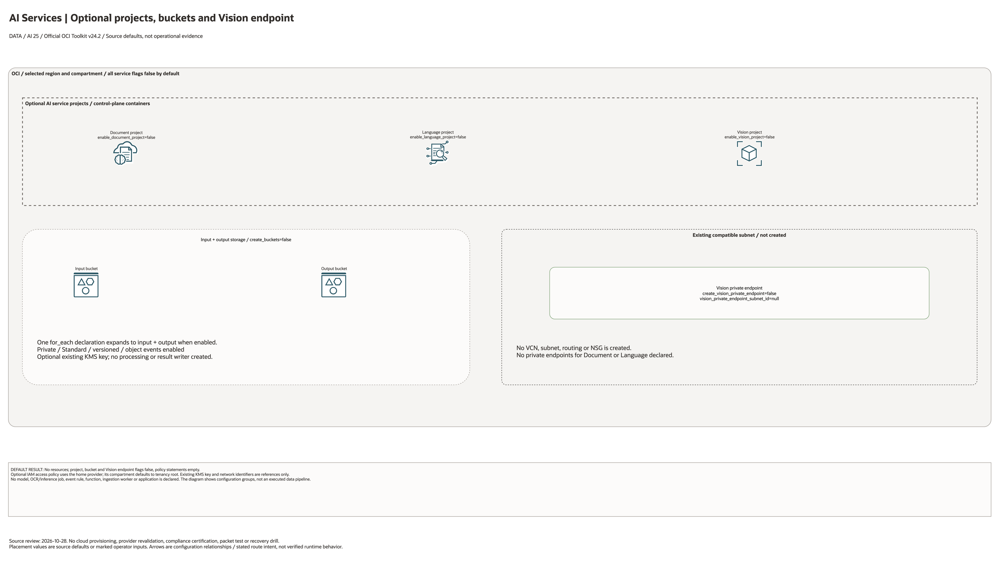

# OCI AI Services Architecture

## Deployment Purpose

Create a landing-zone-ready shape for pretrained OCI AI Services. The blueprint
sets up service projects, private data buckets, optional Vision private access,
and IAM so applications can call Vision, Language, and Document Understanding
without adopting a full GenAI platform.

## Architecture At A Glance

| Layer | Responsibility |
| --- | --- |
| Input bucket | Stores images, documents, audio metadata, or text payloads. |
| AI service projects | Group Document, Language, and Vision work. |
| Vision private endpoint | Optional private network path for Vision. |
| Output bucket | Stores inference results and extracted metadata. |
| IAM | Controls service callers and data readers. |

## Architecture



[Editable draw.io diagram](architecture.drawio)

## Diagram Sources And Scope

Generated with the installed `oci-architecture-diagrams` skill and Oracle Toolkit
v24.2. AWS resources use native AWS icons; types without an exact mapped glyph
remain named boxes. Source review: October 28, 2026. Configuration relationships
and source defaults do not establish working traffic, inference, backups or DR.
No cloud provisioning or provider revalidation was performed; historical
validation metadata remains unchanged.

Regenerate the overview before rebuilding the resource-detail pages:

```bash
python3 scripts/diagrams/data-ai-batch-01.py --render
python3 scripts/diagrams/multicloud-resource-coverage.py --blueprint ai/ai-services --render
python3 scripts/diagrams/multicloud-resource-coverage.py --blueprint ai/ai-services --check
```

## Resource Detail And Coverage

The main draw.io document contains the overview, every resource-detail page and
the existing-resource input references below. Conditional and collection
resources remain visible. Counts are source declarations, not resolved instance
counts or deployed resources. `terraform_data` contracts are local metadata;
companion CloudFormation templates deploy separately.

| Scope | Declarations or references | Preview | Editable source |
| --- | --- | --- | --- |
| OCI resources | 6 | [PNG](oci-resources.png) | [draw.io](oci-resources.drawio) |
| Existing resources / inputs | 4 references | [PNG](existing-resources.png) | [draw.io](existing-resources.drawio) |

[Resource inventory](resource-inventory.json) records source hashes, revisions,
creation expressions, data lookups and resource-to-diagram node mappings.
Supplied subnet, key, compartment and service IDs are references or overrides,
not evidence that this blueprint creates or adopts those external resources.

## Terraform Components

| File | Purpose |
| --- | --- |
| `main.tf` | Buckets, AI service projects, Vision private endpoint, IAM policy. |
| `variables.tf` | Project, bucket, endpoint, and policy inputs. |
| `outputs.tf` | Project IDs, endpoint ID, bucket names, and policy hand-off. |
| `terraform.tfvars.example` | Service-selection example with create flags disabled. |
| `ansible/*.yml` | Standard local runners. |

Declared resource addresses:

| Kind | Name | Source Or Role |
| --- | --- | --- |
| Resource | `oci_objectstorage_bucket.this` | Declared in this blueprint; creation depends on its count or for_each inputs. |
| Resource | `oci_ai_document_project.document` | Declared in this blueprint; creation depends on its count or for_each inputs. |
| Resource | `oci_ai_language_project.language` | Declared in this blueprint; creation depends on its count or for_each inputs. |
| Resource | `oci_ai_vision_project.vision` | Declared in this blueprint; creation depends on its count or for_each inputs. |
| Resource | `oci_ai_vision_vision_private_endpoint.this` | Declared in this blueprint; creation depends on its count or for_each inputs. |
| Resource | `oci_identity_policy.access` | Declared in this blueprint; creation depends on its count or for_each inputs. |

## Request And Deployment Flow

1. Choose the pretrained service capabilities needed.
2. Confirm input/output bucket retention and encryption.
3. Decide whether Vision needs private endpoint access.
4. Configure IAM for callers and service accounts.
5. Run plan and apply.
6. Hand project and bucket outputs to application owners.

## Traffic And Trust Boundaries

- Input and output data can contain sensitive documents, text, and images.
- Private endpoint use depends on service support and customer network policy.
- Application callers should not automatically receive output bucket read access.
- Service projects should sit in the workload or AI platform compartment.
- Data retention should match the customer classification of processed content.

## Detailed Architecture Notes

This blueprint is intentionally separate from `genai-private`. Many customers
need OCR, classification, sentiment, entity extraction, or image analysis before
they need LLM endpoints. Keeping pretrained AI services separate makes adoption
lighter and IAM easier to explain.

The project resources give teams a consistent control plane anchor. Buckets are
optional because some customers already operate centralized data landing zones.

Vision private endpoint support is exposed because image workloads frequently
touch confidential or regulated data.

## Operational Boundaries

- Do not commit source documents, images, transcripts, or inference outputs.
- Keep bucket names, subnet IDs, and caller groups in local tfvars.
- Use `document-intelligence` for event-driven document pipelines.
- Use `genai-guardrails` when outputs are fed into GenAI prompts.

## Review Checklist

- [ ] Selected AI services match the workload.
- [ ] Bucket retention and encryption are approved.
- [ ] Vision private endpoint subnet is correct when enabled.
- [ ] Caller and service-account IAM statements are least privilege.
- [ ] Output consumers are documented.
- [ ] Sensitive data handling is approved.

## October 2026 Configuration Review

Document, Language, and Vision projects are service containers; this blueprint does not execute OCR, analysis, inference, or an application workflow. A Vision private endpoint requires a separately supplied compatible subnet.

Validation in this round is isolated Terraform schema/lint validation and applicable mocked regressions, not a live AI deployment. All cost-bearing services, inference, ingestion, dedicated clusters, and external-cloud resources remained disabled. Providers ignore only the two OCI-managed provenance tags; customer-defined tags remain managed.
