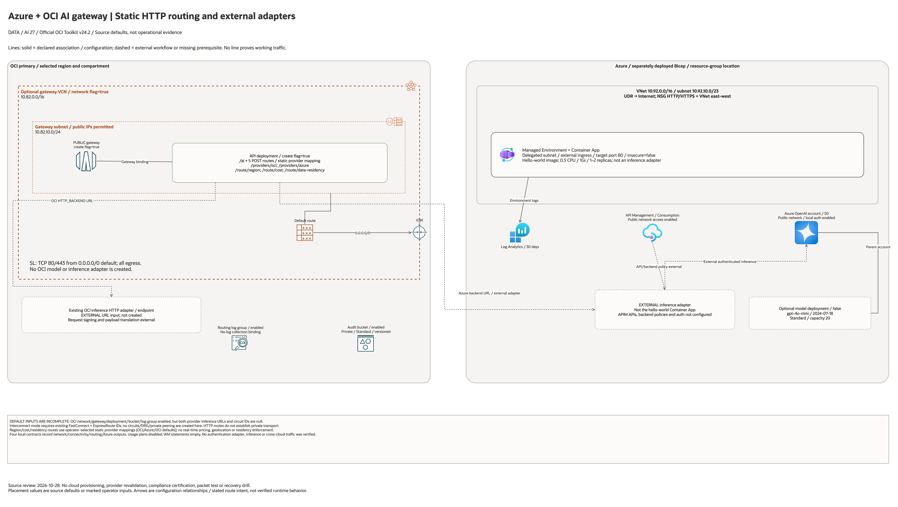

# Azure + OCI AI Gateway Architecture

This page is the deployment architecture for
`blueprints/ai/azure-oci-ai-gateway`. The PNG provides a preview and the native draw.io document retains editable
resource pages.

## Deployment Purpose

Declares an OCI HTTP routing front door and separate Azure network/OpenAI/APIM
resources. Region, cost and data-residency paths select statically configured
backend URLs; adapters, authentication and policy enforcement remain external.

## Architecture At A Glance

| Item | Details |
| --- | --- |
| Boundary | `blueprints/ai/azure-oci-ai-gateway` owns this deployment folder and its Terraform + Ansible runners. |
| Purpose | Build OCI gateway infrastructure and route contracts while supporting full Azure deployment sessions for OpenAI and API gateway endpoints. |
| Terraform components | `oci_core_vcn.gateway`, `oci_core_route_table.gateway`, `oci_core_security_list.gateway`, `oci_core_subnet.gateway`, `oci_apigateway_gateway.this`, `oci_apigateway_deployment.this`, `oci_apigateway_usage_plan.this`, `oci_objectstorage_namespace.this`, `oci_objectstorage_bucket.audit`, `oci_logging_log_group.routing`, `terraform_data.connectivity_contract`, `terraform_data.routing_contract`, `terraform_data.azure_contract` |
| Primary architecture view | The Architecture diagram below shows OCI and Azure boundaries, configuration relationships and external adapter requirements for this deployment. |

## Architecture



[Editable draw.io diagram](architecture.drawio)

## Diagram Sources And Scope

Generated with the installed `oci-architecture-diagrams` skill and Oracle Toolkit
v24.2. Azure resources use embedded native provider artwork where mapped;
unmapped resource types remain named boxes. Source review: October 28, 2026.
No cloud provisioning, provider revalidation, inference, model training or
application traffic test was performed. Historical validation dates are unchanged.

```bash
python3 scripts/diagrams/ai-batch-02.py --render
python3 scripts/diagrams/multicloud-resource-coverage.py --blueprint ai/azure-oci-ai-gateway --render
python3 scripts/diagrams/multicloud-resource-coverage.py --blueprint ai/azure-oci-ai-gateway --check
python3 scripts/diagrams/check-connections.py --write-report
```

## Connection Lines

Solid lines show gateway/network bindings, Azure environment log delivery and the optional model deployment under its account. Dashed lines show HTTP adapter/backend prerequisites, not a working private interconnect. APIM APIs/policies and the Azure/OCI inference adapters are not implemented. The Container App is a separate hello-world application.

Lines represent source-defined configuration or explicitly labelled external
workflows. They do not establish successful runtime traffic. Independent buckets,
policies and log containers are not automatically wired together.

## Resource Detail And Coverage

The main native draw.io document includes the overview, all resource-detail
pages and identifier references. Counts are declarations, not expanded instances
or deployed assets. Disabled/conditional resources remain visible. Companion
Bicep deploys separately; local contracts do not create cloud services.

| Scope | Declarations / references | Preview | Editable source |
| --- | --- | --- | --- |
| Azure resources | 10 | [PNG](azure-resources.png) | [draw.io](azure-resources.drawio) |
| Contracts resources | 4 | [PNG](contracts-resources.png) | [draw.io](contracts-resources.drawio) |
| OCI resources | 11 | [PNG](oci-resources.png) | [draw.io](oci-resources.drawio) |
| Existing identifier inputs | 11 references | [PNG](existing-resources.png) | [draw.io](existing-resources.drawio) |

[Resource inventory](resource-inventory.json) records source hashes, creation
expressions, data lookups and resource-to-diagram node IDs. Supplied identifiers
and overrides remain references, not resources purportedly created or adopted.

## Terraform Components

| Kind | Name | Source Or Role |
| --- | --- | --- |
| Resource | `oci_core_vcn.gateway`, `oci_core_route_table.gateway`, `oci_core_security_list.gateway`, `oci_core_subnet.gateway` | Deploy-and-use OCI network stack for gateway routing and ingress controls. |
| Resource | `oci_apigateway_gateway.this` | OCI API Gateway front door for AI traffic. |
| Resource | `oci_apigateway_deployment.this` | Deploys provider and policy routes for region/cost/residency steering. |
| Resource | `oci_apigateway_usage_plan.this` | Optional quota/rate controls for caller teams. |
| Data source | `oci_objectstorage_namespace.this` | Reads namespace for audit bucket creation. |
| Resource | `oci_objectstorage_bucket.audit` | Optional private storage container; no automatic audit writer. |
| Resource | `oci_logging_log_group.routing` | Optional log-group container; no log resource or producer binding. |
| Resource | `oci_identity_policy.access` | Grants gateway and audit access by policy statements. |
| Resource | `terraform_data.connectivity_contract` | Encodes interconnect versus no-interconnect operating mode. |
| Resource | `terraform_data.routing_contract` | Encodes route decisions and residency metadata. |
| Resource | `terraform_data.azure_contract` | Stores Azure-side hand-off metadata for operations. |
| Resource | `oci_core_internet_gateway.gateway` | Declared in this blueprint; creation depends on its count or for_each inputs. |
| Resource | `terraform_data.oci_network_contract` | Local validation or metadata; does not provision cloud network services. |

## Request And Deployment Flow

- Operator runs Azure deployment sessions first to create OpenAI/APIM and gather endpoint outputs.
- Operator places Azure outputs and OCI backend URLs in local Terraform tfvars.
- Terraform creates OCI network, gateway resources, and route deployment.
- Terraform validates connectivity-mode and endpoint requirements using preconditions.
- Outputs publish route map, connectivity details, provider endpoint metadata, and Azure hand-off values.

## Traffic And Trust Boundaries

- Control plane traffic uses local or CI credentials for Azure CLI and OCI provider operations.
- HTTP routes select supplied OCI/Azure backend URLs. Request signing, provider authentication, payload translation and actual transport reachability require external implementation.
- Trust boundaries include OCI tenancy, Azure subscription boundary, and optional partner interconnect boundary.
- Secrets and private identifiers must remain in ignored local tfvars or approved secret stores.

## Detailed Architecture Notes

These notes expand the diagram with design details usually needed in reviews.

- The route pattern is explicit by path so consumers can deterministically choose policy outcomes.
- `routing_strategy_region_provider`, `routing_strategy_cost_provider`, and `routing_strategy_data_residency_provider` control which backend URL each policy path targets.
- `require_provider_endpoints=true` enforces real backend URLs before route deployment.
- Connectivity mode is modeled as a contract output and enforced by validation rules.
- OCI network resources are deploy-and-use and include route table plus security list wiring.
- Azure sessions deploy network resources, OpenAI account, API Management endpoint, and a real public hello-world endpoint.
- The local hello-world page is included for runbook rehearsals and smoke checks without requiring cloud traffic generation.
- OCI API Gateway HTTP backends should use only the scheme, host, and path.
  Query strings such as Azure OpenAI `api-version` belong on client requests,
  not in the backend URL, because OCI API Gateway rejects backend URLs with
  invalid query/path composition.
- Authentication-error responses alone are not successful inference evidence.
  Correlate route and provider telemetry before attributing a response to the
  intended backend; perform a separately authorized authenticated request for
  end-to-end acceptance.

## Operational Boundaries

- This blueprint can run extension-only with supplied IDs and endpoints or after base landing-zone blueprints.
- Apply and destroy are approval-gated actions; use guarded Ansible wrappers.
- Keep customer-specific OCIDs, backend URLs, keys, and contact details outside committed files.
- Review route policy mappings whenever cost, sovereignty, or region priorities change.
- Re-run validation scripts after changing route definitions, policy statements, or Azure template structure.

## Review Checklist

- Confirm the diagram matches `main.tf`: `oci_core_vcn.gateway`, `oci_core_route_table.gateway`, `oci_core_security_list.gateway`, `oci_core_subnet.gateway`, `oci_apigateway_gateway.this`, `oci_apigateway_deployment.this`, `oci_apigateway_usage_plan.this`, `oci_objectstorage_namespace.this`, `oci_objectstorage_bucket.audit`, `oci_logging_log_group.routing`, `terraform_data.connectivity_contract`, `terraform_data.routing_contract`, `terraform_data.azure_contract`.
- Confirm connectivity mode and circuit IDs align with the intended operating model.
- Confirm provider backend URLs are real endpoints and TLS requirements are understood.
- Confirm route policy-to-provider mapping for region, cost, and data residency is intentional.
- Confirm OCI gateway exposure model and ingress CIDR values meet security requirements.
- Confirm Azure deployment outputs are captured and mirrored into Terraform inputs.
- Confirm `ansible/plan.yml`, `ansible/apply.yml`, `ansible/destroy.yml`, and `ansible/azure-*.yml` still point to the shared runners.

## October 2026 Configuration Review

HTTP backend URLs must be HTTPS and contain no literal query parameters. Invalid URLs are rejected rather than silently losing Azure api-version. Supply query-free adapter URLs, or supported API Gateway request policies/client parameters. An adapter must handle OCI request signing, Azure authentication/API version, and provider-specific payloads. This blueprint does not implement those adapters, frontend authentication, dynamic cost optimization, automatic residency enforcement, or an Azure deployment from the OCI Terraform root. The companion Bicep declares Azure resources and is deployed separately. Selecting a route strategy chooses a static backend; region labels alone do not enforce data residency. Real deployments require both backend URLs even when placeholder contracts are permitted.

Validation in this round is isolated Terraform schema/lint validation and applicable mocked regressions, not a live AI deployment. All cost-bearing services, inference, ingestion, dedicated clusters, and external-cloud resources remained disabled. Providers ignore only the two OCI-managed provenance tags; customer-defined tags remain managed.
