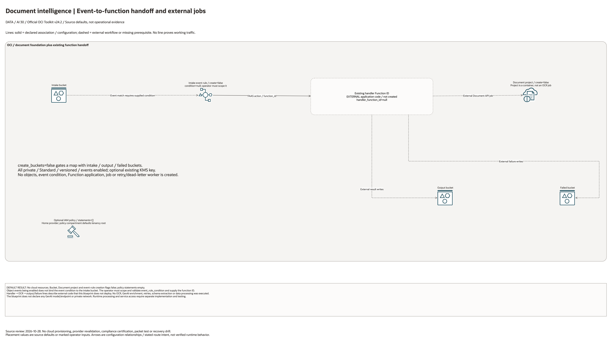

# Document Intelligence Pipeline Architecture

## Deployment Purpose

Provide optional intake/output/failure buckets, a Document project and an
Events action pointing to an existing Function. Extraction, GenAI enrichment,
result writing and failure handling belong to the externally supplied handler.

## Architecture At A Glance

| Layer | Responsibility |
| --- | --- |
| Intake bucket | Drop zone for PDFs, images, contracts, claims, and reports. |
| Events rule | Optional FAAS action; event condition and handler ID must be supplied. |
| Handler Function | Existing ID only; processing code is not deployed. |
| Document project | Groups Document Understanding processors and jobs. |
| Output bucket | Stores structured JSON, extracted text, and summaries. |
| Failed bucket | Keeps rejected or failed documents for retry and evidence. |

## Architecture



[Editable draw.io diagram](architecture.drawio)

## Diagram Sources And Scope

Generated with the installed `oci-architecture-diagrams` skill and Oracle Toolkit
v24.2. Azure resources use embedded native provider artwork where mapped;
unmapped resource types remain named boxes. Source review: October 28, 2026.
No cloud provisioning, provider revalidation, inference, model training or
application traffic test was performed. Historical validation dates are unchanged.

```bash
python3 scripts/diagrams/ai-batch-02.py --render
python3 scripts/diagrams/multicloud-resource-coverage.py --blueprint ai/document-intelligence --render
python3 scripts/diagrams/multicloud-resource-coverage.py --blueprint ai/document-intelligence --check
python3 scripts/diagrams/check-connections.py --write-report
```

## Connection Lines

Events-to-Function is a declared FAAS action referencing an existing handler ID. Intake event matching requires an operator-supplied condition. Dashed handler/OCR/output/failure paths belong to external application code; neither that code nor any OCR/GenAI job is created.

Lines represent source-defined configuration or explicitly labelled external
workflows. They do not establish successful runtime traffic. Independent buckets,
policies and log containers are not automatically wired together.

## Resource Detail And Coverage

The main native draw.io document includes the overview, all resource-detail
pages and identifier references. Counts are declarations, not expanded instances
or deployed assets. Disabled/conditional resources remain visible. Companion
Bicep deploys separately; local contracts do not create cloud services.

| Scope | Declarations / references | Preview | Editable source |
| --- | --- | --- | --- |
| OCI resources | 4 | [PNG](oci-resources.png) | [draw.io](oci-resources.drawio) |
| Existing identifier inputs | 4 references | [PNG](existing-resources.png) | [draw.io](existing-resources.drawio) |

[Resource inventory](resource-inventory.json) records source hashes, creation
expressions, data lookups and resource-to-diagram node IDs. Supplied identifiers
and overrides remain references, not resources purportedly created or adopted.

## Terraform Components

| File | Purpose |
| --- | --- |
| `main.tf` | Buckets, Document Understanding project, Events rule, and IAM policy. |
| `variables.tf` | Bucket, function, event, project, and policy inputs. |
| `outputs.tf` | Buckets, project, event rule, and policy hand-offs. |
| `terraform.tfvars.example` | Disabled-by-default example values. |
| `ansible/*.yml` | Standard local runners. |

Declared resource addresses:

| Kind | Name | Source Or Role |
| --- | --- | --- |
| Resource | `oci_objectstorage_bucket.this` | Declared in this blueprint; creation depends on its count or for_each inputs. |
| Resource | `oci_ai_document_project.this` | Declared in this blueprint; creation depends on its count or for_each inputs. |
| Resource | `oci_events_rule.intake` | Declared in this blueprint; creation depends on its count or for_each inputs. |
| Resource | `oci_identity_policy.access` | Declared in this blueprint; creation depends on its count or for_each inputs. |

## Request And Deployment Flow

1. Confirm document types and target output schema.
2. Confirm retention and encryption for intake, output, and failed buckets.
3. Deploy or reference the handler Function.
4. Create the Document Understanding project.
5. Enable Events rule after the handler is ready.
6. Hand output bucket and schema details to downstream consumers.

## Traffic And Trust Boundaries

- Intake documents may contain regulated or confidential data.
- Failed documents should be treated as sensitive evidence, not casual logs.
- Functions should use private subnets where customer policy requires it.
- GenAI calls should route through private endpoints or `genai-gateway` when
  the workload requires controlled egress and audit.
- Bucket writers, processors, and readers should be separate IAM subjects.

## Detailed Architecture Notes

This blueprint does not prescribe one processor type because invoices, receipts,
contracts, claims, and general PDFs have different extraction needs. It creates
the common landing-zone wiring and leaves processor/job specifics to the
handler delivery.

The failed bucket is part of the architecture on purpose. Production document
pipelines need retry evidence, malformed-file review, and a place to preserve
inputs that could not be processed.

The handler Function is supplied as an OCID so teams can pair this blueprint
with the existing Oracle Functions extension or with an externally managed
function app.

The Document Understanding project is optional because project quotas vary by
tenancy and region. A smoke test can create only the intake, output, and failed
buckets; a full deployment should enable the project once quota is confirmed.

## Operational Boundaries

- Do not commit sample customer documents or extracted text.
- Keep event conditions, function IDs, bucket names, and schema notes in local
  tfvars or controlled pipeline variables.
- Use `genai-guardrails` when prompts or extracted text are archived.
- Use `ai-services` when the customer needs broader Vision or Language projects.

## Review Checklist

- [ ] Document classes and output schema are approved.
- [ ] Intake, output, and failed bucket retention is approved.
- [ ] Handler Function exists before enabling the Events rule.
- [ ] IAM allows only required bucket, Document, Function, and GenAI actions.
- [ ] Failed-document operations and retry runbook are clear.
- [ ] Downstream consumers understand output location and format.

## October 2026 Configuration Review

Provisions optional buckets, an AI Document project, and an event rule referencing an existing Function. It does not deploy that Function, invoke OCR, redact PII, or implement review/exception routing. Validate the supplied function and event condition separately.

Validation in this round is isolated Terraform schema/lint validation and applicable mocked regressions, not a live AI deployment. All cost-bearing services, inference, ingestion, dedicated clusters, and external-cloud resources remained disabled. Providers ignore only the two OCI-managed provenance tags; customer-defined tags remain managed.
