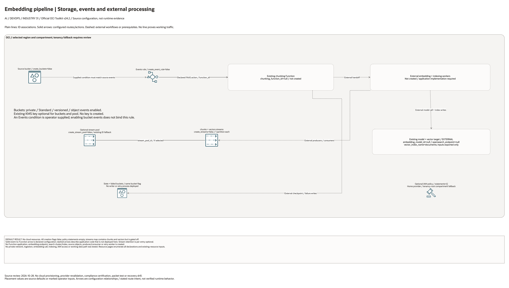

# Embedding And Vector Ingestion Pipeline Architecture

## Deployment Purpose

Create a reusable ingestion foundation for semantic search and RAG workloads.
The blueprint declares optional source/state storage, Streaming, an Events action
and IAM statements around separately deployed chunking and embedding functions.

## Architecture At A Glance

| Layer | Responsibility |
| --- | --- |
| Source bucket | Holds documents or records to embed. |
| Events rule | Optional action to an existing Function; event matching requires a supplied condition. |
| Chunking Function | Splits source files into model-sized chunks. |
| Embedding Function | Calls OCI GenAI embedding model. |
| Streams | Decouple chunk and vector stages when needed. |
| Vector target | OpenSearch or another vector database/index. |
| State bucket | Tracks processed versions and checkpoints. |

## Architecture

[Edit the multi-page draw.io diagram](architecture.drawio). Resource-detail pages
enumerate all source declarations, including disabled conditions and transitive
pinned modules. The existing-resource page lists identifier inputs; it does not
create their dependencies. See [source coverage](resource-inventory.json).

Plain connectors show declared ID associations. Solid arrows show configured
routes or action targets. Dashed lines explicitly mark external application
steps or prerequisites. No connector proves working service traffic.

## Terraform Components

| File | Purpose |
| --- | --- |
| `main.tf` | Buckets, stream pool, streams, Events rule, and IAM policy. |
| `variables.tf` | Function, embedding model, vector target, bucket, stream, and policy inputs. |
| `outputs.tf` | Buckets, streams, event rule, model, index, and policy outputs. |
| `terraform.tfvars.example` | Disabled-by-default sample values. |
| `ansible/*.yml` | Standard local runners. |

Declared resource addresses:

| Kind | Name | Source Or Role |
| --- | --- | --- |
| Resource | `oci_objectstorage_bucket.this` | Declared in this blueprint; creation depends on its count or for_each inputs. |
| Resource | `oci_streaming_stream_pool.this` | Declared in this blueprint; creation depends on its count or for_each inputs. |
| Resource | `oci_streaming_stream.this` | Declared in this blueprint; creation depends on its count or for_each inputs. |
| Resource | `oci_events_rule.source` | Declared in this blueprint; creation depends on its count or for_each inputs. |
| Resource | `oci_identity_policy.access` | Declared in this blueprint; creation depends on its count or for_each inputs. |

## Request And Deployment Flow

1. Confirm source content types and chunking strategy.
2. Deploy or identify the vector index target.
3. Deploy chunking and embedding Functions.
4. Enable buckets and streams.
5. Enable the Events rule only after handlers are ready.
6. Hand vector index and stream outputs to RAG applications.

## Traffic And Trust Boundaries

- Source documents may contain sensitive data.
- Embedding vectors may still reveal information and should be protected.
- Functions need least-privilege access to buckets, streams, GenAI, and target index.
- Private endpoints are preferred for regulated workloads.
- Failed bucket access should be limited to operators and data owners.

## Detailed Architecture Notes

The blueprint deliberately keeps business logic out of Terraform. Chunking,
embedding, filtering, and schema mapping belong in Functions or application
code. Terraform owns the durable platform pieces and output contracts.

Streaming is optional. Small customers can run object event to function directly.
Larger pipelines can use streams to decouple chunking, embedding, and indexing
so retries and back-pressure are easier to operate.

External processing code can write object versions, checksums or checkpoints
to the state bucket; the blueprint does not deploy that writer.

## Operational Boundaries

- Do not commit source documents, generated vectors, or customer index schemas.
- Keep model IDs, endpoint URLs, and function IDs in local tfvars.
- Pair with `opensearch` for the managed search/vector target.
- Pair with `genai-guardrails` when prompt or embedding calls require audit.

## Review Checklist

- [ ] Chunk size and overlap strategy are documented.
- [ ] Embedding model ID is approved and region-supported.
- [ ] Vector index endpoint and index name are correct.
- [ ] Events rule is disabled until handlers are available.
- [ ] IAM covers only required bucket, stream, GenAI, and index access.
- [ ] Retry and failed-object handling are owned.

## October 2026 Configuration Review

Provisions optional buckets, Streaming resources, and an event rule targeting a supplied Function. Chunking, embedding generation, vector-index creation, OpenSearch capacity, and query quality remain external application responsibilities.

Validation in this round is isolated Terraform schema/lint validation and applicable mocked regressions, not a live AI deployment. All cost-bearing services, inference, ingestion, dedicated clusters, and external-cloud resources remained disabled. Providers ignore only the two OCI-managed provenance tags; customer-defined tags remain managed.

## October 28, 2026 Diagram Source Review

All cloud creation flags default false. The rule has an operator-supplied event
condition and a FAAS action referencing an existing Function ID. Source object
events do not automatically bind that condition. Chunking, embedding, stream
producers/consumers, checkpoint writes and vector indexing are external code.
The embedding-model ID and search endpoint are outputs/inputs only; no model,
Function or search cluster is created.

This change reviews documentation and rendered diagrams only. Historical
Terraform/provider validation metadata is unchanged. No cloud provisioning,
application execution or runtime connectivity test was performed.
