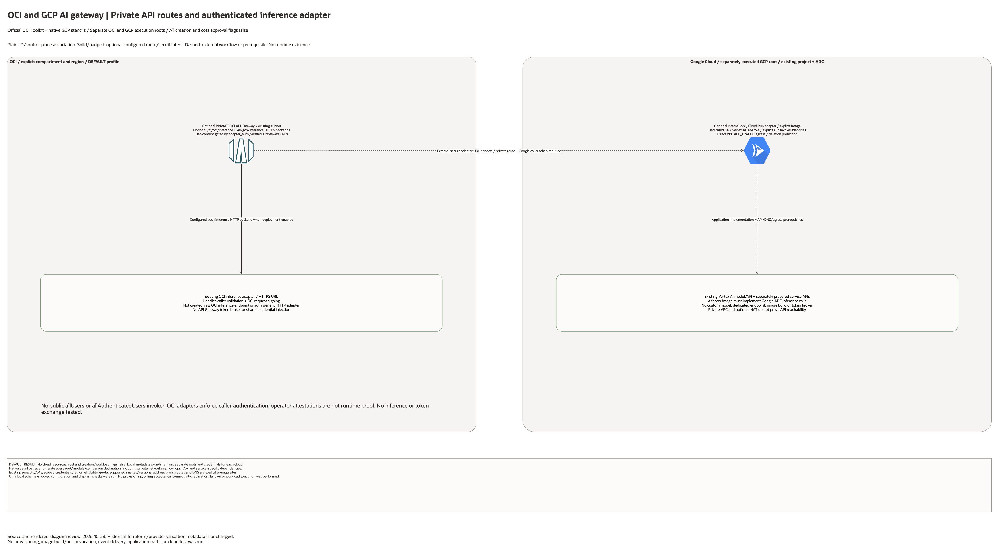

# GCP and OCI AI Gateway

| Item | Details |
| --- | --- |
| Best fit | Private OCI API gateway routes and a separately authenticated GCP inference adapter. |
| OCI root | Explicit compartment, region and DEFAULT profile; independently reviewed plan. |
| GCP root | Separate `gcp/` execution, ADC identity, project, region and deployment state. |
| Safe defaults | All creation, workload and cost approval flags false. |
| Evidence | Local schema/mocked checks only; no live cloud acceptance. |

## Deployment Purpose

Private OCI API gateway routes and a separately authenticated GCP inference adapter.

OCI composes the generic API Gateway component on an existing private subnet, with optional HTTPS routes to two reviewed adapter URLs. GCP creates private networking, a dedicated adapter service account with Vertex AI role, optional internal-only Cloud Run service, direct VPC egress and explicit caller invoker IAM grants.

## Architecture



[Editable overview and native resource pages](architecture/architecture.drawio) · [Architecture notes](architecture/README.md)

## Prerequisites

- Explicit approved OCI compartment/region and separately approved Google project/billing.
- OCI profile DEFAULT unless the operator explicitly changes it; Google ADC is independent.
- Required Google Compute and service-specific APIs pre-enabled by the project owner.
- Non-overlapping routed cloud, workload, pod, service, control-plane and service-peering ranges.
- Appropriate regional service quota, supported versions, IAM permissions and approved cost scope.
- Existing circuits/VPN, private DNS, routing and transport where the workload pattern references them.
- Protected secret inputs and separately owned backend/deployment records for each cloud root.

## Configuration

Copy both disabled `terraform.tfvars.example` files into ignored local inputs.
Review the OCI and GCP plans independently. No directory reads the other's outputs automatically.
Exchange only the required non-secret identifiers through approved handoff records.
Never commit tokens, passwords, private keys, pairing keys, PSKs or saved plans.

## Deployment Workflow

1. Review ownership, billing, required APIs, versions, quota and address plan.
2. Keep creation disabled and run local validation and mocked tests first.
3. Enable one approved foundation at a time and inspect its saved plan.
4. Configure any conditional service-specific features only after prerequisites are complete.
5. Supply explicit cross-cloud endpoint/identity/route handoffs; no automatic trust is installed.
6. Run positive and negative network, identity and workload acceptance separately.
7. Rehearse data recovery, cutover and rollback before declaring production readiness.
8. Teardown dependency resources first, then foundations; verify both providers' inventories.

## Scope And Limitations

A compatible immutable adapter image must implement request validation, Google ADC/Vertex calls and the chosen OCI adapter authentication. No anonymous invoker is granted, and API Gateway does not mint Google ID tokens or sign OCI inference requests. OCI route deployment requires adapter_auth_verified plus HTTPS URLs; these attestations do not prove runtime authentication. No model, custom Vertex endpoint, container build, token broker or private DNS is created. Internal Cloud Run access over cross-cloud connectivity requires separately verified ingress/PGA/DNS/routing and identity. ALL_TRAFFIC egress is blocked without suitable explicit routes/NAT/API access.

Paid creation is disabled by default. Local schema validation and mocked plans are not
proof of cloud availability, live permissions, connectivity, HA, RPO/RTO or runtime safety.
No environment was deployed or exercised during this implementation.

## Local Checks

```bash
terraform init -backend=false
terraform validate
terraform test
terraform -chdir=gcp init -backend=false
terraform -chdir=gcp validate
terraform -chdir=gcp test
```

Use the shared `terraform_runner` through `ansible/plan.yml`, `apply.yml`, `destroy.yml`
and the corresponding `gcp-*.yml` runners. Apply/destroy confirmations remain enforced.
The GCP source entry is `gcp/infrastructure.tf`; Terraform loads all `.tf` files there.

## Cleanup And Ownership

Use dedicated deployment backends and protected local inputs for each cloud.
Deletion-protected resources need an explicit reviewed protection change before teardown.
Versioned backup buckets retain data and use force_destroy=false; archive or remove data explicitly.
Do not delete existing OCI networks, project APIs, shared identities or operator-managed circuits.
No cloud deployment occurred here, so no live cleanup or API inventory was claimed.

## References

[Provider/service design reference](https://docs.cloud.google.com/run/docs/configuring/vpc-direct-vpc).
[Validation and handoff record](../../../docs/multicloud/GCP-COUNTERPARTS-20261028.md).
