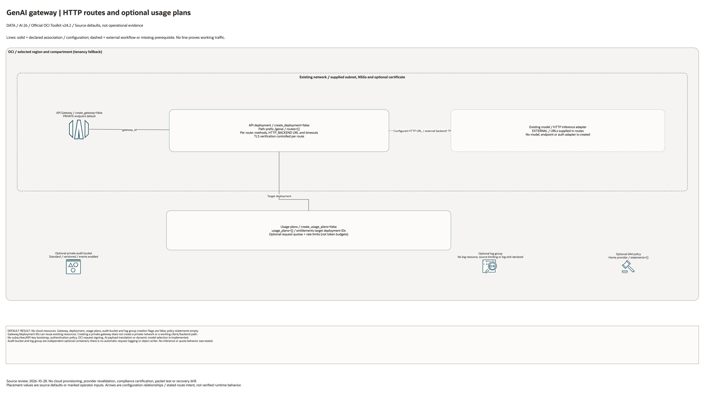

# GenAI Multi-Model Gateway Architecture

## Deployment Purpose

Provide a governed API front door for one or more OCI GenAI models, private
endpoints, or routing functions. The blueprint separates app-team consumption
from platform-team model operations by putting optional routes, request quotas, storage/log containers, and IAM
in one reviewed deployment folder.

## Architecture At A Glance

| Layer | Responsibility |
| --- | --- |
| API Gateway | Stable HTTPS endpoint, path routing, and private/public exposure decision. |
| Usage plans | Per-team rate limits and quota controls. |
| GenAI backends | Existing GenAI endpoints, model APIs, or routing functions. |
| Audit storage | Optional bucket; prompt/response writing is external. |
| Logging | Optional log group; collection/binding is external. |
| IAM | Caller, operator, and audit-reader policy hand-offs. |

## Architecture



[Editable draw.io diagram](architecture.drawio)

## Diagram Sources And Scope

Generated with the installed `oci-architecture-diagrams` skill and Oracle Toolkit
v24.2. Azure resources use embedded native provider artwork where mapped;
unmapped resource types remain named boxes. Source review: October 28, 2026.
No cloud provisioning, provider revalidation, inference, model training or
application traffic test was performed. Historical validation dates are unchanged.

```bash
python3 scripts/diagrams/ai-batch-02.py --render
python3 scripts/diagrams/multicloud-resource-coverage.py --blueprint ai/genai-gateway --render
python3 scripts/diagrams/multicloud-resource-coverage.py --blueprint ai/genai-gateway --check
python3 scripts/diagrams/check-connections.py --write-report
```

## Connection Lines

Solid lines show gateway/deployment and usage-plan target associations. Dashed backend lines identify supplied HTTP inference adapters. No authentication adapter, subscriber bootstrap, automatic log source or audit writer is declared.

Lines represent source-defined configuration or explicitly labelled external
workflows. They do not establish successful runtime traffic. Independent buckets,
policies and log containers are not automatically wired together.

## Resource Detail And Coverage

The main native draw.io document includes the overview, all resource-detail
pages and identifier references. Counts are declarations, not expanded instances
or deployed assets. Disabled/conditional resources remain visible. Companion
Bicep deploys separately; local contracts do not create cloud services.

| Scope | Declarations / references | Preview | Editable source |
| --- | --- | --- | --- |
| OCI resources | 6 | [PNG](oci-resources.png) | [draw.io](oci-resources.drawio) |
| Existing identifier inputs | 8 references | [PNG](existing-resources.png) | [draw.io](existing-resources.drawio) |

[Resource inventory](resource-inventory.json) records source hashes, creation
expressions, data lookups and resource-to-diagram node IDs. Supplied identifiers
and overrides remain references, not resources purportedly created or adopted.

## Terraform Components

| File | Purpose |
| --- | --- |
| `main.tf` | API Gateway, deployment routes, usage plans, audit bucket, log group, and IAM policy. |
| `variables.tf` | Operator-facing input contract for routes, quotas, gateway placement, and audit storage. |
| `outputs.tf` | Gateway, deployment, usage plan, audit bucket, and policy hand-off values. |
| `terraform.tfvars.example` | Safe example with all expensive and exposed resources disabled. |
| `ansible/*.yml` | Repo-standard local plan, apply, and destroy wrappers. |

Declared resource addresses:

| Kind | Name | Source Or Role |
| --- | --- | --- |
| Resource | `oci_objectstorage_bucket.audit` | Declared in this blueprint; creation depends on its count or for_each inputs. |
| Resource | `oci_logging_log_group.gateway` | Declared in this blueprint; creation depends on its count or for_each inputs. |
| Resource | `oci_apigateway_gateway.this` | Declared in this blueprint; creation depends on its count or for_each inputs. |
| Resource | `oci_apigateway_deployment.this` | Declared in this blueprint; creation depends on its count or for_each inputs. |
| Resource | `oci_apigateway_usage_plan.this` | Declared in this blueprint; creation depends on its count or for_each inputs. |
| Resource | `oci_identity_policy.access` | Declared in this blueprint; creation depends on its count or for_each inputs. |

## Request And Deployment Flow

1. Customer chooses whether the gateway is private or public.
2. Platform team maps model tasks to route paths.
3. App/team quotas are written as `usage_plans`.
4. Audit and log destinations are confirmed.
5. Terraform creates or references the gateway and deployment.
6. Downstream app teams receive the gateway endpoint and usage contract.

## Traffic And Trust Boundaries

- Public endpoint use must be intentional and reviewed.
- Private endpoint mode expects private DNS and network reachability from apps.
- API Gateway does not replace model-level authorization; IAM and service
  policies still control who can call GenAI.
- Prompt and response archives may contain sensitive data and should use private
  buckets, retention rules, and least-privilege audit-reader groups.
- Route backends should point to reviewed GenAI endpoints or routing functions.

## Detailed Architecture Notes

The gateway can run in front of a single model endpoint or a broader model
portfolio. Simple deployments map one route to one backend URL. Mature
deployments can point routes at an Oracle Functions router that chooses a model
based on headers, task type, latency, or cost.

Usage plans are designed for chargeback and fairness. They are not a substitute
for budget alarms, but they help prevent one application from consuming shared
capacity unexpectedly.

The audit bucket is optional because some customers centralize prompt logging in
Logging Analytics or a SIEM. When enabled here, it provides a clear hand-off for
retention, redaction, and incident-review processes.

## Operational Boundaries

- This blueprint can run extension-only with existing subnet, gateway, route,
  model, and IAM values.
- In a full landing zone, deploy Core, Networking, Operations, and
  `genai-private` before this gateway.
- Keep backend URLs, customer paths, quota values, and IAM group names in local
  ignored tfvars or approved pipeline variables.
- Do not commit prompt examples, real model payloads, customer hostnames, or
  private API keys.

## Review Checklist

- [ ] Gateway endpoint type is correct for the customer exposure model.
- [ ] Every route has a reviewed backend and timeout.
- [ ] Usage plans are aligned to team quotas and budget expectations.
- [ ] Audit storage and log retention are approved.
- [ ] IAM policy statements are scoped to callers, operators, and auditors.
- [ ] Outputs are passed only to approved downstream application owners.

## October 2026 Configuration Review

Provisions optional HTTP routes, quotas, logs, storage, and IAM. It does not sign OCI inference requests, translate model payloads, implement a provider adapter, or create model hosting. HTTP backends and client authentication require separate implementation and end-to-end validation.

Validation in this round is isolated Terraform schema/lint validation and applicable mocked regressions, not a live AI deployment. All cost-bearing services, inference, ingestion, dedicated clusters, and external-cloud resources remained disabled. Providers ignore only the two OCI-managed provenance tags; customer-defined tags remain managed.
