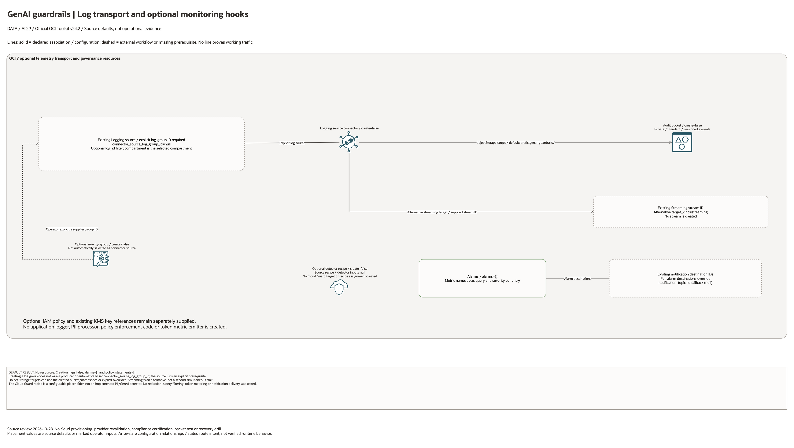

# GenAI Guardrails And Observability Architecture

## Deployment Purpose

Add auditability and security review controls around GenAI workloads without
forcing every model-serving blueprint to reimplement the same observability
shape. The blueprint optionally routes an explicitly supplied log source to storage
or an existing stream, creates configured alarm hooks, and exposes a detector
recipe placeholder. It does not implement redaction, moderation or log producers.

## Architecture At A Glance

| Layer | Responsibility |
| --- | --- |
| Log source | Gateway, Functions router, application, or model endpoint telemetry. |
| Service Connector | Selects Object Storage or an existing Streaming target; this source does not expose Function/ONS targets. |
| Audit bucket | Optional storage; records are not redacted by this blueprint. |
| Monitoring alarms | Operator-supplied queries and existing destination IDs; no token metric emitter. |
| Cloud Guard | Detector recipe shell for GenAI-specific signals. |
| IAM | Security reviewer and service permissions. |

## Architecture



[Editable draw.io diagram](architecture.drawio)

## Diagram Sources And Scope

Generated with the installed `oci-architecture-diagrams` skill and Oracle Toolkit
v24.2. Azure resources use embedded native provider artwork where mapped;
unmapped resource types remain named boxes. Source review: October 28, 2026.
No cloud provisioning, provider revalidation, inference, model training or
application traffic test was performed. Historical validation dates are unchanged.

```bash
python3 scripts/diagrams/ai-batch-02.py --render
python3 scripts/diagrams/multicloud-resource-coverage.py --blueprint ai/genai-guardrails --render
python3 scripts/diagrams/multicloud-resource-coverage.py --blueprint ai/genai-guardrails --check
python3 scripts/diagrams/check-connections.py --write-report
```

## Connection Lines

Lines show the explicitly selected Logging source and the connector's alternative Object Storage or existing Streaming target. A new log group is not automatically selected as that source. Alarm destinations are explicit IDs or the supplied topic fallback. No PII processor or active safety filter is deployed.

Lines represent source-defined configuration or explicitly labelled external
workflows. They do not establish successful runtime traffic. Independent buckets,
policies and log containers are not automatically wired together.

## Resource Detail And Coverage

The main native draw.io document includes the overview, all resource-detail
pages and identifier references. Counts are declarations, not expanded instances
or deployed assets. Disabled/conditional resources remain visible. Companion
Bicep deploys separately; local contracts do not create cloud services.

| Scope | Declarations / references | Preview | Editable source |
| --- | --- | --- | --- |
| OCI resources | 6 | [PNG](oci-resources.png) | [draw.io](oci-resources.drawio) |
| Existing identifier inputs | 8 references | [PNG](existing-resources.png) | [draw.io](existing-resources.drawio) |

[Resource inventory](resource-inventory.json) records source hashes, creation
expressions, data lookups and resource-to-diagram node IDs. Supplied identifiers
and overrides remain references, not resources purportedly created or adopted.

## Terraform Components

| File | Purpose |
| --- | --- |
| `main.tf` | Bucket, log group, Service Connector, Cloud Guard recipe, alarms, IAM. |
| `variables.tf` | Connector, alarm, detector, and policy inputs. |
| `outputs.tf` | Guardrail resource IDs for runbooks and downstream wiring. |
| `terraform.tfvars.example` | Example alarm and disabled create flags. |
| `ansible/*.yml` | Local plan, apply, and destroy wrappers. |

Declared resource addresses:

| Kind | Name | Source Or Role |
| --- | --- | --- |
| Resource | `oci_objectstorage_bucket.audit` | Declared in this blueprint; creation depends on its count or for_each inputs. |
| Resource | `oci_logging_log_group.guardrails` | Declared in this blueprint; creation depends on its count or for_each inputs. |
| Resource | `oci_sch_service_connector.audit` | Declared in this blueprint; creation depends on its count or for_each inputs. |
| Resource | `oci_cloud_guard_detector_recipe.genai` | Declared in this blueprint; creation depends on its count or for_each inputs. |
| Resource | `oci_monitoring_alarm.this` | Declared in this blueprint; creation depends on its count or for_each inputs. |
| Resource | `oci_identity_policy.access` | Declared in this blueprint; creation depends on its count or for_each inputs. |

## Request And Deployment Flow

1. Identify the GenAI log source and metrics namespace.
2. Choose Object Storage or an existing stream. Any redaction processor is an external prerequisite.
3. Configure token, error, and unusual-volume alarms.
4. Add Cloud Guard detector recipe wiring where the customer uses Cloud Guard.
5. Publish audit bucket and alarm outputs to security runbooks.

## Traffic And Trust Boundaries

- Raw prompts and responses can contain sensitive data.
- Redaction should happen before long-term archive when required by policy.
- Audit bucket readers should be separate from GenAI app operators.
- Monitoring destinations should be approved incident channels.
- Detector recipes should be reviewed with the security team before enforcement.

## Detailed Architecture Notes

The blueprint is intentionally an overlay. It can attach to the GenAI gateway,
an application-owned Function router, or a workload that already logs GenAI
calls. This keeps the serving path independent from the audit path.

This blueprint restricts connector_target_kind to Object Storage or Streaming.
It does not declare Function or Notifications connector targets, log producers,
redaction code or automated Cloud Guard target attachment.

Cloud Guard behavior is customer-specific, so this blueprint creates the recipe
shell and leaves detector rule tuning to the security review.

## Operational Boundaries

- Do not commit real prompts, responses, detector rules with customer data, or
  SIEM endpoint details.
- Keep connector source IDs and alarm destinations in local tfvars.
- Pair this blueprint with `genai-gateway` for shared API platforms.
- Pair it with `embedding-pipeline` or `document-intelligence` for data-heavy AI
  workflows.

## Review Checklist

- [ ] Log source and destination are approved.
- [ ] Sensitive prompt/response handling is documented.
- [ ] Alarm queries match the available GenAI service namespace.
- [ ] Notification destinations are owned by the right operations team.
- [ ] Cloud Guard recipe scope is reviewed before enforcement.
- [ ] Audit-reader IAM is least privilege.

## October 2026 Configuration Review

This is an observability scaffold. Storage/logging/alarms and a detector-recipe shell do not implement prompt filtering, PII redaction, output moderation, or an active safety policy. Streaming connector targets do not require Object Storage namespaces; Object Storage targets must supply a namespace or create the audit bucket. The source log group and a target stream must be explicitly supplied where applicable.

Validation in this round is isolated Terraform schema/lint validation and applicable mocked regressions, not a live AI deployment. All cost-bearing services, inference, ingestion, dedicated clusters, and external-cloud resources remained disabled. Providers ignore only the two OCI-managed provenance tags; customer-defined tags remain managed.
