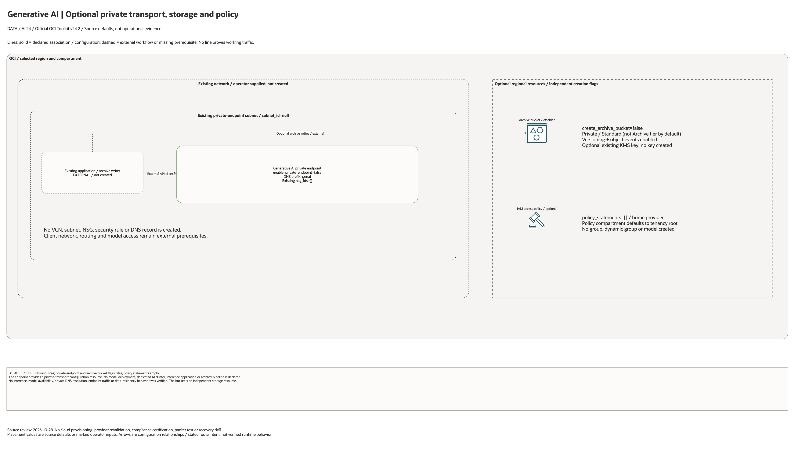

# OCI Generative AI Private Landing Zone Architecture

This is the deployment architecture for `blueprints/ai/genai-private`. The PNG provides a preview; draw.io retains the editable source and resource-detail pages.

## Deployment Purpose

Deploys a private OCI Generative AI endpoint pattern with optional archive bucket and scoped IAM policy.

## Architecture At A Glance

| Item | Details |
|---|---|
| Boundary | `blueprints/ai/genai-private` owns this deployment folder and its Terraform + Ansible runners. |
| Purpose | Deploys a private OCI Generative AI endpoint pattern with optional archive bucket and scoped IAM policy. |
| Terraform components | `oci_generative_ai_generative_ai_private_endpoint.this`, `oci_objectstorage_bucket.archive`, `oci_identity_policy.access` |
| Primary architecture view | The Architecture diagram below shows the optional OCI resources and supplied network prerequisites for this deployment. |

## Architecture



[Editable draw.io diagram](architecture.drawio)

## Diagram Sources And Scope

Generated with the installed `oci-architecture-diagrams` skill and Oracle Toolkit
v24.2. AWS resources use native AWS icons; types without an exact mapped glyph
remain named boxes. Source review: October 28, 2026. Configuration relationships
and source defaults do not establish working traffic, inference, backups or DR.
No cloud provisioning or provider revalidation was performed; historical
validation metadata remains unchanged.

Regenerate the overview before rebuilding the resource-detail pages:

```bash
python3 scripts/diagrams/data-ai-batch-01.py --render
python3 scripts/diagrams/multicloud-resource-coverage.py --blueprint ai/genai-private --render
python3 scripts/diagrams/multicloud-resource-coverage.py --blueprint ai/genai-private --check
```

## Resource Detail And Coverage

The main draw.io document contains the overview, every resource-detail page and
the existing-resource input references below. Conditional and collection
resources remain visible. Counts are source declarations, not resolved instance
counts or deployed resources. `terraform_data` contracts are local metadata;
companion CloudFormation templates deploy separately.

| Scope | Declarations or references | Preview | Editable source |
| --- | --- | --- | --- |
| OCI resources | 3 | [PNG](oci-resources.png) | [draw.io](oci-resources.drawio) |
| Existing resources / inputs | 5 references | [PNG](existing-resources.png) | [draw.io](existing-resources.drawio) |

[Resource inventory](resource-inventory.json) records source hashes, revisions,
creation expressions, data lookups and resource-to-diagram node mappings.
Supplied subnet, key, compartment and service IDs are references or overrides,
not evidence that this blueprint creates or adopts those external resources.

## Connection Lines

The dashed lines identify an existing application and optional archive writer as external prerequisites. Neither caller nor archive workflow is created. The private endpoint is not wired directly to the archive bucket; the application would perform the separate API/storage operations.

Lines show configuration or intended relationships, never verified runtime
traffic. Detail/reference maps enumerate resources and deliberately do not
invent connections between independent declarations.

## Terraform Components

| Kind | Name | Source Or Role |
|---|---|---|
| Resource | `oci_generative_ai_generative_ai_private_endpoint.this` | Declared directly in `main.tf` |
| Resource | `oci_objectstorage_bucket.archive` | Declared directly in `main.tf` |
| Resource | `oci_identity_policy.access` | Declared directly in `main.tf` |

## Request And Deployment Flow

- Operator supplies the existing network, compartment, service, or backend IDs required by the deployment.
- Terraform creates the optional service resource graph declared in `main.tf`.
- Outputs expose service IDs, endpoint names, or attachment IDs for applications and runbooks.

## Traffic And Trust Boundaries

- Control plane traffic is local operator or CI authentication into the OCI provider and the Ansible Terraform runner.
- The private endpoint requires a supplied compatible subnet and approved network access. No client, model deployment, inference call or archive writer is created.
- Trust boundaries are the tenancy, compartment, VCN, subnet, private endpoint, identity domain, or managed service edges shown in the diagram.
- Secrets, OCIDs, customer CIDRs, endpoint URLs, and contact data belong in ignored local tfvars or a secure pipeline variable store, not in committed files.

## Detailed Architecture Notes

- Confirm private endpoint subnet and DNS prefix.
- Confirm model access statements match approved groups.
- Confirm archive bucket lifecycle and KMS settings before enabling storage.

## Operational Boundaries

Use OCI provider 9.9.x, the validated baseline for this blueprint. Provider
8.21.0 does not register the Generative AI private endpoint resource, even though
older generated documentation lists it. Validate provider support before planning.

- Keep customer-specific OCIDs, CIDRs, DNS names, endpoints, contacts, and secrets in ignored local tfvars or approved pipeline variables.
- Run plan from this blueprint folder so relative module paths, provider files, and local Ansible runners resolve predictably.
- Treat apply and destroy as approval-gated operations; use the guarded Ansible playbooks or a reviewed Terraform workflow.
- Re-check route exposure, IAM scope, compartment boundaries, tags, and output hand-offs whenever inputs change.

## Review Checklist

- Confirm the diagram matches `main.tf`: `oci_generative_ai_generative_ai_private_endpoint.this`, `oci_objectstorage_bucket.archive`, `oci_identity_policy.access`.
- Confirm the described traffic or control path is the path you want in OCI before apply.
- Confirm public exposure, private endpoint access, DNS behavior, DRG routing, and inspection points are intentional where present.
- Confirm IAM scopes, compartment boundaries, tags, and operational outputs match the deployment README.
- Confirm `ansible/plan.yml`, `ansible/apply.yml`, and `ansible/destroy.yml` still point at the shared Terraform runner.

## October 2026 Configuration Review

Creates optional private transport, an archive bucket, and IAM policy. IAM policy creation uses the tenancy-home provider. A private endpoint does not prove model availability, inference, data residency, or absence of stored data; the optional bucket deliberately stores data. No endpoint or inference call was created in this review.

Validation in this round is isolated Terraform schema/lint validation and applicable mocked regressions, not a live AI deployment. All cost-bearing services, inference, ingestion, dedicated clusters, and external-cloud resources remained disabled. Providers ignore only the two OCI-managed provenance tags; customer-defined tags remain managed.
