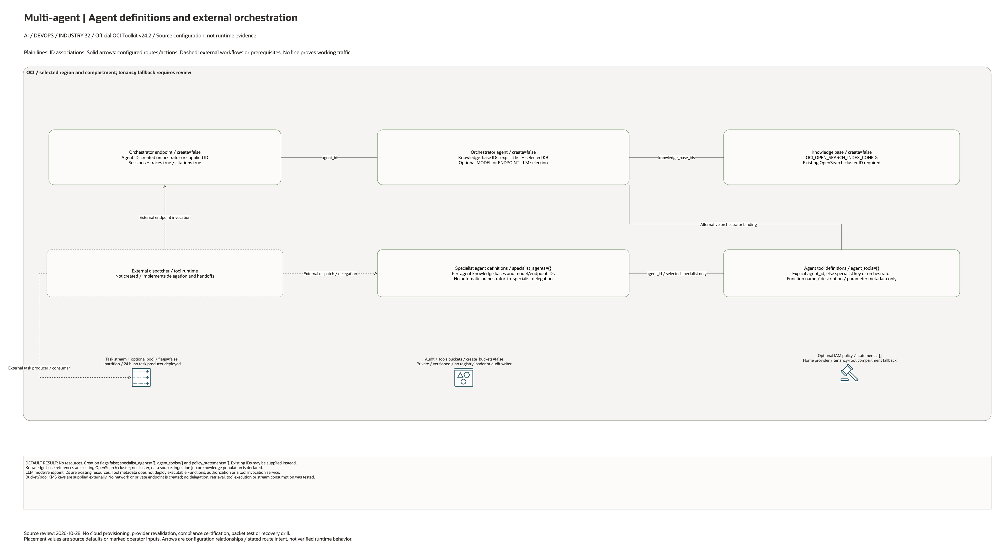

# Multi-Agent Orchestration Architecture

## Deployment Purpose

Provide a controlled platform shape for agentic systems. The blueprint defines optional
orchestrator/specialist agents, a knowledge base, task stream, tool/audit buckets
and supplied IAM statements. External application code must implement the
multi-agent workflow and its storage/stream integrations.

## Architecture At A Glance

| Layer | Responsibility |
| --- | --- |
| Orchestrator agent | Agent/model definition; specialist dispatch requires external runtime code. |
| Specialist agents | Handle focused tasks such as search, data, workflow, or code. |
| Knowledge base | Optional reference to an existing OpenSearch cluster. |
| Task stream | Optional durable stream; producers/consumers are external. |
| Tool registry | Optional bucket; no definition loader is configured. |
| Audit bucket | Optional storage; no trace exporter is configured. |
| IAM | Optional operator-supplied policy statements; tool authorization remains external. |

## Architecture

[Edit the multi-page draw.io diagram](architecture.drawio). Resource-detail pages
enumerate all source declarations, including disabled conditions and transitive
pinned modules. The existing-resource page lists identifier inputs; it does not
create their dependencies. See [source coverage](resource-inventory.json).

Plain connectors show declared ID associations. Solid arrows show configured
routes or action targets. Dashed lines explicitly mark external application
steps or prerequisites. No connector proves working service traffic.

## Terraform Components

| File | Purpose |
| --- | --- |
| `main.tf` | Buckets, stream, GenAI Agent resources, endpoint, tools, and IAM policy. |
| `variables.tf` | Agent, model, knowledge base, stream, tool, and policy inputs. |
| `outputs.tf` | Agent, endpoint, stream, tool, bucket, and policy hand-offs. |
| `terraform.tfvars.example` | Disabled-by-default sample agent configuration. |
| `ansible/*.yml` | Standard local runners. |

Declared resource addresses:

| Kind | Name | Source Or Role |
| --- | --- | --- |
| Resource | `oci_objectstorage_bucket.this` | Declared in this blueprint; creation depends on its count or for_each inputs. |
| Resource | `oci_streaming_stream_pool.this` | Declared in this blueprint; creation depends on its count or for_each inputs. |
| Resource | `oci_streaming_stream.tasks` | Declared in this blueprint; creation depends on its count or for_each inputs. |
| Resource | `oci_generative_ai_agent_knowledge_base.this` | Declared in this blueprint; creation depends on its count or for_each inputs. |
| Resource | `oci_generative_ai_agent_agent.orchestrator` | Declared in this blueprint; creation depends on its count or for_each inputs. |
| Resource | `oci_generative_ai_agent_agent.specialist` | Declared in this blueprint; creation depends on its count or for_each inputs. |
| Resource | `oci_generative_ai_agent_agent_endpoint.orchestrator` | Declared in this blueprint; creation depends on its count or for_each inputs. |
| Resource | `oci_generative_ai_agent_tool.this` | Declared in this blueprint; creation depends on its count or for_each inputs. |
| Resource | `oci_identity_policy.access` | Declared in this blueprint; creation depends on its count or for_each inputs. |

## Request And Deployment Flow

1. Confirm the business tasks and specialist-agent boundaries.
2. Confirm which knowledge bases and tools each agent can access.
3. Deploy or reference OpenSearch and embedding pipelines if RAG is required.
4. Create the task stream and audit/tool buckets.
5. Create orchestrator and specialist agents.
6. Enable endpoint and tools only after policy review.

## Traffic And Trust Boundaries

- Each agent should have the smallest useful tool and data access.
- Tool calls should be auditable and tied to a session.
- Session traces may include sensitive user intent and retrieved data.
- Streaming topics should not be readable by unrelated workloads.
- Cross-agent trust must be explicit; do not grant broad compartment access.

## Detailed Architecture Notes

Multi-agent systems fail quietly when all tools share the same broad identity.
This blueprint keeps agent, tool, stream, and audit boundaries visible so the
security review can reason about which component can do what.

The orchestrator can attach to a created knowledge base or to existing knowledge
bases. Specialist agents are modeled as a map so a customer can start with one
specialist and add more without changing the folder shape.

Tools are optional because many early customers first validate agent routing and
RAG before allowing external actions.

## Operational Boundaries

- Do not commit prompts, session traces, tool credentials, or customer schemas.
- Keep model IDs, knowledge base IDs, and tool definitions in local tfvars or an
  approved pipeline variable store.
- Pair with `genai-guardrails` for prompt/session audit.
- Pair with `embedding-pipeline` and `opensearch` for RAG-backed specialists.

## Review Checklist

- [ ] Orchestrator and specialist roles are documented.
- [ ] Model and endpoint IDs are approved.
- [ ] Tool definitions are reviewed before enabling.
- [ ] Agent IAM boundaries are least privilege.
- [ ] Session audit destination and retention are approved.
- [ ] Streaming task retention and reader permissions are clear.

## October 2026 Configuration Review

Creates optional agent/tool definitions, knowledge-base references, Streaming, and audit storage. Tool definitions do not deploy function implementations. Task routing, tool authorization, document handling, queue consumers, and multi-agent execution require supplied runtime code and separate testing.

Validation in this round is isolated Terraform schema/lint validation and applicable mocked regressions, not a live AI deployment. All cost-bearing services, inference, ingestion, dedicated clusters, and external-cloud resources remained disabled. Providers ignore only the two OCI-managed provenance tags; customer-defined tags remain managed.

## October 28, 2026 Diagram Source Review

All creation flags default false; specialist and tool maps default empty.
Agent endpoints and knowledge-base/tool IDs are explicit associations. The
knowledge base references an existing OpenSearch cluster. Tool function metadata
does not deploy executable Functions. Delegation, Streaming producers/consumers,
registry loading, audit writes and per-tool authorization require external code.
Neither a data source nor an ingestion job is declared in this entry point.

This change reviews documentation and rendered diagrams only. Historical
Terraform/provider validation metadata is unchanged. No cloud provisioning,
application execution or runtime connectivity test was performed.
