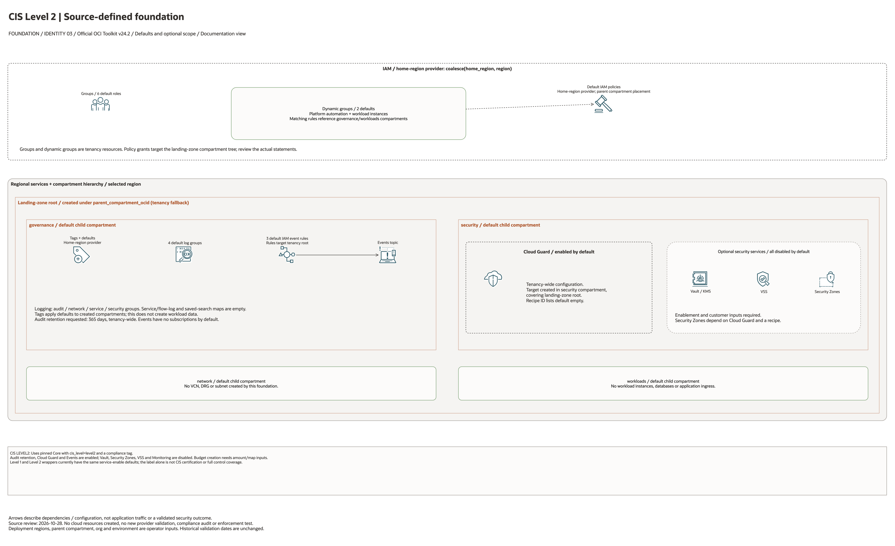

# CIS Level 2 Landing Zone Architecture

This is the deployment architecture for `blueprints/cis/level2`. The PNG provides a GitHub-readable preview; the draw.io source preserves editable shapes and official OCI icons.

## Deployment Purpose

Builds the core landing-zone foundation with stricter CIS Level 2-oriented guardrails, monitoring, scanning, and governance controls.

## Architecture At A Glance

| Item | Details |
| --- | --- |
| Boundary | `blueprints/cis/level2` owns this deployment folder and its Terraform + Ansible runners. |
| Purpose | Builds the core landing-zone foundation with stricter CIS Level 2-oriented guardrails, monitoring, scanning, and governance controls. |
| Terraform components | `core` |
| Primary architecture view | The diagram shows default enablement, tenancy/compartment scope and configuration dependencies; it is not runtime evidence. |

## Architecture

[Editable draw.io source](architecture.drawio). Keep this source aligned with the
PNG documentation preview after diagram changes.

Generated with the [oci-architecture-diagrams skill](https://github.com/leandro-michelino/oci-architecture-diagrams)
and Oracle OCI Architecture Diagram Toolkit v24.2. Regenerate from the repository
root with `python3 scripts/diagrams/foundation-batch-01.py --render`, after
installing the skill and official toolkit. The toolkit is not redistributed here.

The diagram identifies source-default enablement, conditional services,
compartment/tenancy scope and provider-region selection. Arrows describe
configuration dependencies or explicit notification actions, not workload traffic.

Diagram documentation reviewed on 2026-10-28 against root Terraform, variables,
locals, providers and the referenced module definitions. No cloud resources were
created and no Terraform/provider validation date was updated. The diagram does
not establish compliance certification, identity enforcement or runtime behavior.

## Terraform Components

| Kind | Name | Source Or Role |
| --- | --- | --- |
| Module | `core` | `blueprints/core @ fffa8dae83ef178236b3187dc4ba7b82ea2a5f84` |

## Request And Deployment Flow

- The wrapper passes cis_level = level2 into the core blueprint.
- Level 2 review focuses on stronger audit, scanning, security zone, Cloud Guard, and policy posture.
- Outputs are the same core hand-off contract so stricter foundations do not change downstream consumption.

## Traffic And Trust Boundaries

- Control plane traffic is local operator or CI authentication into the OCI provider and the Ansible Terraform runner.
- Data plane traffic is the packet or service path shown in the Architecture diagram; if this deployment only creates identity or governance resources, the data plane is intentionally permission and signal flow instead of network packets.
- Trust boundaries are the tenancy, compartment, VCN, subnet, DRG, private endpoint, identity domain, or managed service edges shown in the diagram.
- Secrets, OCIDs, customer CIDRs, endpoint URLs, and contact data belong in ignored local tfvars or a secure pipeline variable store, not in committed files.

## Detailed Architecture Notes

These notes expand the diagram with the design details that usually matter during review, plan, and hand-off.

- This deployment is a thin CIS Level 2 wrapper around the core foundation, so the operational graph is inherited from blueprints/core.
- The wrapper passes cis_level = level2 and is intended for stricter review of audit, monitoring, security zones, Cloud Guard, VSS, and IAM evidence.
- Level 2 hardening should be reviewed before apply because some settings affect tenancy-wide posture and compartment-level guardrails.
- Downstream network and workload blueprints consume the same core outputs while benefiting from the stricter baseline posture.

## Operational Boundaries

- Keep customer-specific OCIDs, CIDRs, DNS names, endpoints, contacts, and secrets in ignored local tfvars or approved pipeline variables.
- Run plan from this blueprint folder so relative module paths, provider files, and local Ansible runners resolve predictably.
- Treat apply and destroy as approval-gated operations; use the guarded Ansible playbooks or a reviewed Terraform workflow.
- Re-check route exposure, IAM scope, compartment boundaries, tags, and output hand-offs whenever inputs change.

## Review Checklist

- Confirm the diagram matches `main.tf`: `core`.
- Confirm the described traffic path is the path you want in OCI before apply.
- Confirm public exposure, private endpoint access, DNS behavior, DRG routing, and inspection points are intentional where present.
- Confirm IAM scopes, compartment boundaries, tags, and operational outputs match the deployment README.
- Confirm `ansible/plan.yml`, `ansible/apply.yml`, and `ansible/destroy.yml` still point at the shared Terraform runner.

## October 2026 Item Review

The Level 2 profile is an input/preset for optional Core controls, not proof that every Level 2 benchmark recommendation is enforced. Vault and scanning choices remain explicit inputs. Creating compartments, IAM, Audit settings, or Cloud Guard configuration requires separate administrative scope, even when the service itself is free.

The OCI provider ignores only Oracle-managed provenance tags. Validation comments remain in English and separate schema/mocked checks from live provisioning.
