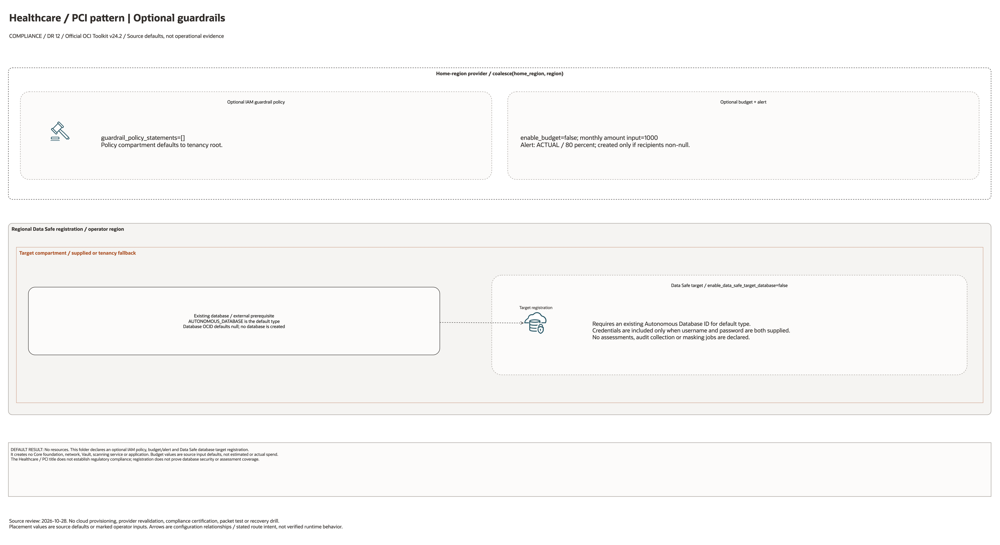

# Healthcare PCI Compliance Architecture

This is the deployment architecture for `blueprints/compliance/healthcare-pci`. The PNG provides a GitHub-readable preview; the draw.io source preserves editable shapes and official OCI icons.

## Deployment Purpose

Deploys a regulated landing-zone control pack with IAM guardrail policy, budget alerting, and optional Data Safe target registration.

## Architecture At A Glance

| Item | Details |
|---|---|
| Boundary | `blueprints/compliance/healthcare-pci` owns this deployment folder and its Terraform + Ansible runners. |
| Purpose | Deploys a regulated landing-zone control pack with IAM guardrail policy, budget alerting, and optional Data Safe target registration. |
| Terraform components | `oci_identity_policy.guardrails`, `oci_budget_budget.this`, `oci_budget_alert_rule.this`, `oci_data_safe_target_database.this` |
| Primary architecture view | The Architecture diagram below shows the OCI components, dependency order, and traffic or control flow for this exact deployment. |

## Architecture

[Editable draw.io source](architecture.drawio). Keep this source aligned with
the PNG documentation preview after diagram changes.

Generated with the [oci-architecture-diagrams skill](https://github.com/leandro-michelino/oci-architecture-diagrams)
and Oracle OCI Architecture Diagram Toolkit v24.2. From the repository root,
run `python3 scripts/diagrams/compliance-dr-batch-01.py --render` after installing
the skill and official toolkit. The toolkit is not redistributed here.

The view distinguishes default service enablement, conditional controls, external
prerequisites, provider/compartment scope and configuration contracts. Defaults
are source values, not evidence of a deployed or certified architecture.

Diagram documentation reviewed on 2026-10-28 against Terraform, variables, locals,
providers, referenced modules and any accompanying Bicep template. No cloud
resources were created and no Terraform/provider validation date was updated.
Arrows do not establish packet flow, assessment coverage, replication or a
successful recovery drill.

## Terraform Components

| Kind | Name | Source Or Role |
|---|---|---|
| Resource | `oci_identity_policy.guardrails` | Declared directly in `main.tf` |
| Resource | `oci_budget_budget.this` | Declared directly in `main.tf` |
| Resource | `oci_budget_alert_rule.this` | Declared directly in `main.tf` |
| Resource | `oci_data_safe_target_database.this` | Declared directly in `main.tf` |

## Request And Deployment Flow

- Operator supplies the existing network, compartment, service, or backend IDs required by the deployment.
- Terraform creates the optional service resource graph declared in `main.tf`.
- Outputs expose service IDs, endpoint names, or attachment IDs for applications and runbooks.

## Traffic And Trust Boundaries

- Control plane traffic is local operator or CI authentication into the OCI provider and the Ansible Terraform runner.
- Data plane traffic is the packet or service path shown in the Architecture diagram; if this deployment only creates identity or governance resources, the data plane is permission and signal flow.
- Trust boundaries are the tenancy, compartment, VCN, subnet, private endpoint, identity domain, or managed service edges shown in the diagram.
- Secrets, OCIDs, customer CIDRs, endpoint URLs, and contact data belong in ignored local tfvars or a secure pipeline variable store, not in committed files.

## Detailed Architecture Notes

- Confirm HIPAA and PCI scope before enabling policies.
- Confirm budget recipients and finance owner.
- Confirm Data Safe credentials are supplied securely.

## Operational Boundaries

- Keep customer-specific OCIDs, CIDRs, DNS names, endpoints, contacts, and secrets in ignored local tfvars or approved pipeline variables.
- Run plan from this blueprint folder so relative module paths, provider files, and local Ansible runners resolve predictably.
- Treat apply and destroy as approval-gated operations; use the guarded Ansible playbooks or a reviewed Terraform workflow.
- Re-check route exposure, IAM scope, compartment boundaries, tags, and output hand-offs whenever inputs change.

## Review Checklist

- Confirm the diagram matches `main.tf`: `oci_identity_policy.guardrails`, `oci_budget_budget.this`, `oci_budget_alert_rule.this`, `oci_data_safe_target_database.this`.
- Confirm the described traffic or control path is the path you want in OCI before apply.
- Confirm public exposure, private endpoint access, DNS behavior, DRG routing, and inspection points are intentional where present.
- Confirm IAM scopes, compartment boundaries, tags, and operational outputs match the deployment README.
- Confirm `ansible/plan.yml`, `ansible/apply.yml`, and `ansible/destroy.yml` still point at the shared Terraform runner.

## October 2026 Item Review

IAM policies and Budget resources use the home-region provider. Budget ownership is tenancy root; its targets track the selected workload compartment. Budgets are soft limits, not hard spending caps. Data Safe registration references an existing database and does not create one. These optional objects do not establish HIPAA or PCI DSS compliance or replace a control assessment. All administrative/Data Safe actions were mocked in this review.

The OCI provider ignores only Oracle-managed provenance tags. Validation comments remain in English and separate schema/mocked checks from live provisioning.
