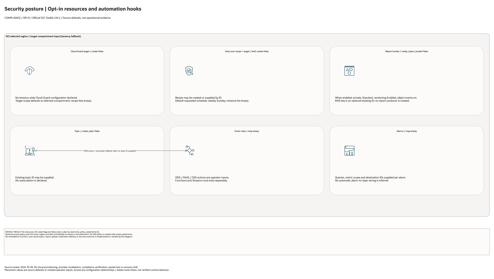

# Security Posture Automation Architecture

## Deployment Purpose

This blueprint extends the compliance baseline with automated security posture
coverage. It connects Cloud Guard target wiring, Vulnerability Scanning,
Events-based response paths, report archives, alarms, and IAM policy hand-offs.

## Architecture At A Glance

| Layer | Components |
| --- | --- |
| Detection | Cloud Guard target with detector and responder recipe attachments. |
| Scanning | Vulnerability Scanning host recipe and target. |
| Response | Events rules with ONS, Functions, or Streaming actions. |
| Evidence | Object Storage report bucket and Monitoring alarm outputs. |
| Governance | IAM statements for security admins, responders, scanners, and auditors. |

## Architecture



[Editable draw.io source](architecture.drawio). Keep this source aligned with
the PNG documentation preview after diagram changes.

Generated with the [oci-architecture-diagrams skill](https://github.com/leandro-michelino/oci-architecture-diagrams)
and Oracle OCI Architecture Diagram Toolkit v24.2. From the repository root,
run `python3 scripts/diagrams/compliance-dr-batch-01.py --render` after installing
the skill and official toolkit. The toolkit is not redistributed here.

The view distinguishes default service enablement, conditional controls, external
prerequisites, provider/compartment scope and configuration contracts. Defaults
are source values, not evidence of a deployed or certified architecture.

Diagram documentation reviewed on 2026-10-28 against Terraform, variables, locals,
providers, referenced modules and any accompanying Bicep template. No cloud
resources were created and no Terraform/provider validation date was updated.
Arrows do not establish packet flow, assessment coverage, replication or a
successful recovery drill.

## Resource Detail And Coverage

Reviewed against the updated diagram standard on October 28, 2026. The main
draw.io document contains the topology overview plus every resource-detail and
existing-resource-reference page below. Source declarations include disabled and
collection-based resources from root Terraform, recursively pinned modules and
companion cloud templates. Counts are declarations, not resolved instance counts.

OCI uses Oracle Toolkit icons; Azure and AWS use their respective draw.io icons.
Types without a specific mapped icon retain their exact name and type in a box.
No GCP declarations were found in this fixed 39-blueprint scope.

| Detail page | Declarations | PNG | Editable source |
| --- | --- | --- | --- |
| OCI resources | 8 | [PNG](oci-resources.png) | [draw.io](oci-resources.drawio) |

[Existing resources and override inputs](existing-resources.png) | [Editable reference page](existing-resources.drawio)

[Source inventory](resource-inventory.json) records exact declarations, full
creation expressions, module call-site gates/enablement inputs, pinned revisions,
source hashes and diagram node mappings. Identifier-input references are listed
separately from managed resources. Null/empty inputs do not prove an external
resource exists; collection schemas may contain additional resource identifiers.

The overview explains default enablement. Resource cards enumerate all declaration
branches and do not imply deployment, ownership adoption, packet flow, security
enforcement or recovery success. No historical Terraform validation date changed.

```bash
python3 scripts/diagrams/multicloud-resource-coverage.py --blueprint compliance/security-posture --render
python3 scripts/diagrams/multicloud-resource-coverage.py --blueprint compliance/security-posture --check
```

If regenerating the overview first, rebuild these detail pages afterward.
See [the fixed first-39 review](../../../../docs/diagrams/FIRST-39-REVIEW.md) and [provider icon sources](../../../../scripts/diagrams/assets/README.md).

## Terraform Components

| File | Purpose |
| --- | --- |
| `main.tf` | Creates report bucket, topic, Cloud Guard target, VSS host scan resources, event rules, alarms, and IAM policy. |
| `variables.tf` | Defines scope, recipes, scanner cadence, event action, alarm, and policy inputs. |
| `outputs.tf` | Exposes target, scanner, bucket, rule, alarm, and policy outputs. |
| `terraform.tfvars.example` | Provides safe disabled defaults and placeholder OCIDs. |

Declared resource addresses:

| Kind | Name | Source Or Role |
| --- | --- | --- |
| Resource | `oci_objectstorage_bucket.reports` | Declared in this blueprint; creation depends on its count or for_each inputs. |
| Resource | `oci_ons_notification_topic.this` | Declared in this blueprint; creation depends on its count or for_each inputs. |
| Resource | `oci_cloud_guard_target.this` | Declared in this blueprint; creation depends on its count or for_each inputs. |
| Resource | `oci_vulnerability_scanning_host_scan_recipe.this` | Declared in this blueprint; creation depends on its count or for_each inputs. |
| Resource | `oci_vulnerability_scanning_host_scan_target.this` | Declared in this blueprint; creation depends on its count or for_each inputs. |
| Resource | `oci_events_rule.this` | Declared in this blueprint; creation depends on its count or for_each inputs. |
| Resource | `oci_monitoring_alarm.this` | Declared in this blueprint; creation depends on its count or for_each inputs. |
| Resource | `oci_identity_policy.access` | Declared in this blueprint; creation depends on its count or for_each inputs. |

## Request And Deployment Flow

1. Security owner chooses protected scope and detector/responder recipes.
2. Platform owner confirms host scan cadence and target compartments.
3. Response owner decides notification, function, or stream actions.
4. Terraform creates report storage and security automation resources.
5. Findings flow from Cloud Guard or VSS into Events and alarm destinations.
6. Auditors use report bucket and outputs as evidence hand-offs.

## Traffic And Trust Boundaries

- Cloud Guard and VSS scopes should be compartment-bounded unless tenancy-wide
  coverage is explicitly approved.
- Auto-remediation Functions must have scoped IAM and should start in notify-only
  review mode for production environments.
- Report buckets can hold sensitive findings and should not be public.
- Event actions should route to owned topics, streams, or functions.
- IAM policies should avoid broad tenancy administrator grants.

## Detailed Architecture Notes

- Cloud Guard target creation is optional so customers can attach to an existing baseline.
- Detector and responder recipes are supplied as OCIDs because many customers
  use Oracle-managed or centrally managed recipes.
- Host scan recipe and target are split to support reused recipes across scopes.
- Event rules are generic enough to handle Cloud Guard, VSS, Audit, or resource events.
- Alarms use a map so each customer can wire the metrics available in their region.
- The report bucket is versioned by default for evidence preservation.

## Operational Boundaries

- Terraform does not author Cloud Guard detector rule logic.
- Terraform does not build remediation function code.
- Scan exceptions and false-positive tuning stay with security operations.
- Evidence retention policy must be aligned with legal and audit requirements.
- Automatic responders require a separate change-management approval.

## Review Checklist

- Protected scope is correct and not broader than intended.
- Detector and responder recipe OCIDs are approved.
- Host scan cadence and target compartments are reviewed.
- Event actions are notify-only or remediation-approved.
- Report bucket retention and access are documented.
- IAM policy statements are least-privilege.
- Terraform plan is reviewed by security and platform owners.

## October 2026 Item Review

Events actions populate only the target fields required by their action type: ONS topic, FAAS function, or OSS stream. Function and Streaming actions no longer require an unrelated ONS topic. The blueprint does not deploy remediation functions, enable tenancy Cloud Guard, or prove that scanning/alarms find and remediate issues; validate existing targets and runtime handlers separately.

The OCI provider ignores only Oracle-managed provenance tags. Validation comments remain in English and separate schema/mocked checks from live provisioning.
