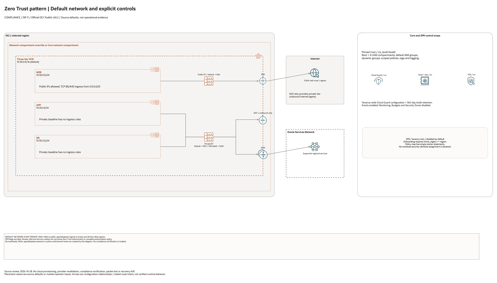

# Zero Trust Compliance Architecture

This is the deployment architecture for `blueprints/compliance/zero-trust`. The PNG provides a GitHub-readable preview; the draw.io source preserves editable shapes and official OCI icons.

## Deployment Purpose

Composes the core landing-zone foundation with a standalone three-tier VCN protected by OCI Zero Trust Packet Routing policies.

## Architecture At A Glance

| Item | Details |
| --- | --- |
| Boundary | `blueprints/compliance/zero-trust` owns this deployment folder and its Terraform + Ansible runners. |
| Purpose | Composes the core landing-zone foundation with a standalone three-tier VCN protected by OCI Zero Trust Packet Routing policies. |
| Terraform components | `core`, `network` |
| Primary architecture view | The diagram shows source-default resources, conditional controls and configuration dependencies; it is not runtime evidence. |

## Architecture

[Editable draw.io source](architecture.drawio). Keep this source aligned with
the PNG documentation preview after diagram changes.

Generated with the [oci-architecture-diagrams skill](https://github.com/leandro-michelino/oci-architecture-diagrams)
and Oracle OCI Architecture Diagram Toolkit v24.2. From the repository root,
run `python3 scripts/diagrams/compliance-dr-batch-01.py --render` after installing
the skill and official toolkit. The toolkit is not redistributed here.

The view distinguishes default service enablement, conditional controls, external
prerequisites, provider/compartment scope and configuration contracts. Defaults
are source values, not evidence of a deployed or certified architecture.

Diagram documentation reviewed on 2026-10-28 against Terraform, variables, locals,
providers, referenced modules and any accompanying Bicep template. No cloud
resources were created and no Terraform/provider validation date was updated.
Arrows do not establish packet flow, assessment coverage, replication or a
successful recovery drill.

## Terraform Components

| Kind | Name | Source Or Role |
| --- | --- | --- |
| Module | `core` | `../../../blueprints/core` |
| Module | `network` | `../../../blueprints/networking/standalone-three-tier-vcn-zpr` |

## Request And Deployment Flow

- Terraform creates the core governance/security foundation first.
- The compliance network or platform layer consumes core compartment and security outputs.
- Traffic and operational signals follow the specific compliance pattern shown in the diagram.

## Traffic And Trust Boundaries

- Control plane traffic is local operator or CI authentication into the OCI provider and the Ansible Terraform runner.
- Data plane traffic is the packet or service path shown in the Architecture diagram; if this deployment only creates identity or governance resources, the data plane is intentionally permission and signal flow instead of network packets.
- Trust boundaries are the tenancy, compartment, VCN, subnet, DRG, private endpoint, identity domain, or managed service edges shown in the diagram.
- Secrets, OCIDs, customer CIDRs, endpoint URLs, and contact data belong in ignored local tfvars or a secure pipeline variable store, not in committed files.

## Detailed Architecture Notes

These notes expand the diagram with the design details that usually matter during review, plan, and hand-off.

- Core Level 2 controls are created first, then the standalone ZPR-enabled VCN consumes the core network compartment output.
- The VCN provides web, app, and database tiers while ZPR policies provide an additional packet authorization layer over normal route and security-list behavior.
- Policy review should confirm which subjects, resources, compartments, and services are allowed to communicate before apply.
- The key hand-off is the VCN/subnet output plus ZPR configuration and policy IDs for security review and downstream workload placement.

## Operational Boundaries

- Keep customer-specific OCIDs, CIDRs, DNS names, endpoints, contacts, and secrets in ignored local tfvars or approved pipeline variables.
- Run plan from this blueprint folder so relative module paths, provider files, and local Ansible runners resolve predictably.
- Treat apply and destroy as approval-gated operations; use the guarded Ansible playbooks or a reviewed Terraform workflow.
- Re-check route exposure, IAM scope, compartment boundaries, tags, and output hand-offs whenever inputs change.

## Review Checklist

- Confirm the diagram matches `main.tf`: `core`, `network`.
- Confirm the described traffic path is the path you want in OCI before apply.
- Confirm public exposure, private endpoint access, DNS behavior, DRG routing, and inspection points are intentional where present.
- Confirm IAM scopes, compartment boundaries, tags, and operational outputs match the deployment README.
- Confirm `ansible/plan.yml`, `ansible/apply.yml`, and `ansible/destroy.yml` still point at the shared Terraform runner.

## October 2026 Item Review

Core administration and optional tenancy-root ZPR onboarding/policies are outside a single workload-compartment test. ZPR remains disabled unless that separate administrative scope is explicitly authorized. The network now references the published web-only ingress and ZPR home-region guard. Attribute assignment, traffic authorization, and a zero-trust outcome are not established by provisioning the network.

The OCI provider ignores only Oracle-managed provenance tags. Validation comments remain in English and separate schema/mocked checks from live provisioning.
