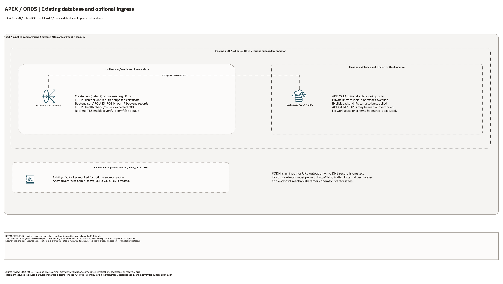

# Oracle APEX On Autonomous Database Architecture

This page is the deployment architecture for `blueprints/data-platform/apex-adw`.
It is intentionally Architecture-first so it is easy to review in GitHub, terminals,
pull requests, runbooks, and customer-safe notes without a diagramming tool.

## Deployment Purpose

Adds a private APEX/ORDS access layer and operator hand-off around an existing
Autonomous Database.

## Architecture At A Glance

| Item | Details |
|---|---|
| Boundary | `blueprints/data-platform/apex-adw` owns this deployment folder and its Terraform + Ansible runners. |
| Purpose | Provides private APEX ingress, ORDS backend wiring, optional Vault secret hand-off, and ADB APEX/ORDS outputs. |
| Terraform components | `data.oci_database_autonomous_database.this`, `oci_load_balancer_load_balancer.this`, `oci_load_balancer_backend_set.ords`, `oci_load_balancer_backend.ords`, `oci_load_balancer_listener.https`, `oci_vault_secret.apex_admin` |
| Primary architecture view | The Architecture diagram below shows the OCI components, dependency order, and private request path for this exact deployment. |

## Architecture



[Editable draw.io diagram](architecture.drawio)

## Diagram Sources And Scope

Generated with the installed `oci-architecture-diagrams` skill, Oracle Toolkit
v24.2 and provider-specific icons where available. Source review: October 28,
2026. No cloud provisioning, provider revalidation, database connection, recovery
drill or application login was performed. Historical validation metadata is unchanged.

Regenerate the overview, then rebuild its resource-detail pages:

```bash
python3 scripts/diagrams/data-dr-batch-01.py --render
python3 scripts/diagrams/multicloud-resource-coverage.py --blueprint data-platform/apex-adw --render
python3 scripts/diagrams/multicloud-resource-coverage.py --blueprint data-platform/apex-adw --check
```

## Resource Detail And Coverage

The main draw.io document includes the overview and the following resource-detail
pages. Each card names a source declaration, including conditional and collection
resources; counts are declarations, not deployed instances. Contracts are local
Terraform metadata. Supplied resources remain prerequisites, not created assets.

| Scope | Declarations | Preview | Editable source |
| --- | --- | --- | --- |
| OCI | 5 | [PNG](oci-resources.png) | [draw.io](oci-resources.drawio) |

[Resource inventory](resource-inventory.json) records source revisions, file hashes
and resource-to-diagram node mappings. The coverage check verifies all declarations,
provider-icon mappings, embedded SVG syntax and inclusion in the main draw.io pages.

## Terraform Components

| Kind | Name | Source Or Role |
|---|---|---|
| Data source | `data.oci_database_autonomous_database.this` | Reads ADB connection URLs, APEX details, compartment, and private endpoint IP. |
| Resource | `oci_load_balancer_load_balancer.this` | Optional private flexible load balancer. |
| Resource | `oci_load_balancer_backend_set.ords` | Backend set for ORDS. |
| Resource | `oci_load_balancer_backend.ords` | ORDS backend IP resources. |
| Resource | `oci_load_balancer_listener.https` | HTTPS listener for private APEX traffic. |
| Resource | `oci_vault_secret.apex_admin` | Optional Vault secret for admin or bootstrap material. |

## Request And Deployment Flow

- Operator supplies an existing Autonomous Database OCID from the ADB blueprint
  outputs or another approved source.
- Terraform reads ADB APEX/ORDS metadata and the private endpoint IP when
  available.
- Terraform optionally creates a private load balancer, backend set, ORDS
  backend IPs, and HTTPS listener.
- Terraform optionally stores APEX admin/bootstrap material in Vault.
- Outputs expose URLs, resource IDs, backend IPs, APEX version details, and
  secret IDs for DBA/APEX and platform teams.

## Traffic And Trust Boundaries

- Control plane traffic is local operator or CI authentication into the OCI
  provider and the Ansible Terraform runner.
- Data plane traffic is private HTTPS traffic from approved clients to the load
  balancer, then to ORDS on the ADB private endpoint.
- Trust boundaries are the tenancy, data-platform compartment, private subnet,
  NSGs, load balancer, ADB private endpoint, Vault, and DNS ownership edge.
- DNS names, certificates, OCIDs, backend IPs, admin usernames, bootstrap
  payloads, and secrets belong in ignored local tfvars or secure pipeline
  variables.

## Detailed Architecture Notes

- Autonomous Database provides the APEX and ORDS runtime. This blueprint does
  not create the database; it wraps the existing database with private ingress
  and operational hand-offs.
- The ADB data source can return `connection_urls.apex_url`,
  `connection_urls.ords_url`, `apex_details`, and `private_endpoint_ip`.
- If `private_endpoint_ip` is not available in the target tenancy, supply
  `autonomous_database_private_endpoint_ip` or explicit `ords_backend_ip_addresses`.
- The listener defaults to HTTPS and therefore requires a certificate when the
  load balancer is enabled.
- Backend SSL verification defaults to `false` because private ADB/ORDS
  certificate validation often needs customer CA decisions. Turn it on when the
  trusted CA path is ready.
- APEX workspace creation remains a DBA/APEX bootstrap step. The blueprint
  stores the material and outputs the names so the process is visible and
  repeatable.

## Operational Boundaries

- Keep customer-specific OCIDs, DNS names, certificates, backend IPs, contacts,
  and secrets in ignored local tfvars or approved pipeline variables.
- Run plan from this blueprint folder so provider files and local Ansible
  runners resolve predictably.
- Treat apply and destroy as approval-gated operations; use the guarded Ansible
  playbooks or a reviewed Terraform workflow.
- Re-check private endpoint IPs, NSGs, certificate rotation, DNS records, Vault
  secret rotation, and APEX workspace ownership whenever inputs change.

## Review Checklist

- Confirm the diagram matches `main.tf`: `data.oci_database_autonomous_database.this`,
  `oci_load_balancer_load_balancer.this`, `oci_load_balancer_backend_set.ords`,
  `oci_load_balancer_backend.ords`, `oci_load_balancer_listener.https`, and
  `oci_vault_secret.apex_admin`.
- Confirm the ADB OCID belongs to the intended environment and compartment.
- Confirm private APEX traffic should flow through the selected load balancer
  subnets and NSGs.
- Confirm DNS points to the private load balancer only after the backend health
  check is green.
- Confirm listener certificates and backend SSL verification match the security
  model.
- Confirm Vault secret content is approved and never committed.
- Confirm APEX workspace bootstrap ownership, admin user, and rotation process.
- Confirm `ansible/plan.yml`, `ansible/apply.yml`, and `ansible/destroy.yml`
  still point at the shared Terraform runner.

## October 2026 Item Review

No database is created here. Missing optional database/IP/URL inputs now remain null and allow a disabled integration plan. enable_admin_secret explicitly controls creation independently of sensitive secret content; reuse admin_secret_id with enable_admin_secret=false. Secret material remains in deployment state and needs an encrypted, access-controlled backend. OCI Load Balancer, Vault/Secrets, ORDS reachability, DNS, certificates, APEX workspace setup, and user authentication require separate validation; no live paid resources were created.

The OCI provider ignores only Oracle-managed provenance tags. Validation comments remain in English and separate schema/mocked checks from live provisioning.
