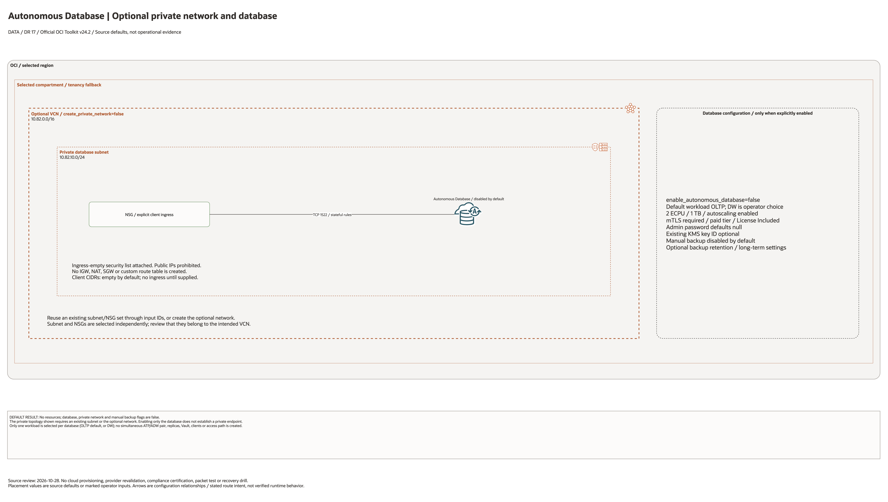

# Autonomous Database Architecture

This is the deployment architecture for `blueprints/data-platform/autonomous-database`. The editable draw.io overview and PNG preview support source-based architecture review.

## Deployment Purpose

Deploys a private Autonomous Database pattern for ATP or ADW with optional manual backup, KMS, NSG, private endpoint inputs, and explicit license model selection.

## Architecture At A Glance

| Item | Details |
|---|---|
| Boundary | `blueprints/data-platform/autonomous-database` owns this deployment folder and its Terraform + Ansible runners. |
| Purpose | Deploys a private Autonomous Database pattern for ATP or ADW with optional manual backup, KMS, NSG, and private endpoint inputs. |
| Terraform components | `oci_database_autonomous_database.this`, `oci_database_autonomous_database_backup.manual` |
| Primary architecture view | The Architecture diagram below shows the OCI components, dependency order, and traffic or control flow for this exact deployment. |

## Architecture



[Editable draw.io diagram](architecture.drawio)

## Diagram Sources And Scope

Generated with the installed `oci-architecture-diagrams` skill, Oracle Toolkit
v24.2 and provider-specific icons where available. Source review: October 28,
2026. No cloud provisioning, provider revalidation, database connection, recovery
drill or application login was performed. Historical validation metadata is unchanged.

Regenerate the overview, then rebuild its resource-detail pages:

```bash
python3 scripts/diagrams/data-dr-batch-01.py --render
python3 scripts/diagrams/multicloud-resource-coverage.py --blueprint data-platform/autonomous-database --render
python3 scripts/diagrams/multicloud-resource-coverage.py --blueprint data-platform/autonomous-database --check
```

## Resource Detail And Coverage

The main draw.io document includes the overview and the following resource-detail
pages. Each card names a source declaration, including conditional and collection
resources; counts are declarations, not deployed instances. Contracts are local
Terraform metadata. Supplied resources remain prerequisites, not created assets.

| Scope | Declarations | Preview | Editable source |
| --- | --- | --- | --- |
| OCI | 7 | [PNG](oci-resources.png) | [draw.io](oci-resources.drawio) |

[Resource inventory](resource-inventory.json) records source revisions, file hashes
and resource-to-diagram node mappings. The coverage check verifies all declarations,
provider-icon mappings, embedded SVG syntax and inclusion in the main draw.io pages.

## Terraform Components

| Kind | Name | Source Or Role |
|---|---|---|
| Resource | `oci_database_autonomous_database.this` | Declared directly in `main.tf` |
| Resource | `oci_database_autonomous_database_backup.manual` | Declared directly in `main.tf` |
| Resource | `oci_core_vcn.adb` | Declared in this blueprint; creation depends on its count or for_each inputs. |
| Resource | `oci_core_subnet.adb` | Declared in this blueprint; creation depends on its count or for_each inputs. |
| Resource | `oci_core_network_security_group.adb` | Declared in this blueprint; creation depends on its count or for_each inputs. |
| Resource | `oci_core_network_security_group_security_rule.database_ingress` | Optional stateful TCP ingress from explicit client CIDRs on database_port. |

| Resource | `oci_core_security_list.adb` | Explicit empty security list prevents inherited default SSH ingress. |

## Request And Deployment Flow

- Operator supplies the existing network, compartment, service, or backend IDs required by the deployment.
- Terraform creates the optional service resource graph declared in `main.tf`.
- Outputs expose service IDs, endpoint names, or attachment IDs for applications and runbooks.

## Traffic And Trust Boundaries

- Control plane traffic is local operator or CI authentication into the OCI provider and the Ansible Terraform runner.
- Data plane traffic is the packet or service path shown in the Architecture diagram; if this deployment only creates identity or governance resources, the data plane is permission and signal flow.
- Trust boundaries are the tenancy, compartment, VCN, subnet, private endpoint, identity domain, or managed service edges shown in the diagram.
- Secrets, OCIDs, customer CIDRs, endpoint URLs, and contact data belong in ignored local tfvars or a secure pipeline variable store, not in committed files.

## Detailed Architecture Notes

- Confirm admin password handling uses a secure variable source.
- Confirm `license_model` matches approved Oracle Database licensing rights.
- Confirm private endpoint subnet, NSGs, KMS key, workload type, and storage sizing.
- Confirm backup retention and auto-scaling expectations before apply.

## Operational Boundaries

- Keep customer-specific OCIDs, CIDRs, DNS names, endpoints, contacts, and secrets in ignored local tfvars or approved pipeline variables.
- Run plan from this blueprint folder so relative module paths, provider files, and local Ansible runners resolve predictably.
- Treat apply and destroy as approval-gated operations; use the guarded Ansible playbooks or a reviewed Terraform workflow.
- Re-check route exposure, IAM scope, compartment boundaries, tags, and output hand-offs whenever inputs change.

## Review Checklist

- Confirm the diagram matches `main.tf`: `oci_database_autonomous_database.this`, `oci_database_autonomous_database_backup.manual`.
- Confirm the described traffic or control path is the path you want in OCI before apply.
- Confirm public exposure, private endpoint access, DNS behavior, DRG routing, and inspection points are intentional where present.
- Confirm IAM scopes, compartment boundaries, tags, and operational outputs match the deployment README.
- Confirm `ansible/plan.yml`, `ansible/apply.yml`, and `ansible/destroy.yml` still point at the shared Terraform runner.

## October 2026 Item Review

Disabled/public-mode plans now support absent private endpoint inputs. The optional private network creates a VCN, private subnet, and NSG. allowed_client_cidrs is empty by default; when supplied, only database_port (default mTLS 1522) is permitted. Additional tool/HTTPS flows require explicit NSG configuration. The live test created only this network and one client rule, not a database, backup, application, or connection session. Always Free requires the actual tenancy home region and cannot use private endpoints or manual backups; sizing/feature eligibility still requires a separate check.

The OCI provider ignores only Oracle-managed provenance tags. Validation comments remain in English and separate schema/mocked checks from live provisioning.

The private subnet attaches an explicit ingress/egress-empty security list instead of inheriting the VCN default SSH/ICMP rules. Security lists and NSGs are additive, so the empty list leaves ingress controlled by the explicit NSG rules. Stateful return traffic is allowed by the corresponding NSG session; application-initiated flows require separately configured egress rules.
