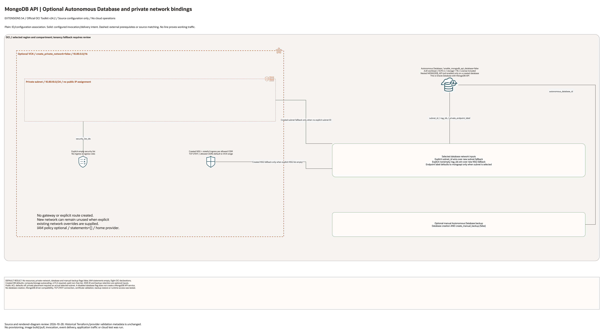

# Autonomous Database MongoDB API Architecture

This is the deployment architecture for `blueprints/data-platform/mongodb-api`. It keeps the design reviewable in GitHub, terminals, pull requests, runbooks, and customer-safe notes without a diagramming tool.

## Deployment Purpose

Deploys an OCI-managed MongoDB-compatible document API by creating an Autonomous Database with the MongoDB API database tool enabled. The blueprint is private-first and captures network placement, NSGs, KMS, backup, IAM, and hand-off outputs.

## Architecture At A Glance

| Item | Details |
|---|---|
| Boundary | `blueprints/data-platform/mongodb-api` owns this deployment folder and its Terraform + Ansible runners. |
| Purpose | Managed MongoDB-compatible API endpoint backed by Autonomous Database. |
| Terraform components | `oci_core_vcn.mongodb_api`, `oci_core_subnet.mongodb_api`, `oci_core_network_security_group.mongodb_api`, `oci_database_autonomous_database.this`, `oci_database_autonomous_database_backup.manual`, `oci_identity_policy.access` |
| Primary architecture view | The Architecture diagram below shows OCI control flow, private data path, optional backup, and app hand-off points for this exact deployment. |

## Architecture

[Editable draw.io overview and native detail pages](architecture.drawio) · [Resource inventory](resource-inventory.json)

Native pages cover every conditional declaration and existing-reference input. Counts describe declarations, not deployed resource counts.

## Terraform Components

| Kind | Name | Source Or Role |
|---|---|---|
| Resource | `oci_database_autonomous_database.this` | Creates the Autonomous Database, private endpoint settings, MongoDB API tool configuration, and database-level controls. |
| Resource | `oci_core_vcn.mongodb_api` | Optional private VCN for complete deploy-and-use private endpoint deployments. |
| Resource | `oci_core_subnet.mongodb_api` | Optional private endpoint subnet. |
| Resource | `oci_core_network_security_group.mongodb_api` | Optional NSG attached to the Autonomous Database private endpoint. |
| Resource | `oci_core_network_security_group_security_rule.mongodb_api_ingress` | Optional NSG ingress rules from approved client CIDRs to the MongoDB API port. |
| Resource | `oci_database_autonomous_database_backup.manual` | Creates an optional initial manual backup when enabled. |
| Resource | `oci_identity_policy.access` | Creates optional IAM policy statements in the tenancy home region. |

| Resource | `oci_core_security_list.mongodb_api` | Explicit empty security list prevents inherited default SSH ingress. |

## Request And Deployment Flow

- Operator supplies tenancy, region, compartment, subnet, NSG, credential, and optional KMS or IAM values.
- Terraform creates or consumes private network resources, then plans the Autonomous Database with `db_tools_details` configured for the MongoDB API.
- Terraform creates optional backup and IAM resources only when their enable inputs require them.
- Outputs expose the Autonomous Database OCID, state, private endpoint values, MongoDB API URL, service console URL, and optional policy or backup IDs.
- Application owners consume the URL and credentials through an approved deployment or secret hand-off process.

## Traffic And Trust Boundaries

- Control plane traffic is local operator or CI authentication into the OCI provider and the blueprint-local Ansible Terraform runner.
- Data plane traffic should originate from approved private application subnets and reach the Autonomous Database private endpoint through VCN DNS and NSG rules.
- Public access is represented only by `enable_public_access_control` and `whitelisted_ips`; prefer a private endpoint and empty public allow-list for production.
- Trust boundaries are the tenancy, compartment, VCN, private subnet, NSG, private endpoint, and managed Autonomous Database service edge.
- Secrets, OCIDs, endpoint URLs, and customer CIDRs belong in ignored local tfvars or an approved pipeline variable store, not in committed files.

## Detailed Architecture Notes

- Eight optional OCI declarations are enumerated. All creation flags default false; IAM statements are empty. The database is Oracle Autonomous Database with MongoDB API, not a native MongoDB replica set.
- The optional AJD database defaults to two ECPUs, 1 TB, License Included, compute/storage autoscaling and required mTLS. The nested MONGODB_API feature exists only when database creation is enabled.
- Explicit subnet and nonempty NSG inputs override the created network fallbacks; newly enabled network resources can remain unused. Private placement requires an actual selected subnet. Public ACL defaults off and does not alone establish private placement.
- The created private subnet binds an explicit empty security list. The NSG permits stateful TCP 27017 from configured CIDRs. No gateway, explicit route or tested client connection is created.
- Manual backup requires both database and backup flags. IAM statements, KMS key, credentials and existing network identifiers remain operator inputs. Driver compatibility requires runtime testing.

## Operational Boundaries

- Keep customer-specific OCIDs, CIDRs, endpoint URLs, contacts, and secrets in ignored local tfvars or approved pipeline variables.
- Run plan from this blueprint folder so provider files and local Ansible runners resolve predictably.
- Treat apply and destroy as approval-gated operations; use the guarded Ansible playbooks or a reviewed Terraform workflow.
- Re-check route exposure, IAM scope, compartment boundaries, tags, and output hand-offs whenever inputs change.
- Validate application compatibility with the Oracle Database API for MongoDB before production migration or cutover.
- Keep self-managed MongoDB replica sets, OKE operators, or backup agents out of this blueprint unless the target pattern changes from managed API to self-managed database.

## Review Checklist

- Confirm the diagram matches `main.tf`: optional VCN/subnet/NSG resources, `oci_database_autonomous_database.this`, `oci_database_autonomous_database_backup.manual`, and `oci_identity_policy.access`.
- Confirm the described private endpoint path is the path you want in OCI before apply.
- Confirm the application has been tested against the MongoDB API compatibility surface it needs.
- Confirm admin password handling, KMS key, backup retention, and optional manual backup behavior.
- Confirm public exposure, private endpoint access, DNS behavior, DRG routing, and inspection points are intentional.
- Confirm IAM scopes, compartment boundaries, tags, and operational outputs match the deployment README.
- Confirm `ansible/plan.yml`, `ansible/apply.yml`, and `ansible/destroy.yml` still point at the shared Terraform runner.

## October 2026 Item Review

Disabled/public-mode plans now support absent private endpoint inputs. The live test created only the private VCN/subnet/NSG and its TCP 27017 client rule. No Autonomous Database, MongoDB service, backup, authentication, or driver session was created or tested. Always Free constraints include home-region placement, no private endpoint, and no manual backup; model/shape/feature availability remains separate.

The OCI provider ignores only Oracle-managed provenance tags. Validation comments remain in English and separate schema/mocked checks from live provisioning.

The private subnet attaches an explicit ingress/egress-empty security list instead of inheriting the VCN default SSH/ICMP rules. Security lists and NSGs are additive, so the empty list leaves ingress controlled by the explicit NSG rules. Stateful return traffic is allowed by the corresponding NSG session; application-initiated flows require separately configured egress rules.

## Diagram Review - 2026-10-28

Source, connector direction, creation conditions, native detail pages and PNGs were reviewed locally. Plain lines show ID/configuration associations; solid arrows show declared request/route intent; dashed lines show external prerequisites. No cloud resources were created and no runtime traffic was tested in this review. Historical provider and live-validation evidence remains limited to its original stated scope.
