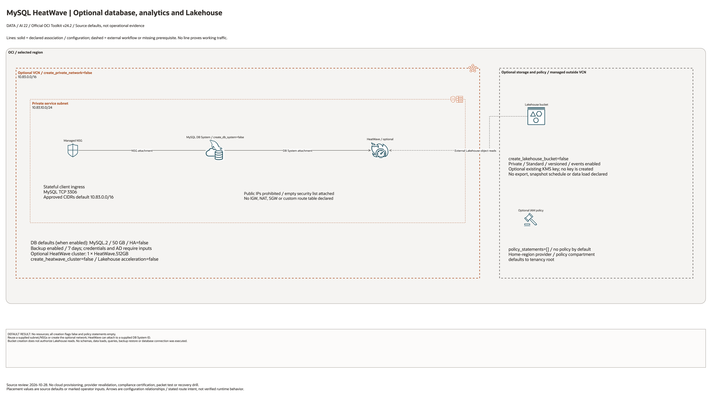

# MySQL HeatWave Landing Zone Architecture

## Deployment Purpose

This blueprint provides a repeatable OCI landing-zone pattern for MySQL
HeatWave. It covers a private MySQL endpoint, optional HeatWave analytics
cluster, optional Lakehouse bucket, backup posture, encryption, and IAM handoff.

## Architecture At A Glance

| Layer | Components |
| --- | --- |
| Data serving | MySQL DB System in a private subnet. |
| Analytics | HeatWave cluster attached to the DB System. |
| Lakehouse | Object Storage bucket for external tables or exports. |
| Protection | Backup policy, KMS option, empty subnet security list, NSG client rules, and no public endpoint by default. |
| Governance | IAM policy shell, tags, and reviewed credential flow. |

## Architecture



[Editable draw.io diagram](architecture.drawio)

## Diagram Sources And Scope

Generated with the installed `oci-architecture-diagrams` skill and Oracle Toolkit
v24.2. AWS resources use native AWS icons; types without an exact mapped glyph
remain named boxes. Source review: October 28, 2026. Configuration relationships
and source defaults do not establish working traffic, inference, backups or DR.
No cloud provisioning or provider revalidation was performed; historical
validation metadata remains unchanged.

Regenerate the overview before rebuilding the resource-detail pages:

```bash
python3 scripts/diagrams/data-ai-batch-01.py --render
python3 scripts/diagrams/multicloud-resource-coverage.py --blueprint data-platform/mysql-heatwave --render
python3 scripts/diagrams/multicloud-resource-coverage.py --blueprint data-platform/mysql-heatwave --check
```

## Resource Detail And Coverage

The main draw.io document contains the overview, every resource-detail page and
the existing-resource input references below. Conditional and collection
resources remain visible. Counts are source declarations, not resolved instance
counts or deployed resources. `terraform_data` contracts are local metadata;
companion CloudFormation templates deploy separately.

| Scope | Declarations or references | Preview | Editable source |
| --- | --- | --- | --- |
| OCI resources | 9 | [PNG](oci-resources.png) | [draw.io](oci-resources.drawio) |
| Existing resources / inputs | 8 references | [PNG](existing-resources.png) | [draw.io](existing-resources.drawio) |

[Resource inventory](resource-inventory.json) records source hashes, revisions,
creation expressions, data lookups and resource-to-diagram node mappings.
Supplied subnet, key, compartment and service IDs are references or overrides,
not evidence that this blueprint creates or adopts those external resources.

## Connection Lines

Solid lines show the NSG selection and DB System/HeatWave attachment. The dashed Lakehouse line is an external loading workflow; this blueprint does not grant object-read access or execute a load. IAM statements and bucket creation do not establish that workflow.

Lines show configuration or intended relationships, never verified runtime
traffic. Detail/reference maps enumerate resources and deliberately do not
invent connections between independent declarations.

## Terraform Components

| File | Purpose |
| --- | --- |
| `main.tf` | Creates MySQL DB System, HeatWave cluster, Lakehouse bucket, and optional IAM policy. |
| `variables.tf` | Captures subnet, shape, HA, backup, HeatWave, Lakehouse, and IAM choices. |
| `outputs.tf` | Exposes DB System, HeatWave, endpoint, bucket, and policy outputs. |
| `terraform.tfvars.example` | Shows safe placeholders for local deployment inputs. |

Declared resource addresses:

| Kind | Name | Source Or Role |
| --- | --- | --- |
| Resource | `oci_core_vcn.mysql` | Declared in this blueprint; creation depends on its count or for_each inputs. |
| Resource | `oci_core_subnet.mysql` | Declared in this blueprint; creation depends on its count or for_each inputs. |
| Resource | `oci_core_security_list.mysql` | Explicit empty list attached to the generated subnet so the VCN default list is not inherited. |
| Resource | `oci_core_network_security_group.mysql` | Declared in this blueprint; creation depends on its count or for_each inputs. |
| Resource | `oci_core_network_security_group_security_rule.mysql_ingress` | Declared in this blueprint; creation depends on its count or for_each inputs. |
| Resource | `oci_objectstorage_bucket.lakehouse` | Declared in this blueprint; creation depends on its count or for_each inputs. |
| Resource | `oci_mysql_mysql_db_system.this` | Declared in this blueprint; creation depends on its count or for_each inputs. |
| Resource | `oci_mysql_heat_wave_cluster.this` | Declared in this blueprint; creation depends on its count or for_each inputs. |
| Resource | `oci_identity_policy.access` | Declared in this blueprint; creation depends on its count or for_each inputs. |

## Request And Deployment Flow

1. Database owner chooses MySQL version, shape, storage, and HA posture.
2. Network owner provides private subnet and NSG identifiers.
3. Security owner confirms credential, KMS, and backup requirements.
4. Terraform creates or references the MySQL DB System.
5. Terraform optionally attaches HeatWave and enables Lakehouse support.
6. App owners consume the private endpoint and IAM hand-off outputs.

## Traffic And Trust Boundaries

- When the blueprint creates the private network, its subnet uses an empty
  security list and the DB NSG allows TCP/3306 from approved CIDRs only.
- Existing subnets and NSGs are externally governed and need a separate review.
- Admin credentials must not be committed; use local ignored tfvars or CI secret injection.
- HeatWave attaches to the DB System and should inherit the same data owner review.
- Lakehouse bucket data is a governed data platform boundary, not temporary scratch.
- IAM statements should separate DBAs, analytics operators, app users, and auditors.

## Detailed Architecture Notes

- `create_db_system` and `create_heatwave_cluster` are separate so customers can
  add HeatWave to an existing DB System.
- The lakehouse bucket can be created even when the DB System is referenced.
- Bucket creation alone does not authorize HeatWave to read objects or load data.
- `backup_policy` is included by default when the DB System is created.
- `kms_key_id` can encrypt both bucket and DB data when customer-managed keys are required.
- The blueprint intentionally avoids public endpoint assumptions.
- Maintenance and advanced MySQL configuration can be layered through existing OCI configuration IDs.

## Operational Boundaries

- Terraform does not create schemas, users, grants, or application tables.
- Terraform does not load Lakehouse data or run analytics jobs.
- Password rotation must be handled by the customer secret workflow.
- HeatWave sizing should be validated against workload data volume.
- Backup restore testing belongs in the operations runbook, not only Terraform.
- The 2026-10-15 checks were Terraform schema and mocked plans only. No DB,
  HeatWave, backup, or client connection was provisioned or tested.

OCI networking reference: [Security lists and subnet association](https://docs.oracle.com/en-us/iaas/Content/Network/Concepts/creating-securitylist.htm).

## Review Checklist

- Subnet and NSG access are approved by network and security owners.
- DB shape, storage, and HA posture match the workload tier.
- Backup retention and window are documented.
- Admin credentials are supplied outside git.
- HeatWave and Lakehouse cost impact is approved.
- IAM policy statements are scoped to groups, not broad tenancy administrators.
- Outputs are handed to app and analytics teams after apply.
