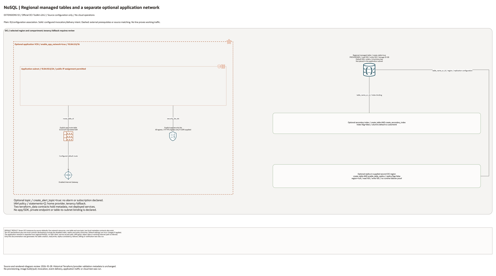

# OCI NoSQL Database Architecture

This page is the deployment architecture for `blueprints/data-platform/nosql`.
It is intentionally Architecture-first so it is easy to review in GitHub,
terminals, pull requests, runbooks, and customer-safe notes without a diagramming
tool.

## Deployment Purpose

Implements a managed OCI NoSQL table pattern with optional secondary index,
optional cross-region replica, and deploy-and-use app networking for consumers.

## Architecture At A Glance

| Item | Details |
| --- | --- |
| Boundary | `blueprints/data-platform/nosql` owns this deployment folder and its Terraform + Ansible runners. |
| Purpose | Build a NoSQL table contract plus optional index/replica and app network hand-off. |
| Terraform components | `oci_core_vcn.app`, `oci_core_route_table.app`, `oci_core_security_list.app`, `oci_core_subnet.app`, `oci_nosql_table.this`, `oci_nosql_index.secondary`, `oci_nosql_table_replica.this`, `oci_ons_notification_topic.alert`, `terraform_data.app_network_contract`, `terraform_data.nosql_contract` |
| Primary architecture view | The Architecture diagram below shows dependency order and table/consumer flow for this deployment. |

## Architecture

[Editable draw.io overview and native detail pages](architecture.drawio) · [Resource inventory](resource-inventory.json)

Native pages cover every conditional declaration and existing-reference input. Counts describe declarations, not deployed resource counts.

## Terraform Components

| Kind | Name | Source Or Role |
| --- | --- | --- |
| Resource | `oci_core_vcn.app`, `oci_core_route_table.app`, `oci_core_security_list.app`, `oci_core_subnet.app` | Optional app-network resources for NoSQL consumer workloads. |
| Resource | `oci_nosql_table.this` | Core table resource with schema and capacity limits. |
| Resource | `oci_nosql_index.secondary` | Optional secondary index for access patterns. |
| Resource | `oci_nosql_table_replica.this` | Optional replica for regional resilience. |
| Resource | `oci_ons_notification_topic.alert` | Optional notifications topic for NoSQL operations. |
| Resource | `oci_identity_policy.access` | Optional policy shell for operators and app access groups. |
| Resource | `terraform_data.app_network_contract` | Network ID contract output for downstream wiring. |
| Resource | `terraform_data.nosql_contract` | Schema/capacity/replica contract output for hand-off. |
| Sample | `samples/*.tfvars.example` | Public-safe table-only and app-network input shapes. |
| Script | `scripts/test-nosql-lifecycle.sh` | Repository-level real lifecycle runner for create, OCI verification, destroy, and state cleanup. |
| Resource | `oci_core_internet_gateway.app` | Declared in this blueprint; creation depends on its count or for_each inputs. |

## Request And Deployment Flow

- Operator sets schema, capacity, and replica intent in local tfvars.
- Terraform creates optional app-network resources first.
- Terraform creates the NoSQL table and optional index/replica resources.
- Terraform emits hand-off contracts for downstream operations and app teams.
- Operators use outputs for app integration, IAM review, and runbook updates.

## Traffic And Trust Boundaries

- Control plane traffic is local/CI authentication into OCI provider and
  Terraform runner through Ansible wrappers.
- The optional app subnet is public, with an Internet Gateway route for
  outbound traffic. It does not put the managed NoSQL API inside this VCN.
  No application compute or NoSQL private endpoint is deployed here.
- App subnet security rules govern any future application VNICs. HTTPS ingress
  is absent by default and requires an explicit `app_ingress_allowed_cidr`.
- Trust boundaries include compartment ownership, optional policy ownership,
  and optional cross-region replica boundary.
- Secrets and private identifiers belong in ignored local tfvars or secure
  pipeline variable stores.

## Detailed Architecture Notes

- Ten OCI resource declarations and two local terraform_data metadata contracts are enumerated. Source defaults enable five application-network resources, one table and one topic: seven OCI resource instances if applied with valid inputs, with possible charges.
- NoSQL is a regional managed service outside the application subnet. No application client, private NoSQL endpoint or SDK connection is created. The public-IP-eligible subnet has an explicit route table and security list; HTTPS ingress requires an explicit CIDR.
- The default orders table uses PROVISIONED read/write limits of 100 and storage 25 GB. The optional index defaults to customerId; its column collection must be nonempty when enabled.
- Index and replica creation also require create_table=true. A replica requires a supplied second region; configured replication is not evidence of tested consistency or failover.
- The default alert topic has no alarm or subscription. Optional IAM statements do not automatically grant table access.

## Operational Boundaries

- This blueprint supports extension-only use with existing compartment and network standards.
- Apply and destroy are approval-gated operations; use guarded Ansible playbooks.
- Keep tenancy-specific OCIDs, DDL variants, and access statements in local ignored tfvars.
- Re-run plan whenever DDL, capacity, index, or replica settings change.
- Use the output contracts in downstream runbooks and app onboarding checklists.
- Use `--keep-resources` in the lifecycle runner only when manual table or
  index validation is required before a later cleanup run.
- The 2026-10-15 source metadata records schema checks, five mocked plans
  and a reduced application-network lifecycle with cleanup. See
  [historical evidence](../../../../docs/DATA-DEVOPS-DR-REVIEW-20261015.md).
  No NoSQL table, replica or application traffic was covered; that lifecycle
  was not repeated during this diagram review.

OCI reference: [NoSQL table capacity modes](https://docs.oracle.com/en-us/iaas/tools/python/latest/api/nosql/models/oci.nosql.models.TableLimits.html).

## Review Checklist

- Confirm the diagram matches `main.tf`: `oci_core_vcn.app`, `oci_core_route_table.app`, `oci_core_security_list.app`, `oci_core_subnet.app`, `oci_nosql_table.this`, `oci_nosql_index.secondary`, `oci_nosql_table_replica.this`, `oci_ons_notification_topic.alert`, `terraform_data.app_network_contract`, `terraform_data.nosql_contract`.
- Confirm DDL, key model, and index expectations are approved by the app owner.
- Confirm capacity and storage limits are realistic for expected workload.
- Confirm replica region intent and change-management path when replica is enabled.
- Confirm app-network ingress and route assumptions when network resources are enabled.
- Confirm policy statements map to intended operator and consumer groups.
- Confirm `ansible/plan.yml`, `ansible/apply.yml`, and `ansible/destroy.yml` still point at the shared runner.
- Confirm real lifecycle tests use ignored tfvars and either destroy
  immediately or document the planned cleanup window.

## Diagram Review - 2026-10-28

Source, connector direction, creation conditions, native detail pages and PNGs were reviewed locally. Plain lines show ID/configuration associations; solid arrows show declared request/route intent; dashed lines show external prerequisites. No cloud resources were created and no runtime traffic was tested in this review. Historical provider and live-validation evidence remains limited to its original stated scope.
