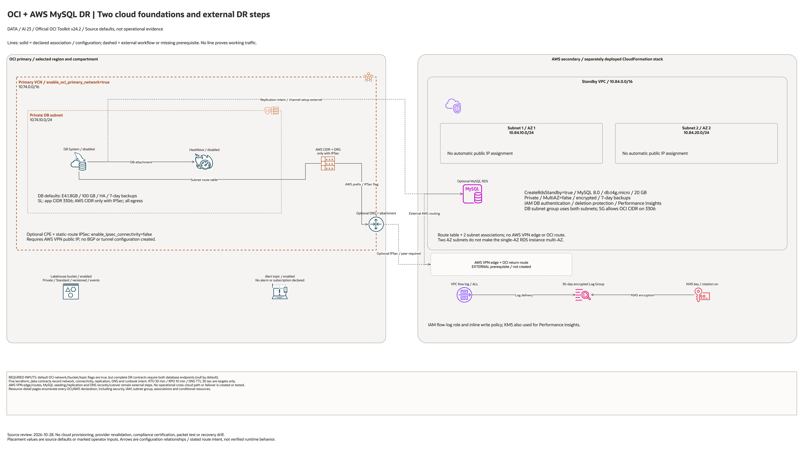

# OCI + AWS MySQL HeatWave DR Architecture

## Deployment Purpose

Provide a reviewable foundation for cross-cloud MySQL disaster recovery. OCI is
the intended primary write platform and AWS the intended standby target. OCI
IPSec resources are optional. AWS VPN routing, MySQL replication, and DNS
cutover are external implementation steps and must be verified separately.

## Architecture At A Glance

| Item | Details |
| --- | --- |
| Primary database cloud | OCI |
| Secondary database cloud | AWS |
| Primary database service | OCI MySQL HeatWave (DB System + HeatWave cluster) |
| Secondary database endpoint | Optional MySQL 8.0 RDS instance from the separate CloudFormation stack; no replication channel configured |
| Cross-cloud network | Optional OCI DRG + CPE + static-route IPSec; AWS VPN gateway, tunnel configuration, and routes are not created here |
| Replication style | Asynchronous replication and TLS requirements documented in a contract; no channel is configured |
| Failover control | DNS cutover and runbook contract outputs; no automated DNS change or failover |

## Architecture



[Editable draw.io diagram](architecture.drawio)

## Diagram Sources And Scope

Generated with the installed `oci-architecture-diagrams` skill and Oracle Toolkit
v24.2. AWS resources use native AWS icons; types without an exact mapped glyph
remain named boxes. Source review: October 28, 2026. Configuration relationships
and source defaults do not establish working traffic, inference, backups or DR.
No cloud provisioning or provider revalidation was performed; historical
validation metadata remains unchanged.

Regenerate the overview before rebuilding the resource-detail pages:

```bash
python3 scripts/diagrams/data-ai-batch-01.py --render
python3 scripts/diagrams/multicloud-resource-coverage.py --blueprint data-platform/oci-aws-mysql-heatwave-dr --render
python3 scripts/diagrams/multicloud-resource-coverage.py --blueprint data-platform/oci-aws-mysql-heatwave-dr --check
```

## Resource Detail And Coverage

The main draw.io document contains the overview, every resource-detail page and
the existing-resource input references below. Conditional and collection
resources remain visible. Counts are source declarations, not resolved instance
counts or deployed resources. `terraform_data` contracts are local metadata;
companion CloudFormation templates deploy separately.

| Scope | Declarations or references | Preview | Editable source |
| --- | --- | --- | --- |
| AWS resources | 13 | [PNG](aws-resources.png) | [draw.io](aws-resources.drawio) |
| Contracts resources | 5 | [PNG](contracts-resources.png) | [draw.io](contracts-resources.drawio) |
| OCI resources | 12 | [PNG](oci-resources.png) | [draw.io](oci-resources.drawio) |
| Existing resources / inputs | 4 references | [PNG](existing-resources.png) | [draw.io](existing-resources.drawio) |

[Resource inventory](resource-inventory.json) records source hashes, revisions,
creation expressions, data lookups and resource-to-diagram node mappings.
Supplied subnet, key, compartment and service IDs are references or overrides,
not evidence that this blueprint creates or adopts those external resources.

## Connection Lines

Solid lines show DB/HeatWave attachment, configured subnet routing, flow-log delivery and log encryption. Dashed lines show replication intent and the missing AWS VPN edge/return route. Those external prerequisites and the MySQL replication channel are not created by the templates. The independently created bucket and alert topic have no automatic producer/subscription wiring.

Lines show configuration or intended relationships, never verified runtime
traffic. Detail/reference maps enumerate resources and deliberately do not
invent connections between independent declarations.

## Terraform Components

| Component | Purpose |
| --- | --- |
| `oci_core_vcn.primary` | OCI primary network boundary for database resources. |
| `oci_core_subnet.primary_db` | Private subnet for OCI MySQL DB System endpoint. |
| `oci_core_route_table.primary_db` | Private subnet route to the AWS replication CIDR through the DRG when IPSec is enabled; no Internet Gateway/default route. |
| `oci_core_security_list.primary_db` | MySQL ingress policy from app CIDR and AWS replication CIDR. |
| `oci_core_drg.primary` | OCI routing hub for IPSec connectivity to AWS. |
| `oci_core_cpe.aws` | OCI-side representation of the AWS VPN endpoint public IP. |
| `oci_core_ipsec.aws` | IPSec connection resource with static route to AWS replication CIDR. |
| `oci_mysql_mysql_db_system.primary` | OCI primary MySQL database service resource. |
| `oci_mysql_heat_wave_cluster.primary` | OCI HeatWave analytics cluster on primary database. |
| `oci_objectstorage_bucket.lakehouse` | Optional OCI bucket for lakehouse and DR evidence artifacts. |
| `oci_ons_notification_topic.dr_alert` | Optional DR alert topic for replication and failover events. |
| `terraform_data.*_contract` | Machine-readable contracts for network, replication, DNS, and runbooks. |

Declared resource addresses:

| Kind | Name | Source Or Role |
| --- | --- | --- |
| Resource | `oci_core_drg_attachment.primary_db` | Declared in this blueprint; creation depends on its count or for_each inputs. |
| Resource | `terraform_data.oci_network_contract` | Local validation or metadata; does not provision cloud network services. |
| Resource | `terraform_data.connectivity_contract` | Local validation or metadata; does not provision cloud network services. |
| Resource | `terraform_data.replication_contract` | Local validation or metadata; does not provision cloud network services. |
| Resource | `terraform_data.dns_failover_contract` | Local validation or metadata; does not provision cloud network services. |
| Resource | `terraform_data.runbook_contract` | Local validation or metadata; does not provision cloud network services. |

## Request And Deployment Flow

1. Operator sets baseline inputs for OCI tenancy, naming, and compartment scope.
2. Operator chooses whether OCI network and IPSec should be created in this run.
3. Operator creates or references OCI MySQL + HeatWave primary resources.
4. Operator sets primary and secondary endpoint values for replication and DNS contracts.
5. Terraform emits contract outputs consumed by operations runbooks and platform automation.
6. AWS standby stack is executed through `ansible/aws-*.yml` sessions and outputs are fed into contracts.

## Traffic And Trust Boundaries

- OCI is the write-primary trust zone for application traffic.
- AWS is the intended standby trust zone. Its template creates VPC, two AZ subnets, route table, associations, security group, flow logs, KMS, IAM and optional RDS resources. It creates no VPN edge or route to OCI.
- The generated OCI database subnet is private and has no Internet Gateway or
  default route. Its attached security list limits MySQL ingress to the
  configured application and AWS replication CIDRs. The application CIDR
  defaults to the example VCN range (`10.74.0.0/16`); change it when deploying
  a different VCN or approved client network. AWS replication ingress is
  omitted when `enable_ipsec_connectivity = false`.
- IPSec is the intended cross-cloud transport path, but the AWS VPN endpoint,
  matching tunnel settings, and AWS routes are outside this template.
- Security boundaries are enforced by OCI security list rules, AWS security groups,
  and route tables scoped to known replication CIDRs.
- DNS failover is an explicit control-plane action and should require operator approval.

## Detailed Architecture Notes

- This blueprint models OCI as mandatory primary (`oci_is_primary=true`).
- Replication is modeled as asynchronous with explicit RPO contract values.
  Neither Terraform nor CloudFormation configures a MySQL replication channel.
- `aws_bgp_asn` is informational for a separate AWS network design. This
  Terraform configuration uses static-route IPSec and does not configure BGP.
- AWS standby endpoint values are inputs/outputs for runbooks; exact secondary engine
  delivery is driven by AWS deployment session parameters and standards.
- CloudFormation can create a MySQL-compatible RDS instance but does not seed
  it from OCI, build an AWS VPN edge, or provide an end-to-end DR deployment.
- The AWS standby template exposes deletion protection, backup retention, and
  Performance Insights switches for account-specific sizing and teardown.
  Validate shape availability and all AWS/OCI charges before any live test.
- For production, enforce secure secret injection for MySQL credentials and avoid
  committing any live endpoint or password values in tfvars files.

## Operational Boundaries

- Do not run apply/destroy without explicit approval controls.
- Validate IPSec tunnel health before declaring replication ready.
- Validate replication lag before failover and before failback cutovers.
- Keep DNS TTL aligned with runbook timing assumptions.
- Capture drill evidence (timestamps, approvals, lag checks, validation queries) in
  the configured evidence bucket and runbook systems.
- The 2026-10-15 checks were Terraform schema and mocked plan/apply only. No OCI
  database, IPSec connection, AWS stack, replication, DNS, or failover was
  provisioned or tested.

Implementation references: [OCI static-route Site-to-Site VPN](https://docs.oracle.com/en-us/iaas/Content/Network/Tasks/settingupIPsec.htm), [OCI outbound MySQL replication](https://docs.oracle.com/en-us/iaas/mysql-database/doc/configuring-outbound-replication-from-db-system-external-replica.html).

## Review Checklist

- OCI remains primary and AWS remains secondary for this environment.
- IPSec CIDR and route intent match approved network design.
- Security rules allow only required MySQL and operations traffic.
- Replication and DNS contract outputs are complete and accurate.
- Runbook sequencing matches target RTO/RPO and drill cadence.
- AWS standby outputs are captured and handed back into OCI contracts.
- No local secrets or generated Terraform artifacts are committed.
