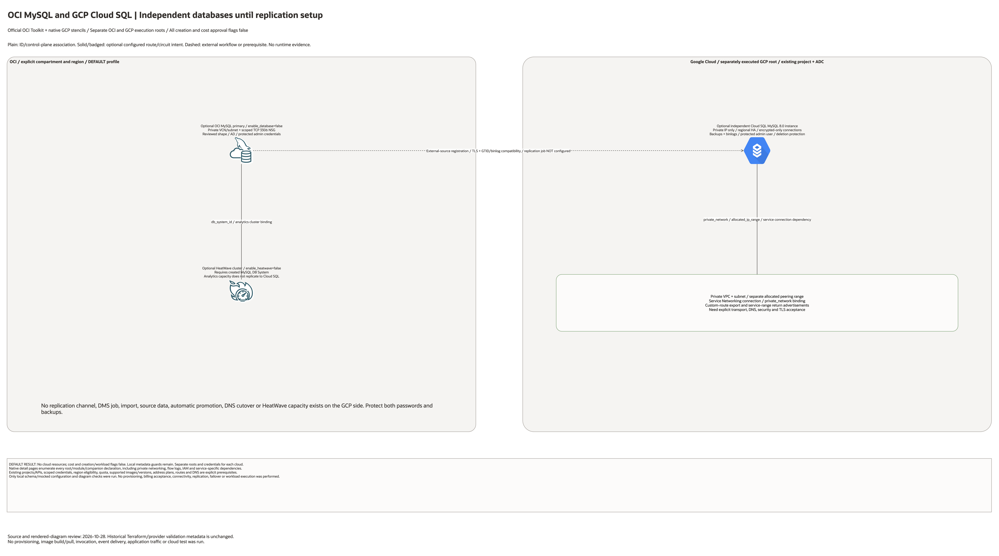

# OCI HeatWave and GCP MySQL DR Architecture

## Deployment Purpose

OCI MySQL primary with optional HeatWave and a private GCP MySQL recovery foundation.
Source-bounded configuration, not observed cloud topology.

## Architecture At A Glance

| Scope | Description |
| --- | --- |
| OCI | Root module/resource declarations in the explicit workload compartment. |
| GCP | Separately executed companion and pinned private-network module. |
| Defaults | All cloud creation and workload flags disabled. |
| Existing | Project APIs, cloud identities, shared networks and external workflows remain labelled. |

## Architecture

[Editable overview and native detail pages](architecture.drawio) · [Resource inventory](resource-inventory.json)

## Terraform Components

OCI composes the generic MySQL HeatWave blueprint with optional private network, DB System and optional HeatWave cluster. GCP creates private networking, a dedicated service-peering range/connection, regional MySQL 8.0 Cloud SQL instance, encrypted-only connections, automated binlogs/backups and an explicitly supplied sensitive admin password.

Every conditional resource, including transitive pinned modules and the GCP companion,
is enumerated on native detail pages. Counts mean declarations, not resolved instances.
The GCP network module is pinned to its validated publication revision.
No container, service-managed host or model API is invented as an independent resource.

## Request And Deployment Flow

1. Review explicit account, cost, API, quota and address-plan prerequisites.
2. Inspect each independent root's disabled default plan.
3. Enable only the separately approved foundation and service flags.
4. Perform explicit endpoint, key, DNS, route and identity handoffs.
5. Test intended flows and denied flows separately before any migration or cutover.

## Traffic And Trust Boundaries

- OCI and Google Cloud are distinct administrative and credential boundaries.
- Plain connectors represent IDs/configuration; solid arrows show configured intent.
- Dashed arrows show external transfer, replication, authentication or cutover workflows.
- A cross-cloud diagram connector does not install a circuit, route or IAM trust.
- Cloud Router is BGP control plane, not a packet-forwarding VM.
- GCP private subnet flow logs are declared; monitoring alerts and retention policy are not inferred.
- Encryption at rest uses service defaults unless a source-declared customer key is added.

## Detailed Architecture Notes

The Cloud SQL instance is independent until an external replication/import workflow is configured. No MySQL replication channel, external source registration, DMS job, replication account, secret exchange, DNS cutover or automatic promotion is created. Verify OCI source binlog/GTID/version compatibility, TLS, routable source/target addresses and the external-source workflow before calling it DR. HeatWave analytics capacity is not replicated to Cloud SQL. Private Service Access return advertisements and export-custom-routes need separate review. Passwords are sensitive inputs, still requiring protected deployment records.

Only source-declared native glyphs are used; unmapped resources remain named boxes.
Existing APIs, billing, keys and project ownership are prerequisites, not created resources.
Default routes are deleted by the GCP network module; optional NAT/route is explicitly gated.
Firewall rules apply to matching VM tags and scoped prefixes/ports, not every managed service.

## Operational Boundaries

- No runtime activation, workload deployment, application traffic or failover test was run.
- Data backup/transfer/replication and promotion remain distinct from infrastructure provisioning.
- Operator attestations must not be treated as successful automated discovery or acceptance.
- Keep protected inputs and independent deployment backends outside version control.
- Review scoped IAM, region/service support, effective routes and return paths before enabling.
- Rehearse cleanup and restore without deleting existing shared dependencies.

## Review Checklist

- Compare every resource and creation condition with the inventory and companion sources.
- Confirm no unexpected cloud resources in disabled plans.
- Verify private endpoints, caller identities and negative/denied request behavior.
- Verify route preference and failover only where actual transport is configured.
- Measure workload recovery and data consistency against approved objectives.
- Review permissions, costs, backups and explicit cleanup ownership.

## References

[Primary service reference](https://docs.cloud.google.com/sql/docs/mysql/replication/external-server).
[Validation record](../../../../docs/multicloud/GCP-COUNTERPARTS-20261028.md).
