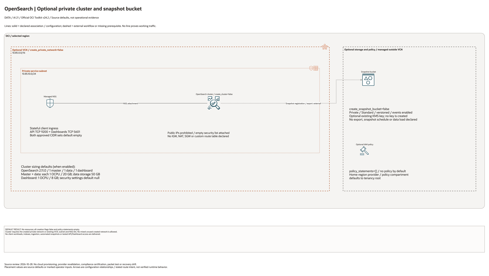

# OpenSearch Search And Vector Platform Architecture

## Deployment Purpose

Provide a managed OpenSearch foundation for application search, operational
search, semantic search, and vector-backed AI workloads. The blueprint keeps
network placement, sizing, snapshot storage, and IAM in a consistent
data-platform deployment folder.

## Architecture At A Glance

| Layer | Responsibility |
| --- | --- |
| OpenSearch cluster | Search, analytics, and vector index runtime. |
| Private subnet | Network boundary for search traffic. |
| NSG | Restricts app, ingestion, and admin access. |
| Dashboard endpoint | Operator and search-admin UI. |
| Snapshot bucket | Export, backup, and vector dataset recovery staging. |
| IAM policy | Admin, writer, and reader permission hand-offs. |

## Architecture



[Editable draw.io diagram](architecture.drawio)

## Diagram Sources And Scope

Generated with the installed `oci-architecture-diagrams` skill and Oracle Toolkit
v24.2. AWS resources use native AWS icons; types without an exact mapped glyph
remain named boxes. Source review: October 28, 2026. Configuration relationships
and source defaults do not establish working traffic, inference, backups or DR.
No cloud provisioning or provider revalidation was performed; historical
validation metadata remains unchanged.

Regenerate the overview before rebuilding the resource-detail pages:

```bash
python3 scripts/diagrams/data-ai-batch-01.py --render
python3 scripts/diagrams/multicloud-resource-coverage.py --blueprint data-platform/opensearch --render
python3 scripts/diagrams/multicloud-resource-coverage.py --blueprint data-platform/opensearch --check
```

## Resource Detail And Coverage

The main draw.io document contains the overview, every resource-detail page and
the existing-resource input references below. Conditional and collection
resources remain visible. Counts are source declarations, not resolved instance
counts or deployed resources. `terraform_data` contracts are local metadata;
companion CloudFormation templates deploy separately.

| Scope | Declarations or references | Preview | Editable source |
| --- | --- | --- | --- |
| OCI resources | 9 | [PNG](oci-resources.png) | [draw.io](oci-resources.drawio) |
| Existing resources / inputs | 8 references | [PNG](existing-resources.png) | [draw.io](existing-resources.drawio) |

[Resource inventory](resource-inventory.json) records source hashes, revisions,
creation expressions, data lookups and resource-to-diagram node mappings.
Supplied subnet, key, compartment and service IDs are references or overrides,
not evidence that this blueprint creates or adopts those external resources.

## Connection Lines

The NSG association is explicit. The dashed cluster-to-bucket line marks external snapshot repository registration and export; no automatic cluster/bucket integration or snapshot job is created.

Lines show configuration or intended relationships, never verified runtime
traffic. Detail/reference maps enumerate resources and deliberately do not
invent connections between independent declarations.

## Terraform Components

| File | Purpose |
| --- | --- |
| `main.tf` | OpenSearch cluster, snapshot bucket, and IAM policy. |
| `variables.tf` | Network, sizing, security, snapshot, and policy inputs. |
| `outputs.tf` | Cluster, endpoint, dashboard, bucket, and policy outputs. |
| `terraform.tfvars.example` | Example network and disabled create flags. |
| `samples/*.tfvars.example` | Public-safe input shapes for private-network and existing-network deployments. |
| `ansible/*.yml` | Standard local runners. |
| `scripts/test-opensearch-lifecycle.sh` | Repository-level real lifecycle runner for create, OCI verification, destroy, and state cleanup. |

Declared resource addresses:

| Kind | Name | Source Or Role |
| --- | --- | --- |
| Resource | `oci_core_vcn.opensearch` | Declared in this blueprint; creation depends on its count or for_each inputs. |
| Resource | `oci_core_subnet.opensearch` | Declared in this blueprint; creation depends on its count or for_each inputs. |
| Resource | `oci_core_security_list.opensearch` | Empty security list attached to the generated subnet. |
| Resource | `oci_core_network_security_group_security_rule.search_ingress` | Conditional per-client TCP/9200 ingress. |
| Resource | `oci_core_network_security_group_security_rule.dashboard_ingress` | Conditional per-client TCP/5601 ingress. |
| Resource | `oci_core_network_security_group.opensearch` | Declared in this blueprint; creation depends on its count or for_each inputs. |
| Resource | `oci_objectstorage_bucket.snapshots` | Declared in this blueprint; creation depends on its count or for_each inputs. |
| Resource | `oci_opensearch_opensearch_cluster.this` | Declared in this blueprint; creation depends on its count or for_each inputs. |
| Resource | `oci_identity_policy.access` | Declared in this blueprint; creation depends on its count or for_each inputs. |

## Request And Deployment Flow

1. Confirm the workload: search, logs, RAG, vectors, or mixed use.
2. Choose private subnet, NSG, and allowed callers.
3. Size master, data, and dashboard nodes.
4. Decide snapshot/export bucket requirements.
5. Apply the cluster after cost and security review.
6. Hand endpoint outputs to ingestion and application blueprints.

## Traffic And Trust Boundaries

- OpenSearch should normally live in private subnets.
- NSGs should separate app callers, ingestion jobs, and admin access.
- Dashboard access should be more restricted than application search access.
- The optional subnet attaches an ingress-empty security list instead of inheriting the VCN default list. The attached NSG permits API TCP/9200 and Dashboard TCP/5601 only from the separate approved CIDR sets. Empty sets block client ingress.
- Existing subnet security lists and NSG rules are external and must be audited before cluster creation.
- Snapshot buckets may contain sensitive indexed data.
- Vector indexes can expose source-document semantics and should be protected.

## Detailed Architecture Notes

The cluster resource exposes a large number of sizing inputs because OpenSearch
cost and performance are sensitive to node count, memory, OCPU, and storage.
The defaults are intentionally small for example purposes, not production
guidance.

The blueprint does not create indexes. Index templates, analyzers, vector
mappings, and lifecycle policies usually belong to the application or ingestion
pipeline because they change more often than the landing-zone foundation.

Snapshot bucket creation is optional so customers can use centralized backup or
data-platform storage when that already exists.
The bucket is not connected to the cluster by this Terraform configuration; repository registration, export jobs, and restore checks remain separate work.

## Operational Boundaries

- Do not commit admin password hashes, customer index mappings, or source data.
- Keep subnet, NSG, and security settings in local tfvars.
- Use this before `embedding-pipeline` or `multi-agent` when vectors are needed.
- Pair with backup and monitoring runbooks for production clusters.
- Use `--keep-resources` in the lifecycle runner only when manual endpoint or
  index validation is required before a later cleanup run.

## Review Checklist

- [ ] VCN, subnet, and NSG are correct.
- [ ] Node sizing is approved for workload and budget.
- [ ] Security mode and admin access are reviewed.
- [ ] Snapshot strategy is documented.
- [ ] Index writers and readers are least privilege.
- [ ] Outputs are handed to only approved consumers.
- [ ] Real lifecycle tests use ignored tfvars and either destroy immediately or
      document the planned cleanup window.
