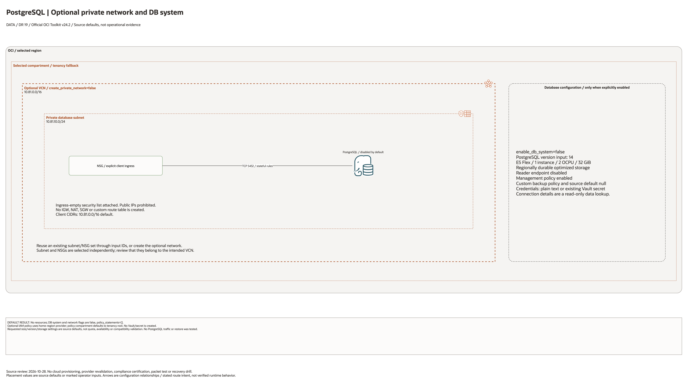

# PostgreSQL Landing Zone Architecture

This is the deployment architecture for `blueprints/data-platform/postgresql`. The editable draw.io overview and PNG preview support source-based architecture review.

## Deployment Purpose

Deploys a private OCI PostgreSQL DB system with network controls, storage durability settings, backup/maintenance policy hooks, optional restore source, and optional scoped IAM policy.

## Architecture At A Glance

| Item | Details |
|---|---|
| Boundary | `blueprints/data-platform/postgresql` owns this deployment folder and its Terraform + Ansible runners. |
| Purpose | Provides a private managed PostgreSQL database foundation for application teams. |
| Terraform components | `oci_core_vcn.postgresql`, `oci_core_subnet.postgresql`, `oci_core_network_security_group.postgresql`, `oci_psql_db_system.this`, `data.oci_psql_db_system_connection_detail.this`, `oci_identity_policy.access` |
| Primary architecture view | The Architecture diagram below shows the OCI components, dependency order, and traffic or control flow for this exact deployment. |

## Architecture



[Editable draw.io diagram](architecture.drawio)

## Diagram Sources And Scope

Generated with the installed `oci-architecture-diagrams` skill, Oracle Toolkit
v24.2 and provider-specific icons where available. Source review: October 28,
2026. No cloud provisioning, provider revalidation, database connection, recovery
drill or application login was performed. Historical validation metadata is unchanged.

Regenerate the overview, then rebuild its resource-detail pages:

```bash
python3 scripts/diagrams/data-dr-batch-01.py --render
python3 scripts/diagrams/multicloud-resource-coverage.py --blueprint data-platform/postgresql --render
python3 scripts/diagrams/multicloud-resource-coverage.py --blueprint data-platform/postgresql --check
```

## Resource Detail And Coverage

The main draw.io document includes the overview and the following resource-detail
pages. Each card names a source declaration, including conditional and collection
resources; counts are declarations, not deployed instances. Contracts are local
Terraform metadata. Supplied resources remain prerequisites, not created assets.

| Scope | Declarations | Preview | Editable source |
| --- | --- | --- | --- |
| OCI | 7 | [PNG](oci-resources.png) | [draw.io](oci-resources.drawio) |

[Resource inventory](resource-inventory.json) records source revisions, file hashes
and resource-to-diagram node mappings. The coverage check verifies all declarations,
provider-icon mappings, embedded SVG syntax and inclusion in the main draw.io pages.

## Terraform Components

| Kind | Name | Source Or Role |
|---|---|---|
| Resource | `oci_core_vcn.postgresql` | Optional private VCN for complete deploy-and-use PostgreSQL deployments. |
| Resource | `oci_core_subnet.postgresql` | Optional private database subnet. |
| Resource | `oci_core_network_security_group.postgresql` | Optional NSG attached to the PostgreSQL DB system. |
| Resource | `oci_core_network_security_group_security_rule.postgresql_ingress` | Optional NSG ingress rules from approved client CIDRs to PostgreSQL port 5432. |
| Resource | `oci_psql_db_system.this` | Declared directly in `main.tf` |
| Data source | `oci_psql_db_system_connection_detail.this` | Reads primary, reader, and instance endpoint details for hand-off outputs. |
| Resource | `oci_identity_policy.access` | Optional scoped IAM policy declared directly in `main.tf` |

## Request And Deployment Flow

- Operator supplies tenancy values, private network mode or existing subnet/NSGs, version, shape, storage, backup, and credential settings.
- Terraform creates or consumes private network resources, then creates the PostgreSQL DB system, network details, storage details, optional management policy, optional source restore settings, and optional IAM policy.
- Outputs expose DB system ID, state, private network IDs, endpoint details, instance details, admin username, and policy ID for app teams and runbooks.

## Traffic And Trust Boundaries

- Control plane traffic is local operator or CI authentication into the OCI provider and the Ansible Terraform runner.
- Data plane traffic is application traffic to the private PostgreSQL endpoint, typically on port 5432 and scoped by NSGs.
- Trust boundaries are the tenancy, compartment, private subnet, NSG, credential source, storage durability boundary, and IAM policy edges shown in the diagram.
- Secrets, OCIDs, customer CIDRs, database passwords, endpoint URLs, and contact data belong in ignored local tfvars or a secure pipeline variable store, not in committed files.

## Detailed Architecture Notes

- Keep PostgreSQL in a private subnet and expose it only to app subnets or approved admin paths.
- The optional network path is intentionally small: one VCN, one private subnet, one NSG, and only port 5432 from approved client CIDRs.
- The created subnet explicitly attaches an ingress-empty security list, so it does not inherit the VCN default SSH/ICMP rules. Stateful TCP/5432 ingress lives on the attached NSG.
- Existing subnet security lists are outside this blueprint's control and must be checked independently.
- Prefer Vault secret references for admin credentials when the deployment process can read approved secret OCIDs.
- Review storage durability and availability domain placement together; regional durability and AD-specific placement are different operational choices.
- In one-AD regions, set `is_regionally_durable = false` and provide `availability_domain`; regional durability is for supported multi-AD regions.
- Use backup and maintenance policy settings deliberately so restore and maintenance expectations are visible before apply.
- Use IAM policy statements only for approved DBA, operator, or application groups.
- The IAM policy is created through the tenancy-home provider. Set `home_region` explicitly when enabling it; policy creation is outside a compartment-only network test.

## Operational Boundaries

- Keep customer-specific OCIDs, CIDRs, DNS names, endpoints, contacts, and secrets in ignored local tfvars or approved pipeline variables.
- Run plan from this blueprint folder so relative module paths, provider files, and local Ansible runners resolve predictably.
- Treat apply and destroy as approval-gated operations; use the guarded Ansible playbooks or a reviewed Terraform workflow.
- Re-check route exposure, IAM scope, compartment boundaries, tags, and output hand-offs whenever inputs change.

## Review Checklist

- Confirm the diagram matches `main.tf`: optional VCN/subnet/NSG resources, `oci_psql_db_system.this`, and `oci_identity_policy.access`.
- Confirm the described traffic or control path is the path you want in OCI before apply.
- Confirm public exposure, private endpoint access, DNS behavior, DRG routing, and inspection points are intentional where present.
- Confirm IAM scopes, compartment boundaries, tags, and operational outputs match the deployment README.
- Confirm `ansible/plan.yml`, `ansible/apply.yml`, and `ansible/destroy.yml` still point at the shared Terraform runner.
