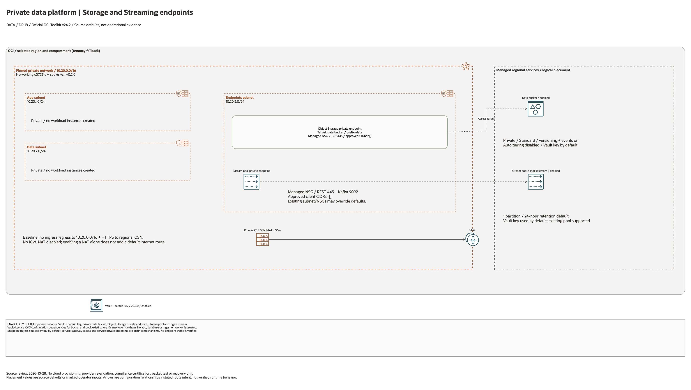

# Private Data Platform Architecture

This is the deployment architecture for `blueprints/data-platform/private-data-platform`. The editable draw.io overview and PNG preview support source-based architecture review.

## Deployment Purpose

Creates a private data landing zone with a private VCN, Vault/KMS, Object Storage bucket access through a private endpoint, and optional Streaming.

## Architecture At A Glance

| Item | Details |
| --- | --- |
| Boundary | `blueprints/data-platform/private-data-platform` owns this deployment folder and its Terraform + Ansible runners. |
| Purpose | Creates a private data landing zone with a private VCN, Vault/KMS, Object Storage bucket access through a private endpoint, and optional Streaming. |
| Terraform components | `oci_objectstorage_namespace.this`, `network`, `vault`, optional Object Storage bucket and endpoint, managed endpoint NSGs and rules, `streaming` |
| Primary architecture view | The Architecture diagram below shows source-declared components and configuration relationships; it does not verify runtime traffic. |


## Architecture



[Editable draw.io diagram](architecture.drawio)

## Diagram Sources And Scope

Generated with the installed `oci-architecture-diagrams` skill, Oracle Toolkit
v24.2 and provider-specific icons where available. Source review: October 28,
2026. No cloud provisioning, provider revalidation, database connection, recovery
drill or application login was performed. Historical validation metadata is unchanged.

Regenerate the overview, then rebuild its resource-detail pages:

```bash
python3 scripts/diagrams/data-dr-batch-01.py --render
python3 scripts/diagrams/multicloud-resource-coverage.py --blueprint data-platform/private-data-platform --render
python3 scripts/diagrams/multicloud-resource-coverage.py --blueprint data-platform/private-data-platform --check
```

## Resource Detail And Coverage

The main draw.io document includes the overview and the following resource-detail
pages. Each card names a source declaration, including conditional and collection
resources; counts are declarations, not deployed instances. Contracts are local
Terraform metadata. Supplied resources remain prerequisites, not created assets.

| Scope | Declarations | Preview | Editable source |
| --- | --- | --- | --- |
| OCI | 17 | [PNG](oci-resources.png) | [draw.io](oci-resources.drawio) |

[Resource inventory](resource-inventory.json) records source revisions, file hashes
and resource-to-diagram node mappings. The coverage check verifies all declarations,
provider-icon mappings, embedded SVG syntax and inclusion in the main draw.io pages.

## Terraform Components

| Kind | Name | Source Or Role |
| --- | --- | --- |
| Data source | `oci_objectstorage_namespace.this` | `Read during plan/apply` |
| Module | `network` | `../../../blueprints/networking/standalone-private-endpoint-only` |
| Module | `vault` | `../../../modules/security/vault` |
| Resource | `oci_objectstorage_bucket.data` | `Declared directly in main.tf` |
| Resource | `oci_objectstorage_private_endpoint.data` | `Declared directly in main.tf` |
| Resource | `oci_core_network_security_group.object_storage_endpoint` and HTTPS ingress | Managed Object Storage endpoint NSG and approved TCP/443 client rules. |
| Resource | `oci_core_network_security_group.streaming_endpoint` and client ingress | Managed Streaming endpoint NSG and approved TCP/443 and TCP/9092 client rules. |
| Module | `streaming` | `../../../blueprints/extensions/streaming` |

## Request And Deployment Flow

- Operator reviews tfvars, enable flags, and required external IDs.
- Terraform creates resources in the dependency order declared by main.tf.
- Outputs expose the hand-off contract for the next deployment, app team, or runbook.

## Traffic And Trust Boundaries

- Control plane traffic is local operator or CI authentication into the OCI provider and the Ansible Terraform runner.
- Data plane traffic is the packet or service path shown in the Architecture diagram; if this deployment only creates identity or governance resources, the data plane is intentionally permission and signal flow instead of network packets.
- Trust boundaries are the tenancy, compartment, VCN, subnet, DRG, private endpoint, identity domain, or managed service edges shown in the diagram.
- Secrets, OCIDs, customer CIDRs, endpoint URLs, and contact data belong in ignored local tfvars or a secure pipeline variable store, not in committed files.

## Detailed Architecture Notes

These notes expand the diagram with the design details that usually matter during review, plan, and hand-off.

- The private endpoint VCN is created before data services so Object Storage and Streaming can use private network paths.
- Vault/KMS supplies the default key path for the bucket and stream pool unless explicit KMS key IDs are supplied.
- Object Storage remains NoPublicAccess. The private endpoint is a VNIC with a private IP in the VCN; the managed NSG allows HTTPS only from explicitly approved client CIDRs. A service gateway is a separate route to regional Oracle Services Network endpoints, not a hop through the Object Storage private endpoint.
- The root pins the Networking module at revision `c07231c91d146265a46836757f3c399861a59fff`. Its subnet security list has no ingress, is explicitly attached, and permits HTTPS egress to the regional Oracle Services Network through the Service Gateway. Endpoint connectivity and traffic were not tested.
- A new Streaming pool uses the created `endpoints` subnet by default. Its managed NSG uses separate stateful TCP/443 and TCP/9092 rules from approved CIDRs. Existing stream pools and externally supplied NSGs require their own private/public and rule review.
- Enabling Object Storage private endpoint requires the managed bucket. Creating the bucket and endpoint does not prove client DNS, IAM, application access, or data transfer.

## Operational Boundaries

- Keep customer-specific OCIDs, CIDRs, DNS names, endpoints, contacts, and secrets in ignored local tfvars or approved pipeline variables.
- Run plan from this blueprint folder so relative module paths, provider files, and local Ansible runners resolve predictably.
- Treat apply and destroy as approval-gated operations; use the guarded Ansible playbooks or a reviewed Terraform workflow.
- Re-check route exposure, IAM scope, compartment boundaries, tags, and output hand-offs whenever inputs change.
- The historical service defaults are enabled. Explicitly disable Vault, bucket, Object Storage endpoint, and Streaming for a network-only lifecycle test; enabling them can incur charges.

## Review Checklist

- Confirm the diagram matches `main.tf`: `oci_objectstorage_namespace.this`, `network`, `vault`, bucket, Object Storage private endpoint, managed endpoint NSGs and ingress rules, and `streaming`.
- Confirm the described traffic path is the path you want in OCI before apply.
- Confirm public exposure, private endpoint access, DNS behavior, DRG routing, and inspection points are intentional where present.
- Confirm IAM scopes, compartment boundaries, tags, and operational outputs match the deployment README.
- Confirm `ansible/plan.yml`, `ansible/apply.yml`, and `ansible/destroy.yml` still point at the shared Terraform runner.
