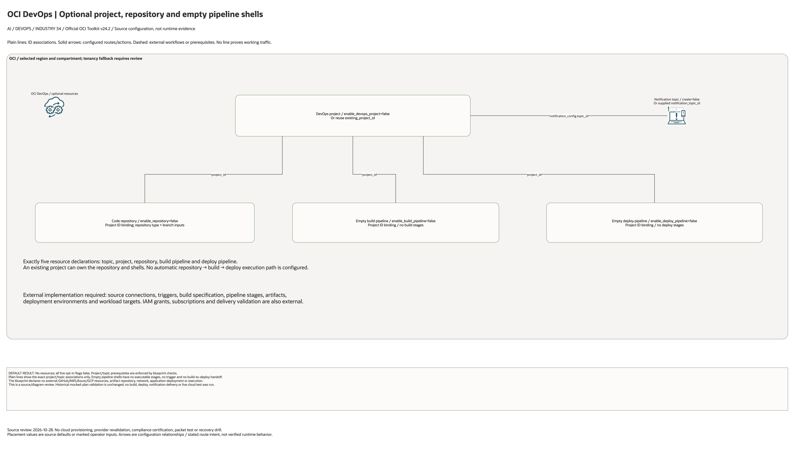

# OCI DevOps Pipeline Architecture

This is the deployment architecture for `blueprints/devops/oci-devops-pipeline`. It keeps the design reviewable in GitHub, terminals, pull requests, runbooks, and customer-safe notes without a diagramming tool.

## Deployment Purpose

Optionally creates an OCI DevOps project with a notification topic, code
repository, and empty build and deploy pipeline shells.

## Architecture At A Glance

| Item | Details |
|---|---|
| Boundary | `blueprints/devops/oci-devops-pipeline` owns this deployment folder and its Terraform + Ansible runners. |
| Purpose | Creates optional OCI DevOps control-plane shells. Runtime stages and delivery are configured separately. |
| Terraform components | `oci_ons_notification_topic.this`, `oci_devops_project.this`, `oci_devops_repository.this`, `oci_devops_build_pipeline.this`, `oci_devops_deploy_pipeline.this` |
| Primary architecture view | The Architecture diagram below shows the OCI components, dependency order, and traffic or control flow for this exact deployment. |

## Architecture

[Edit the multi-page draw.io diagram](architecture.drawio). Resource-detail pages
enumerate all source declarations, including disabled conditions and transitive
pinned modules. The existing-resource page lists identifier inputs; it does not
create their dependencies. See [source coverage](resource-inventory.json).

Plain connectors show declared ID associations. Solid arrows show configured
routes or action targets. Dashed lines explicitly mark external application
steps or prerequisites. No connector proves working service traffic.

## Terraform Components

| Kind | Name | Source Or Role |
|---|---|---|
| Resource | `oci_ons_notification_topic.this` | Declared directly in `main.tf` |
| Resource | `oci_devops_project.this` | Declared directly in `main.tf` |
| Resource | `oci_devops_repository.this` | Declared directly in `main.tf` |
| Resource | `oci_devops_build_pipeline.this` | Declared directly in `main.tf` |
| Resource | `oci_devops_deploy_pipeline.this` | Declared directly in `main.tf` |

## Request And Deployment Flow

- Operator supplies the existing network, compartment, service, or backend IDs required by the deployment.
- Terraform creates the optional service resource graph declared in `main.tf`.
- Outputs expose service IDs, endpoint names, or attachment IDs for applications and runbooks.

## Traffic And Trust Boundaries

- Control plane traffic is local operator or CI authentication into the OCI provider and the Ansible Terraform runner.
- Data plane traffic is the packet or service path shown in the Architecture diagram; if this deployment only creates identity or governance resources, the data plane is permission and signal flow.
- Trust boundaries are the tenancy, compartment, VCN, subnet, private endpoint, identity domain, or managed service edges shown in the diagram.
- Secrets, OCIDs, customer CIDRs, endpoint URLs, and contact data belong in ignored local tfvars or a secure pipeline variable store, not in committed files.

## Detailed Architecture Notes

- Confirm notification topic ownership and arrange subscriptions separately.
- Confirm repository naming and branch strategy.
- Add project logging, build/deploy stages, triggers, artifacts, and target environments before runtime use.
- A project requires a new or existing topic; child resources require a new or existing project. Plan-time validation enforces both dependencies.

## Operational Boundaries

- Keep customer-specific OCIDs, CIDRs, DNS names, endpoints, contacts, and secrets in ignored local tfvars or approved pipeline variables.
- Run plan from this blueprint folder so relative module paths, provider files, and local Ansible runners resolve predictably.
- Treat apply and destroy as approval-gated operations; use the guarded Ansible playbooks or a reviewed Terraform workflow.
- Re-check route exposure, IAM scope, compartment boundaries, tags, and output hand-offs whenever inputs change.

## Review Checklist

- Confirm the diagram matches `main.tf`: `oci_ons_notification_topic.this`, `oci_devops_project.this`, `oci_devops_repository.this`, `oci_devops_build_pipeline.this`, `oci_devops_deploy_pipeline.this`.
- Confirm the described traffic or control path is the path you want in OCI before apply.
- Confirm public exposure, private endpoint access, DNS behavior, DRG routing, and inspection points are intentional where present.
- Confirm IAM scopes, compartment boundaries, tags, and operational outputs match the deployment README.
- Confirm `ansible/plan.yml`, `ansible/apply.yml`, and `ansible/destroy.yml` still point at the shared Terraform runner.

## October 28, 2026 Diagram Source Review

All five resource flags default false. Repository and pipeline shells bind to
a created or supplied existing project ID; the project references a created or
supplied topic ID. No pipeline stages, triggers, build specification, artifacts,
environments, IAM grants, subscriptions or build-to-deploy execution are
configured. No external cloud or GitHub resource is declared.

This change reviews documentation and rendered diagrams only. Historical
Terraform/provider validation metadata is unchanged. No cloud provisioning,
application execution or runtime connectivity test was performed.
