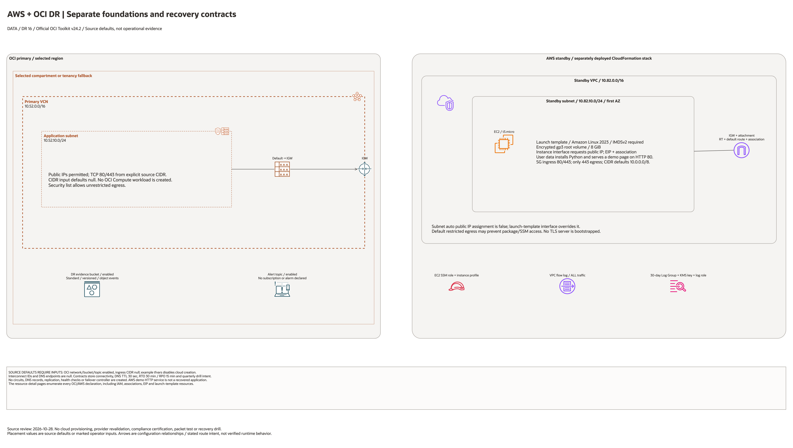

# AWS + OCI Cross-Cloud DR Architecture

This is the deployment architecture for `blueprints/disaster-recovery/aws-oci-cross-cloud-dr`. The editable draw.io overview and PNG preview support source-based architecture review.

## Deployment Purpose

Defines OCI primary resources and AWS standby references for a proposed
cross-cloud DR design. DNS and interconnect values are runbook contracts;
this Terraform folder does not provision or test those traffic paths.

## Architecture At A Glance

| Item | Details |
| --- | --- |
| Boundary | `blueprints/disaster-recovery/aws-oci-cross-cloud-dr` owns this deployment folder and its Terraform + Ansible runners. |
| Purpose | Optional OCI network and evidence resources plus metadata for an externally built AWS standby, connectivity path, and DNS workflow. |
| Terraform components | `oci_core_vcn.primary`, `oci_core_route_table.primary`, `oci_core_security_list.primary_app`, `oci_core_subnet.primary_app`, `oci_objectstorage_namespace.this`, `oci_objectstorage_bucket.dr_evidence`, `oci_ons_notification_topic.dr_alert`, `terraform_data.connectivity_contract`, `terraform_data.dns_failover_contract`, `terraform_data.runbook_contract` |
| Primary architecture view | The Architecture diagram below shows source-declared components and configuration relationships; it does not verify runtime traffic. |

## Architecture



[Editable draw.io diagram](architecture.drawio)

## Diagram Sources And Scope

Generated with the installed `oci-architecture-diagrams` skill, Oracle Toolkit
v24.2 and provider-specific icons where available. Source review: October 28,
2026. No cloud provisioning, provider revalidation, database connection, recovery
drill or application login was performed. Historical validation metadata is unchanged.

Regenerate the overview, then rebuild its resource-detail pages:

```bash
python3 scripts/diagrams/data-dr-batch-01.py --render
python3 scripts/diagrams/multicloud-resource-coverage.py --blueprint disaster-recovery/aws-oci-cross-cloud-dr --render
python3 scripts/diagrams/multicloud-resource-coverage.py --blueprint disaster-recovery/aws-oci-cross-cloud-dr --check
```

## Resource Detail And Coverage

The main draw.io document includes the overview and the following resource-detail
pages. Each card names a source declaration, including conditional and collection
resources; counts are declarations, not deployed instances. Contracts are local
Terraform metadata. Supplied resources remain prerequisites, not created assets.

| Scope | Declarations | Preview | Editable source |
| --- | --- | --- | --- |
| AWS | 18 | [PNG](aws-resources.png) | [draw.io](aws-resources.drawio) |
| Contracts | 4 | [PNG](contracts-resources.png) | [draw.io](contracts-resources.drawio) |
| OCI | 7 | [PNG](oci-resources.png) | [draw.io](oci-resources.drawio) |

[Resource inventory](resource-inventory.json) records source revisions, file hashes
and resource-to-diagram node mappings. The coverage check verifies all declarations,
provider-icon mappings, embedded SVG syntax and inclusion in the main draw.io pages.

## Terraform Components

| Kind | Name | Source Or Role |
| --- | --- | --- |
| Resource | `oci_core_vcn.primary`, `oci_core_route_table.primary`, `oci_core_security_list.primary_app`, `oci_core_subnet.primary_app` | Deploy-and-use OCI primary networking stack for DR workloads. |
| Resource | `terraform_data.oci_network_contract` | OCI network contract output for operations and downstream hand-off. |
| Data source | `oci_objectstorage_namespace.this` | Read during plan/apply for evidence bucket namespace. |
| Resource | `oci_objectstorage_bucket.dr_evidence` | Optional evidence bucket for drills and incidents. |
| Resource | `oci_ons_notification_topic.dr_alert` | Optional DR alert topic for operator notifications. |
| Resource | `terraform_data.connectivity_contract` | Connectivity mode contract including interconnect IDs when provided. |
| Resource | `terraform_data.dns_failover_contract` | DNS failover runbook contract for primary/standby cutover. |
| Resource | `terraform_data.runbook_contract` | Runbook metadata for drill cadence and recovery targets. |
| Resource | `oci_core_internet_gateway.primary` | Declared in this blueprint; creation depends on its count or for_each inputs. |

## Request And Deployment Flow

- Operator sets connectivity mode and endpoint assumptions in local tfvars.
- Terraform creates optional OCI primary networking, evidence, and alert resources.
- Terraform publishes connectivity, DNS failover, and runbook metadata as outputs; it does not configure DNS or circuits.
- Runbook owners consume outputs for drills, failover, and failback procedures.

## Traffic And Trust Boundaries

- Control plane traffic is local operator or CI authentication into the OCI provider and the Ansible Terraform runner.
- The application traffic path in the diagram is an intended design, not a path established by this Terraform configuration. Validate OCI primary, AWS standby, DNS cutover, and failover separately.
- Trust boundaries are the OCI tenancy, the separately deployed AWS standby, and any separately provisioned FastConnect + Direct Connect interconnect.
- Secrets, OCIDs, endpoint URLs, circuit IDs, and operational contacts belong in ignored local tfvars or a secure pipeline variable store, not in committed files.

## Detailed Architecture Notes

These notes expand the diagram with the design details that usually matter
during review, plan, and hand-off.

- The blueprint keeps OCI as primary through variable validation and output contracts.
- `connectivity_mode` records an intended partner interconnect or no-interconnect mode. Circuit IDs are references; this blueprint creates no circuits or cross-cloud routes.
- The DNS failover contract captures endpoint and TTL assumptions so operational teams can align cutover timing with runbook tests.
- The runbook contract stores drill cadence and RTO/RPO targets so governance checks can compare planned versus measured recovery behavior.
- A network-only OCI lifecycle proves only creation and cleanup of the selected VCN, gateway, route table, security list, and subnet. It cannot prove AWS standby health, cross-cloud connectivity, DNS cutover, data replication, or failover.
- The committed example explicitly disables OCI cloud resources and contract requirements. The historical variable defaults remain enabled for state compatibility. An enabled public subnet requires an explicit ingress CIDR; review its internet route and unrestricted egress before use.
- AWS resources are provisioned through the local AWS session artifacts (`aws/main.yaml` and `ansible/aws-*.yml`) and referenced in Terraform by standby endpoint values.
- `hello-world/index.html` is included as a lightweight drill/demo status page that mirrors the same primary/standby assumptions.
- The AWS standby instance bootstrap depends on outbound HTTPS for package and
  managed-service access. Ephemeral E2E tests should allow that egress while
  keeping inbound HTTP/HTTPS scoped to the operator CIDR.
- Validate the exported `AwsStandbyEndpoint` with a real HTTP `200` response
  before copying it into OCI-side DNS failover and runbook contracts.

## Operational Boundaries

- This extension can run extension-only with supplied endpoint and connectivity identifiers, or as part of a broader base-plus-extension operating model.
- Keep customer-specific OCIDs, CIDRs, circuit IDs, endpoint URLs, contacts, and secrets in ignored local tfvars or approved pipeline variables.
- Run plan from this blueprint folder so provider files and local Ansible runners resolve predictably.
- Treat apply and destroy as approval-gated operations; use guarded Ansible playbooks or a reviewed Terraform workflow.
- Re-check runbook objective targets and endpoint assumptions whenever inputs change.

## Review Checklist

- Confirm the diagram matches `main.tf`: `oci_core_vcn.primary`, `oci_core_route_table.primary`, `oci_core_security_list.primary_app`, `oci_core_subnet.primary_app`, `oci_objectstorage_namespace.this`, `oci_objectstorage_bucket.dr_evidence`, `oci_ons_notification_topic.dr_alert`, `terraform_data.connectivity_contract`, `terraform_data.dns_failover_contract`, `terraform_data.runbook_contract`.
- Confirm OCI is primary and AWS is standby for this environment.
- Confirm connectivity mode selection and interconnect IDs where applicable.
- Confirm DNS endpoint and TTL assumptions support the intended cutover model.
- Confirm IAM scopes, compartment boundaries, tags, and operational outputs match the deployment README.
- Confirm `ansible/plan.yml`, `ansible/apply.yml`, and `ansible/destroy.yml` still point at the shared Terraform runner.
