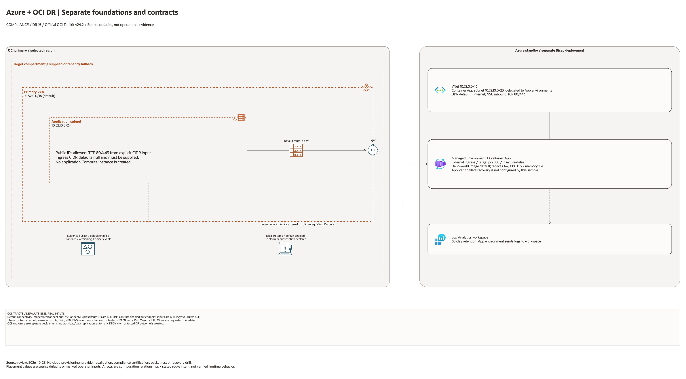

# Azure + OCI Cross-Cloud DR Architecture

This is the deployment architecture for `blueprints/disaster-recovery/azure-oci-cross-cloud-dr`. The PNG provides a GitHub-readable preview; the draw.io source preserves editable shapes and official OCI icons.

## Deployment Purpose

Defines OCI primary resources and Azure standby references for a proposed
cross-cloud DR design. DNS and interconnect values are runbook contracts;
this Terraform folder does not provision or test those traffic paths.

## Architecture At A Glance

| Item | Details |
| --- | --- |
| Boundary | `blueprints/disaster-recovery/azure-oci-cross-cloud-dr` owns this deployment folder and its Terraform + Ansible runners. |
| Purpose | Optional OCI network and evidence resources plus metadata for an externally built Azure standby, connectivity path, and DNS workflow. |
| Terraform components | `oci_core_vcn.primary`, `oci_core_route_table.primary`, `oci_core_security_list.primary_app`, `oci_core_subnet.primary_app`, `oci_objectstorage_namespace.this`, `oci_objectstorage_bucket.dr_evidence`, `oci_ons_notification_topic.dr_alert`, `terraform_data.connectivity_contract`, `terraform_data.dns_failover_contract`, `terraform_data.runbook_contract` |
| Primary architecture view | The diagram shows source-default resources, conditional controls and configuration dependencies; it is not runtime evidence. |

## Architecture



[Editable draw.io source](architecture.drawio). Keep this source aligned with
the PNG documentation preview after diagram changes.

Generated with the [oci-architecture-diagrams skill](https://github.com/leandro-michelino/oci-architecture-diagrams)
and Oracle OCI Architecture Diagram Toolkit v24.2. From the repository root,
run `python3 scripts/diagrams/compliance-dr-batch-01.py --render` after installing
the skill and official toolkit. The toolkit is not redistributed here.

The view distinguishes default service enablement, conditional controls, external
prerequisites, provider/compartment scope and configuration contracts. Defaults
are source values, not evidence of a deployed or certified architecture.

Diagram documentation reviewed on 2026-10-28 against Terraform, variables, locals,
providers, referenced modules and any accompanying Bicep template. No cloud
resources were created and no Terraform/provider validation date was updated.
Arrows do not establish packet flow, assessment coverage, replication or a
successful recovery drill.

## Resource Detail And Coverage

Reviewed against the updated diagram standard on October 28, 2026. The main
draw.io document contains the topology overview plus every resource-detail and
existing-resource-reference page below. Source declarations include disabled and
collection-based resources from root Terraform, recursively pinned modules and
companion cloud templates. Counts are declarations, not resolved instance counts.

OCI uses Oracle Toolkit icons; Azure and AWS use their respective draw.io icons.
Types without a specific mapped icon retain their exact name and type in a box.
No GCP declarations were found in this fixed 39-blueprint scope.

| Detail page | Declarations | PNG | Editable source |
| --- | --- | --- | --- |
| Azure resources | 7 | [PNG](azure-resources.png) | [draw.io](azure-resources.drawio) |
| Contracts resources | 4 | [PNG](contracts-resources.png) | [draw.io](contracts-resources.drawio) |
| OCI resources | 7 | [PNG](oci-resources.png) | [draw.io](oci-resources.drawio) |

[Existing resources and override inputs](existing-resources.png) | [Editable reference page](existing-resources.drawio)

[Source inventory](resource-inventory.json) records exact declarations, full
creation expressions, module call-site gates/enablement inputs, pinned revisions,
source hashes and diagram node mappings. Identifier-input references are listed
separately from managed resources. Null/empty inputs do not prove an external
resource exists; collection schemas may contain additional resource identifiers.

The overview explains default enablement. Resource cards enumerate all declaration
branches and do not imply deployment, ownership adoption, packet flow, security
enforcement or recovery success. No historical Terraform validation date changed.

```bash
python3 scripts/diagrams/multicloud-resource-coverage.py --blueprint disaster-recovery/azure-oci-cross-cloud-dr --render
python3 scripts/diagrams/multicloud-resource-coverage.py --blueprint disaster-recovery/azure-oci-cross-cloud-dr --check
```

If regenerating the overview first, rebuild these detail pages afterward.
See [the fixed first-39 review](../../../../docs/diagrams/FIRST-39-REVIEW.md) and [provider icon sources](../../../../scripts/diagrams/assets/README.md).

## Connection Lines

The dashed cross-cloud connection shows the interconnect intent recorded by existing circuit-ID contracts. It requires separate circuit provisioning and routing; it is not application replication or a working recovery path.

Lines show configuration or intended relationships, never verified runtime
traffic. Detail/reference maps enumerate resources and deliberately do not
invent connections between independent declarations.

## Terraform Components

| Kind | Name | Source Or Role |
| --- | --- | --- |
| Resource | `oci_core_vcn.primary`, `oci_core_route_table.primary`, `oci_core_security_list.primary_app`, `oci_core_subnet.primary_app` | Deploy-and-use OCI primary networking stack for DR workloads. |
| Resource | `terraform_data.oci_network_contract` | OCI network contract output for operations and downstream hand-off. |
| Data source | `oci_objectstorage_namespace.this` | Read during plan/apply for evidence bucket namespace. |
| Resource | `oci_objectstorage_bucket.dr_evidence` | Optional evidence bucket for drills and incidents. |
| Resource | `oci_ons_notification_topic.dr_alert` | Optional DR alert topic for operator notifications. |
| Resource | `terraform_data.connectivity_contract` | Connectivity mode contract including interconnect IDs when provided. |
| Resource | `terraform_data.dns_failover_contract` | DNS failover runbook contract for primary/standby cutover. |
| Resource | `terraform_data.runbook_contract` | Runbook metadata for drill cadence and recovery targets. |
| Resource | `oci_core_internet_gateway.primary` | Declared in this blueprint; creation depends on its count or for_each inputs. |

## Request And Deployment Flow

- Operator sets connectivity mode and endpoint assumptions in local tfvars.
- Terraform creates optional OCI primary networking, evidence, and alert resources.
- Terraform publishes connectivity, DNS failover, and runbook metadata as outputs; it does not configure DNS or circuits.
- Runbook owners consume outputs for drills, failover, and failback procedures.

## Traffic And Trust Boundaries

- Control plane traffic is local operator or CI authentication into the OCI provider and the Ansible Terraform runner.
- The application traffic path in the diagram is an intended design, not a path established by this Terraform configuration. Validate OCI primary, Azure standby, DNS cutover, and failover separately.
- Trust boundaries are the OCI tenancy, the separately deployed Azure standby, and any separately provisioned FastConnect + ExpressRoute interconnect.
- Secrets, OCIDs, endpoint URLs, circuit IDs, and operational contacts belong in ignored local tfvars or a secure pipeline variable store, not in committed files.

## Detailed Architecture Notes

These notes expand the diagram with the design details that usually matter
during review, plan, and hand-off.

- The blueprint keeps OCI as primary through variable validation and output contracts.
- `connectivity_mode` records an intended partner interconnect or no-interconnect mode. Circuit IDs are references; this blueprint creates no circuits or cross-cloud routes.
- The DNS failover contract captures endpoint and TTL assumptions so operational teams can align cutover timing with runbook tests.
- The runbook contract stores drill cadence and RTO/RPO targets so governance checks can compare planned versus measured recovery behavior.
- A network-only OCI lifecycle proves only creation and cleanup of the selected VCN, gateway, route table, security list, and subnet. It cannot prove Azure standby health, cross-cloud connectivity, DNS cutover, data replication, or failover.
- The committed example explicitly disables OCI cloud resources and contract requirements. The historical variable defaults remain enabled for state compatibility. An enabled public subnet requires an explicit ingress CIDR; review its internet route and unrestricted egress before use.
- Azure resources are provisioned through the local Azure session artifacts (`azure/main.bicep` and `ansible/azure-*.yml`) and referenced in Terraform by standby endpoint values.
- `hello-world/index.html` is included as a lightweight drill/demo status page that mirrors the same primary/standby assumptions.
- Azure Container Apps capacity is regional. Treat
  `ManagedEnvironmentCapacityHeavyUsageError` as a regional capacity issue, not
  as a blueprint contract failure; delete the failed test resource group and
  retry in an approved alternate region.

## Operational Boundaries

- This extension can run extension-only with supplied endpoint and connectivity identifiers, or as part of a broader base-plus-extension operating model.
- Keep customer-specific OCIDs, CIDRs, circuit IDs, endpoint URLs, contacts, and secrets in ignored local tfvars or approved pipeline variables.
- Run plan from this blueprint folder so provider files and local Ansible runners resolve predictably.
- Treat apply and destroy as approval-gated operations; use guarded Ansible playbooks or a reviewed Terraform workflow.
- Re-check runbook objective targets and endpoint assumptions whenever inputs change.

## Review Checklist

- Confirm the diagram matches `main.tf`: `oci_core_vcn.primary`, `oci_core_route_table.primary`, `oci_core_security_list.primary_app`, `oci_core_subnet.primary_app`, `oci_objectstorage_namespace.this`, `oci_objectstorage_bucket.dr_evidence`, `oci_ons_notification_topic.dr_alert`, `terraform_data.connectivity_contract`, `terraform_data.dns_failover_contract`, `terraform_data.runbook_contract`.
- Confirm OCI is primary and Azure is standby for this environment.
- Confirm connectivity mode selection and interconnect IDs where applicable.
- Confirm DNS endpoint and TTL assumptions support the intended cutover model.
- Confirm IAM scopes, compartment boundaries, tags, and operational outputs match the deployment README.
- Confirm `ansible/plan.yml`, `ansible/apply.yml`, and `ansible/destroy.yml` still point at the shared Terraform runner.

Provider icons: Azure SVGs and AWS native stencils from draw.io identify mapped
external-cloud resources. Unmapped associations and local contracts retain
explicit named boxes. See [icon sources](../../../../scripts/diagrams/assets/README.md).
