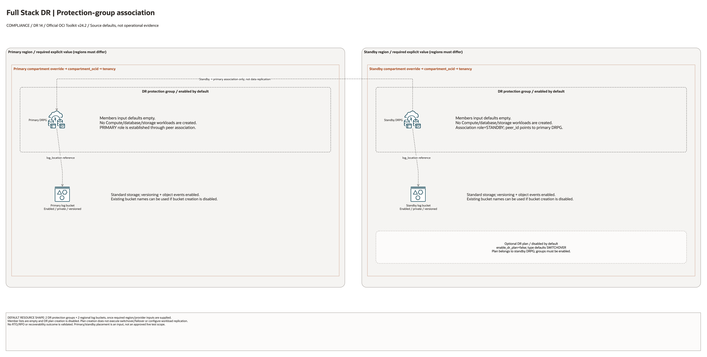

# Full Stack Disaster Recovery Architecture

This is the deployment architecture for `blueprints/disaster-recovery/fsdr`. The PNG provides a GitHub-readable preview; the draw.io source preserves editable shapes and official OCI icons.

## Deployment Purpose

Creates OCI Full Stack Disaster Recovery protection groups, log buckets, and an optional DR plan across primary and standby regions.

## Architecture At A Glance

| Item | Details |
| --- | --- |
| Boundary | `blueprints/disaster-recovery/fsdr` owns this deployment folder and its Terraform + Ansible runners. |
| Purpose | Creates OCI Full Stack Disaster Recovery protection groups, log buckets, and an optional DR plan across primary and standby regions. |
| Terraform components | `oci_objectstorage_namespace.primary`, `oci_objectstorage_namespace.standby`, `oci_objectstorage_bucket.primary_dr_logs`, `oci_objectstorage_bucket.standby_dr_logs`, `oci_disaster_recovery_dr_protection_group.primary`, `oci_disaster_recovery_dr_protection_group.standby`, `oci_disaster_recovery_dr_plan.standby` |
| Primary architecture view | The diagram shows source-default resources, conditional controls and configuration dependencies; it is not runtime evidence. |


## Architecture



[Editable draw.io source](architecture.drawio). Keep this source aligned with
the PNG documentation preview after diagram changes.

Generated with the [oci-architecture-diagrams skill](https://github.com/leandro-michelino/oci-architecture-diagrams)
and Oracle OCI Architecture Diagram Toolkit v24.2. From the repository root,
run `python3 scripts/diagrams/compliance-dr-batch-01.py --render` after installing
the skill and official toolkit. The toolkit is not redistributed here.

The view distinguishes default service enablement, conditional controls, external
prerequisites, provider/compartment scope and configuration contracts. Defaults
are source values, not evidence of a deployed or certified architecture.

Diagram documentation reviewed on 2026-10-28 against Terraform, variables, locals,
providers, referenced modules and any accompanying Bicep template. No cloud
resources were created and no Terraform/provider validation date was updated.
Arrows do not establish packet flow, assessment coverage, replication or a
successful recovery drill.

## Resource Detail And Coverage

Reviewed against the updated diagram standard on October 28, 2026. The main
draw.io document contains the topology overview plus every resource-detail and
existing-resource-reference page below. Source declarations include disabled and
collection-based resources from root Terraform, recursively pinned modules and
companion cloud templates. Counts are declarations, not resolved instance counts.

OCI uses Oracle Toolkit icons; Azure and AWS use their respective draw.io icons.
Types without a specific mapped icon retain their exact name and type in a box.
No GCP declarations were found in this fixed 39-blueprint scope.

| Detail page | Declarations | PNG | Editable source |
| --- | --- | --- | --- |
| OCI resources | 5 | [PNG](oci-resources.png) | [draw.io](oci-resources.drawio) |

[Existing resources and override inputs](existing-resources.png) | [Editable reference page](existing-resources.drawio)

[Source inventory](resource-inventory.json) records exact declarations, full
creation expressions, module call-site gates/enablement inputs, pinned revisions,
source hashes and diagram node mappings. Identifier-input references are listed
separately from managed resources. Null/empty inputs do not prove an external
resource exists; collection schemas may contain additional resource identifiers.

The overview explains default enablement. Resource cards enumerate all declaration
branches and do not imply deployment, ownership adoption, packet flow, security
enforcement or recovery success. No historical Terraform validation date changed.

```bash
python3 scripts/diagrams/multicloud-resource-coverage.py --blueprint disaster-recovery/fsdr --render
python3 scripts/diagrams/multicloud-resource-coverage.py --blueprint disaster-recovery/fsdr --check
```

If regenerating the overview first, rebuild these detail pages afterward.
See [the fixed first-39 review](../../../../docs/diagrams/FIRST-39-REVIEW.md) and [provider icon sources](../../../../scripts/diagrams/assets/README.md).

## Terraform Components

| Kind | Name | Source Or Role |
| --- | --- | --- |
| Data source | `oci_objectstorage_namespace.primary` | `Read during plan/apply` |
| Data source | `oci_objectstorage_namespace.standby` | `Read during plan/apply` |
| Resource | `oci_objectstorage_bucket.primary_dr_logs` | `Declared directly in main.tf` |
| Resource | `oci_objectstorage_bucket.standby_dr_logs` | `Declared directly in main.tf` |
| Resource | `oci_disaster_recovery_dr_protection_group.primary` | `Declared directly in main.tf` |
| Resource | `oci_disaster_recovery_dr_protection_group.standby` | `Declared directly in main.tf` |
| Resource | `oci_disaster_recovery_dr_plan.standby` | Optional plan owned by the associated standby DRPG. |

## Request And Deployment Flow

- Operator reviews tfvars, enable flags, and required external IDs.
- Terraform creates resources in the dependency order declared by main.tf.
- Outputs expose the hand-off contract for the next deployment, app team, or runbook.

## Traffic And Trust Boundaries

- Control plane traffic is local operator or CI authentication into the OCI provider and the Ansible Terraform runner.
- Data plane traffic is the packet or service path shown in the Architecture diagram; if this deployment only creates identity or governance resources, the data plane is intentionally permission and signal flow instead of network packets.
- Trust boundaries are the tenancy, compartment, VCN, subnet, DRG, private endpoint, identity domain, or managed service edges shown in the diagram.
- Secrets, OCIDs, customer CIDRs, endpoint URLs, and contact data belong in ignored local tfvars or a secure pipeline variable store, not in committed files.

## Detailed Architecture Notes

These notes expand the diagram with the design details that usually matter during review, plan, and hand-off.

- The primary and standby OCI providers target different regions. Bucket and DRPG creation is opt-in; existing log buckets may be named instead.
- The standby DRPG associates with the newly created primary DRPG and is assigned `STANDBY`; OCI assigns the peer its corresponding `PRIMARY` role.
- Protection group members should map to real application resources that can be moved, recovered, or orchestrated by FSDR.
- The optional DR plan is created only on the associated standby DRPG and should be reviewed against the intended failover or switchover type.
- Runtime application replication is outside this folder; this deployment prepares the FSDR control plane and log locations.
- FSDR resource-principal access is an IAM prerequisite. The DR protection groups need dynamic-group and policy coverage for the resource families they orchestrate.
- Switchover and failover execution is an operational action, not a normal Terraform apply action. Plans are generated and executed from the DR protection group that is currently standby.
- OCI role reversal can change which DRPG is standby; review the state file before any subsequent apply. Disassociate the pair during destroy using the provider's `disassociate_trigger` workflow, then verify the state file and OCI API.
- Movable compute recovery depends on the compute instance, its destination subnet mapping, and a replicated volume group that covers all attached boot and block volumes.
- Windows AD domain-joined member servers need workload runbook coverage for AD DNS, domain-controller reachability, Kerberos time sync, hostname conflicts, secure-channel validation, SPNs, service accounts, certificates, monitoring, backups, and application bindings.
- FSDR drills can create a duplicate Windows member-server identity while production stays online. Isolate the drill network, use lab AD, or add custom plan steps before the drill copy can contact production AD.
- Windows domain controllers need an AD-specific DR pattern and should not be treated as ordinary movable compute members.
- Object Storage recovery depends on bucket replication outside this Terraform folder; add bucket members only after replication is active.
- The optional `examples/real-dr-lab` harness creates disposable compute, network, bucket, and replicated volume-group resources for customer drills without changing this blueprint boundary.

## Operational Boundaries

- Keep customer-specific OCIDs, CIDRs, DNS names, endpoints, contacts, and secrets in ignored local tfvars or approved pipeline variables.
- Run plan from this blueprint folder so relative module paths, provider files, and local Ansible runners resolve predictably.
- Treat apply and destroy as approval-gated operations; use the guarded Ansible playbooks or a reviewed Terraform workflow.
- Re-check route exposure, IAM scope, compartment boundaries, tags, and output hand-offs whenever inputs change.
- For Windows AD domain-joined member servers, keep the runbook in `runbooks/windows-ad-domain-joined-compute.md` aligned with any customer-specific DNS, domain-controller, monitoring, backup, or application steps.

## Review Checklist

- Confirm the diagram matches `main.tf`: `oci_objectstorage_namespace.primary`, `oci_objectstorage_namespace.standby`, `oci_objectstorage_bucket.primary_dr_logs`, `oci_objectstorage_bucket.standby_dr_logs`, `oci_disaster_recovery_dr_protection_group.primary`, `oci_disaster_recovery_dr_protection_group.standby`, `oci_disaster_recovery_dr_plan.standby`.
- Confirm the described traffic path is the path you want in OCI before apply.
- Confirm public exposure, private endpoint access, DNS behavior, DRG routing, and inspection points are intentional where present.
- Confirm IAM scopes, compartment boundaries, tags, and operational outputs match the deployment README.
- Confirm `ansible/plan.yml`, `ansible/apply.yml`, and `ansible/destroy.yml` still point at the shared Terraform runner.
