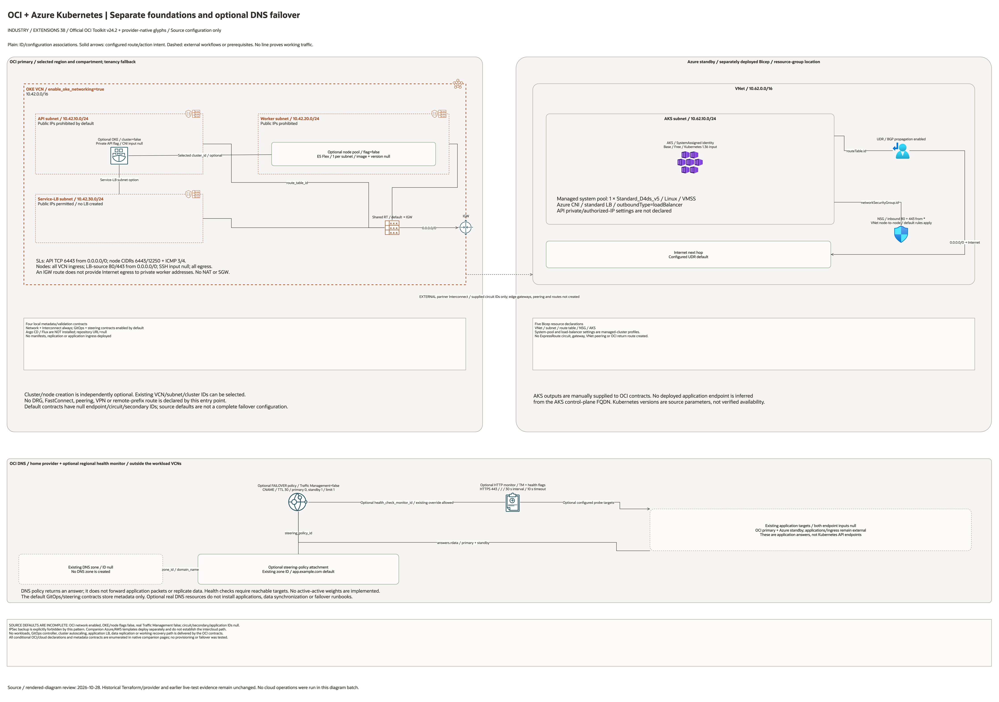

# AKS + OKE Active Passive Architecture

This page is the deployment architecture for
`blueprints/extensions/aks-oke-active-passive`. It is intentionally Architecture-first
so it is easy to review in GitHub, terminals, pull requests, runbooks, and
customer-safe notes without a diagramming tool.

The default operating mode described here is OCI-primary active/passive.

## Deployment Purpose

Implements an OCI-primary AKS + OKE active/passive Kubernetes pattern over
partner ExpressRoute + FastConnect interconnect, with GitOps orchestration and
DNS failover contracts, while explicitly excluding IPSec backup.

## Kubernetes Version Guidance

Keep OKE and AKS on the latest common Kubernetes minor version available in the
selected regions. The desired baseline remains `1.36` where both providers
support it, but region support is authoritative. If a selected region lags the
desired baseline, pin both clusters to the newest common supported minor version
for that run.

## Architecture At A Glance

| Item | Details |
| --- | --- |
| Boundary | `blueprints/extensions/aks-oke-active-passive` owns this deployment folder and its Terraform + Ansible runners. |
| Purpose | OCI-primary active/passive AKS + OKE pattern with interconnect-only connectivity, GitOps contracts, and optional OCI Traffic Management failover. |
| Terraform components | `oci_core_vcn.oke`, `oci_core_route_table.oke`, `oci_core_security_list.oke_*`, `oci_core_subnet.oke_*`, `oci_containerengine_cluster.oci_primary`, `oci_containerengine_node_pool.oci_primary`, optional `oci_health_checks_http_monitor.traffic_failover`, optional `oci_dns_steering_policy.traffic_failover`, optional `oci_dns_steering_policy_attachment.traffic_failover`, `terraform_data.interconnect_contract`, `terraform_data.gitops_contract`, `terraform_data.traffic_steering_contract` |
| Primary architecture view | The Architecture diagram below shows the OCI components, dependency order, and traffic flow for this exact deployment. |

## Architecture

[Edit the multi-page draw.io diagram](architecture.drawio). Companion pages
enumerate every declared resource, creation condition and existing identifier
input; see the [source inventory](resource-inventory.json). Provider-native
icons identify mapped services; exact types without a matching glyph retain
labelled boxes. No resources are inferred from those inputs.

Plain lines show ID/configuration associations; solid arrows show declared
route/action intent. Dashed lines mark external workflows or prerequisites.
No connector proves successful deployment or runtime traffic.

## Terraform Components

| Kind | Name | Source Or Role |
| --- | --- | --- |
| Resource | `oci_core_vcn.oke`, `oci_core_route_table.oke`, `oci_core_security_list.oke_*`, `oci_core_subnet.oke_*` | Deploy-and-use OCI networking stack for OKE control plane, nodes, and service load balancers. |
| Resource | `oci_containerengine_cluster.oci_primary` | Optional OCI primary OKE cluster when enabled. |
| Resource | `oci_containerengine_node_pool.oci_primary` | Optional OCI primary OKE node pool when enabled. |
| Resource | `terraform_data.oke_network_contract` | Validation contract for either managed or supplied OKE networking identifiers. |
| Resource | `terraform_data.interconnect_contract` | Interconnect-only contract for ExpressRoute + FastConnect and no IPSec fallback. |
| Resource | `terraform_data.gitops_contract` | GitOps operating contract for multi-cluster rollout. |
| Resource | `terraform_data.traffic_steering_contract` | DNS failover contract for OCI primary and AKS standby endpoints. |
| Optional resource | `oci_health_checks_http_monitor.traffic_failover` | HTTP(S) health monitor used by OCI Traffic Management failover. |
| Optional resource | `oci_dns_steering_policy.traffic_failover` | OCI DNS failover policy with OCI primary and Azure standby answers. |
| Optional resource | `oci_dns_steering_policy_attachment.traffic_failover` | Attachment between the steering policy, DNS zone, and application FQDN. |
| Resource | `oci_core_internet_gateway.oke` | Declared in this blueprint; creation depends on its count or for_each inputs. |
| Resource | `oci_core_security_list.oke_endpoint` | Declared in this blueprint; creation depends on its count or for_each inputs. |
| Resource | `oci_core_security_list.oke_node` | Declared in this blueprint; creation depends on its count or for_each inputs. |
| Resource | `oci_core_subnet.oke_endpoint` | Declared in this blueprint; creation depends on its count or for_each inputs. |
| Resource | `oci_core_subnet.oke_service_lb` | Declared in this blueprint; creation depends on its count or for_each inputs. |
| Resource | `oci_core_subnet.oke_nodes` | Declared in this blueprint; creation depends on its count or for_each inputs. |

## Request And Deployment Flow

- Operator supplies existing AKS IDs, interconnect IDs, and endpoint targets in local tfvars.
- Terraform can create OCI OKE networking (VCN, route table, security lists, subnets) or validate supplied networking IDs.
- Terraform optionally creates OKE resources; network/interconnect contracts are unconditional, while GitOps/steering contracts have independent flags.
- Outputs expose primary/standby cluster metadata, contract IDs, and OCI Traffic Management resource IDs for operations runbooks.

## Traffic And Trust Boundaries

- Control plane traffic is local operator or CI authentication into the OCI provider and the Ansible Terraform runner.
- Optional DNS configuration returns an OCI primary or Azure standby answer; DNS does not forward application packets. Working client/backend paths remain external prerequisites.
- Trust boundaries are the OCI tenancy boundary, the Azure boundary represented by externally supplied AKS and endpoint IDs, and the interconnect boundary represented by FastConnect + ExpressRoute partner links.
- Secrets, OCIDs, ExpressRoute IDs, endpoints, and contact data belong in ignored local tfvars or a secure pipeline variable store, not in committed files.

## Detailed Architecture Notes

These notes expand the diagram with the design details that usually matter
at review, plan, and hand-off time.

- The blueprint creates OCI routing and security primitives for deploy-and-use cluster networking and still allows external OCI network IDs when needed.
- OKE networking declares DNS labels, an IGW default route, worker-to-API rules on 6443/12250 and HTTP/HTTPS rules on the node/LB security list. Private workers have no NAT or Service Gateway declared; application LBs are not created.
- Azure-side deployment is provisioned by the same blueprint folder through `azure/main.bicep` and `ansible/azure-*.yml` sessions.
- OKE resource creation is optional so customers can run extension-only mode with existing cluster IDs or base-plus-extension mode with new OKE resources.
- `interconnect_mode` and `enable_ipsec_backup` validations keep the deployment constrained to partner interconnect without VPN fallback.
- The DNS failover contract keeps OCI as the active target by default and uses Azure only as standby; active/active remains possible with an intentional weighted DNS/GSLB design.
- When `enable_oci_traffic_management=true`, the blueprint can create the health monitor, failover steering policy, and policy attachment for a supplied OCI DNS zone and application FQDN.
- OCI Traffic Management steering policies and attachments are created through the tenancy home-region provider alias; set `home_region` before enabling the feature.
- Requests to direct application IPs or load-balancer hostnames can test reachability; they do not exercise DNS failover. A delegated application FQDN and separate acceptance test are required for that path.
- TTL 30 seconds, monitor interval 30 seconds and timeout 10 seconds are source parameters. They do not establish a measured recovery time or failback guarantee.
- The failover priority rule must reference `answer.pool` values (`primary` and `standby`), which matches the OCI Traffic Management FAILOVER template requirements.
- Optional DNS steering selects an application answer. Circuit provisioning, cross-cloud network routing and working client/backend paths remain external; Kubernetes load balancers do not implement cross-cloud balancing here.
- Kubernetes versions are source parameters; companion templates default to 1.36 while OCI version is supplied. Regional availability and cross-provider compatibility require separate verification.
- GitOps outputs record cluster/repository metadata. Controller installation, reconciliation, workload rollout and application consistency remain external.

## Operational Boundaries

- This extension can run extension-only with supplied brownfield OCI, interconnect, and AKS IDs, or base-plus-extension using outputs from core and networking blueprints.
- Keep customer-specific OCIDs, CIDRs, circuit IDs, endpoint URLs, contacts, and secrets in ignored local tfvars or approved pipeline variables.
- Run plan from this blueprint folder so provider files and local Ansible runners resolve predictably.
- Treat apply and destroy as approval-gated operations; use guarded Ansible playbooks or a reviewed Terraform workflow.
- Re-check DNS failover targets, health checks, GitOps branch controls, and interconnect ownership whenever inputs change.

## Review Checklist

- Confirm the diagram matches `main.tf`: `oci_core_vcn.oke`, `oci_core_route_table.oke`, `oci_core_security_list.oke_*`, `oci_core_subnet.oke_*`, `oci_containerengine_cluster.oci_primary`, `oci_containerengine_node_pool.oci_primary`, optional OCI Traffic Management resources, `terraform_data.interconnect_contract`, `terraform_data.gitops_contract`, `terraform_data.traffic_steering_contract`.
- Confirm OCI remains primary and IPSec backup remains disabled.
- Confirm interconnect IDs match the intended ExpressRoute + FastConnect partner path.
- Confirm the described traffic path is the path you want before apply.
- Confirm IAM scopes, compartment boundaries, tags, and operational outputs match the deployment README.
- Confirm `ansible/plan.yml`, `ansible/apply.yml`, and `ansible/destroy.yml` still point at the shared Terraform runner.

## October 28, 2026 Diagram Source Review

The overview includes all five Azure Bicep declarations, OCI resources and
four local metadata/validation contracts. The Bicep AKS system pool is a managed
cluster profile: one Linux Standard_D4ds_v5 worker, Azure CNI and standard-LB
outbound mode. No API private/authorized-IP configuration is declared. Network
and cluster deployment do not create application ingress or application targets.

The OCI network flag defaults true; cluster/node flags and actual Traffic
Management default false. OCI private worker addresses have only an IGW default
route, with no NAT or Service Gateway; this is not proof of worker Internet
egress. FastConnect/ExpressRoute IDs are metadata inputs; no edge gateway,
circuit, peering or remote-prefix route is created. The cross-cloud line is an
external prerequisite. GitOps contracts do not install Argo CD or Flux. DNS links
represent answer/zone/monitor associations, not packet forwarding or data
replication. Source Kubernetes parameters do not prove regional support.

The hello-world helper serves local static HTML; it does not deploy a Kubernetes
application.

This batch reviews source code, native pages and rendered diagrams only.
Historical Terraform/provider and earlier runtime evidence is unchanged. No
cloud provisioning, user session, Kubernetes execution, mesh traffic or failover
test was performed.
