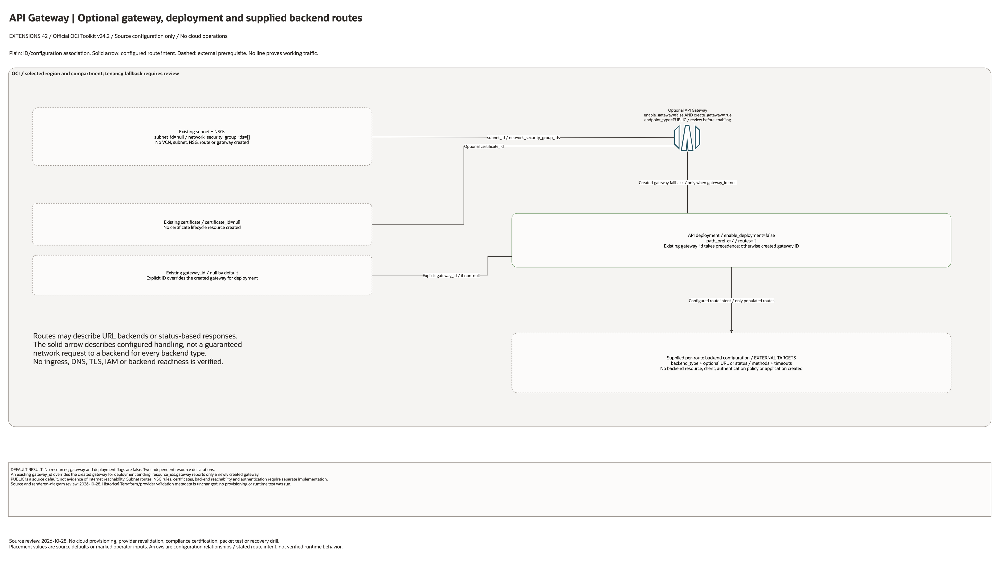

# API Gateway Extension Architecture

This is the deployment architecture for `blueprints/extensions/apigw`. It keeps the design reviewable in GitHub, terminals, pull requests, runbooks, and customer-safe notes without a diagramming tool.

## Deployment Purpose

Adds OCI API Gateway and deployment routes so application APIs can be exposed through a managed gateway endpoint.

## Architecture At A Glance

| Item | Details |
| --- | --- |
| Boundary | `blueprints/extensions/apigw` owns this deployment folder and its Terraform + Ansible runners. |
| Purpose | Adds OCI API Gateway and deployment routes so application APIs can be exposed through a managed gateway endpoint. |
| Terraform components | `oci_apigateway_gateway.this`, `oci_apigateway_deployment.this` |
| Primary architecture view | The diagram shows source-defined components and configuration associations; it is not runtime evidence. |

## Architecture

[Edit the overview and native detail pages](architecture.drawio) · [Source resource inventory](resource-inventory.json)

The main draw.io document includes declaration-detail and existing-resource input pages.
These enumerate source declarations and references, not deployed instance counts.

## Terraform Components

| Kind | Name | Source Or Role |
| --- | --- | --- |
| Resource | `oci_apigateway_gateway.this` | `Declared directly in main.tf` |
| Resource | `oci_apigateway_deployment.this` | `Declared directly in main.tf` |

## Request And Deployment Flow

- Operator supplies the existing network, compartment, service, or backend IDs required by the extension.
- Terraform creates the optional service resource graph declared in main.tf.
- Outputs expose only the IDs, names or endpoints declared in `outputs.tf`; they do not establish downstream application connectivity.

## Traffic And Trust Boundaries

- Control plane traffic is local operator or CI authentication into the OCI provider and the Ansible Terraform runner.
- Plain lines show declared ID/configuration associations. Only the API Gateway route arrow represents configured route intent; no line proves working traffic.
- Resources use the selected compartment, with a tenancy fallback that requires review. Existing networks and service identities are operator inputs only where declared.
- Secrets, OCIDs, customer CIDRs, endpoint URLs, and contact data belong in ignored local tfvars or a secure pipeline variable store, not in committed files.

## Detailed Architecture Notes

- No resources are created by default: `enable_gateway=false` and `enable_deployment=false`; gateway creation additionally requires `create_gateway=true`.
- An explicit `gateway_id` takes precedence over a newly created gateway when selecting the deployment target. The gateway creation and deployment flags are independent.
- `endpoint_type=PUBLIC` is the source default. Existing subnet, NSGs and certificate IDs are supplied; no associated network, certificate, authentication or backend resource is created.
- The solid route arrow describes configured handling only when routes are supplied. A URL backend and a status-based response do not imply the same network traffic; default `routes=[]`.

- Diagram/source review: 2026-10-28. Historical provider and infrastructure validation evidence remains unchanged. No cloud operation or runtime test was run for this conversion.

## Operational Boundaries

- This extension can run extension-only with supplied brownfield OCI IDs, or as
  base-plus-extension using outputs from core, networking, ownership, or
  operations blueprints.
- Keep customer-specific OCIDs, CIDRs, DNS names, endpoints, contacts, and secrets in ignored local tfvars or approved pipeline variables.
- Run plan from this blueprint folder so relative module paths, provider files, and local Ansible runners resolve predictably.
- Treat apply and destroy as approval-gated operations; use the guarded Ansible playbooks or a reviewed Terraform workflow.
- Re-check route exposure, IAM scope, compartment boundaries, tags, and output hand-offs whenever inputs change.

## Review Checklist

- Confirm the diagram matches `main.tf`: `oci_apigateway_gateway.this`, `oci_apigateway_deployment.this`.
- Confirm the described traffic path is the path you want in OCI before apply.
- Confirm public exposure, private endpoint access, DNS behavior, DRG routing, and inspection points are intentional where present.
- Confirm IAM scopes, compartment boundaries, tags, and operational outputs match the deployment README.
- Confirm `ansible/plan.yml`, `ansible/apply.yml`, and `ansible/destroy.yml` still point at the shared Terraform runner.
