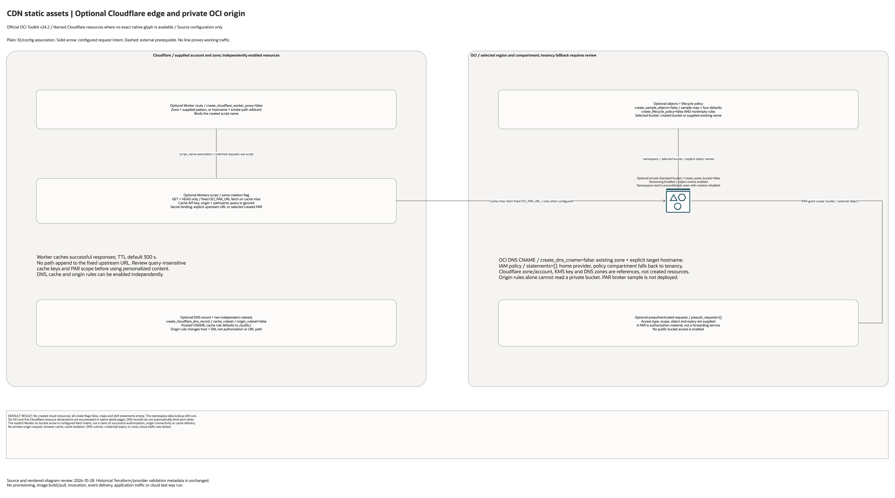

# CDN Static Asset Distribution Architecture

## Deployment Purpose

This blueprint gives application teams a deployable OCI origin for sensitive
document downloads and public-safe static assets. It keeps Object Storage
private, uses PARs for authenticated private downloads, and produces a hand-off
contract for Cloudflare at OCI or an existing Cloudflare account.

## Architecture At A Glance

| Layer | Components |
| --- | --- |
| Private origin | Object Storage bucket with `NoPublicAccess`, versioning, optional KMS, and object events. |
| Private download | Backend-generated ObjectRead PARs for per-user documents. |
| Static edge | Cloudflare at OCI or external Cloudflare for approved public-safe prefixes, with optional Terraform-managed Cloudflare DNS, cache ruleset, Worker, and route. |
| Operations | Optional lifecycle rules, optional OCI DNS CNAME, optional Cloudflare edge resources, and real lifecycle test runner. |
| Handoff | Bucket name, origin host/path, PAR broker sample, and CDN/DNS contract outputs. |

## Architecture

[Editable draw.io overview and native detail pages](architecture.drawio) · [Resource inventory](resource-inventory.json)

Native pages cover every conditional declaration and existing-reference input. Counts describe declarations, not deployed resource counts.

## Terraform Components

| File | Purpose |
| --- | --- |
| `main.tf` | Creates the private bucket, sample objects, PARs, lifecycle policy, optional DNS CNAME, and optional IAM policy. |
| `variables.tf` | Defines bucket ownership, sample objects, PARs, lifecycle rules, CDN mode, OCI DNS, Cloudflare DNS/cache/Worker options, tags, and policy inputs. |
| `outputs.tf` | Exposes bucket, origin URL, sample URLs, sensitive PAR URLs, Cloudflare resource IDs, and CDN hand-off details. |
| `samples/` | Provides real lifecycle, Cloudflare hand-off, PAR-only, and Python backend broker examples. |
| `scripts/test-cdn-static-assets-lifecycle.sh` | Runs a real create, verify, PAR curl, destroy, and cleanup test from ignored local tfvars. |

Declared resource addresses:

| Kind | Name | Source Or Role |
| --- | --- | --- |
| Resource | `oci_objectstorage_bucket.asset` | Declared in this blueprint; creation depends on its count or for_each inputs. |
| Resource | `oci_objectstorage_object.sample` | Declared in this blueprint; creation depends on its count or for_each inputs. |
| Resource | `oci_objectstorage_preauthrequest.this` | Declared in this blueprint; creation depends on its count or for_each inputs. |
| Resource | `oci_objectstorage_object_lifecycle_policy.this` | Declared in this blueprint; creation depends on its count or for_each inputs. |
| Resource | `oci_dns_rrset.cdn_cname` | Declared in this blueprint; creation depends on its count or for_each inputs. |
| Resource | `cloudflare_dns_record.cdn` | Declared in this blueprint; creation depends on its count or for_each inputs. |
| Resource | `cloudflare_ruleset.cache_static_assets` | Declared in this blueprint; creation depends on its count or for_each inputs. |
| Resource | `cloudflare_ruleset.origin_route` | Declared in this blueprint; creation depends on its count or for_each inputs. |
| Resource | `cloudflare_workers_script.oci_asset_proxy` | Declared in this blueprint; creation depends on its count or for_each inputs. |
| Resource | `cloudflare_workers_route.oci_asset_proxy` | Declared in this blueprint; creation depends on its count or for_each inputs. |
| Resource | `oci_identity_policy.access` | Declared in this blueprint; creation depends on its count or for_each inputs. |

## Request And Deployment Flow

1. Application owner classifies assets as private documents or public-safe static assets.
2. Platform owner deploys or references the private Object Storage origin bucket.
3. Test owner optionally enables synthetic objects and a Terraform-managed smoke-test PAR.
4. Backend owner deploys the PAR broker sample or equivalent application logic.
5. Edge owner provisions Cloudflare at OCI or uses an approved external Cloudflare account.
6. DNS owner optionally creates an OCI DNS CNAME or Terraform creates a Cloudflare proxied DNS record for a disposable external-account test.
7. Test owner optionally enables the Cloudflare Worker smoke proxy to hide a PAR URL behind the Cloudflare hostname.
8. Test owner runs the lifecycle script and confirms `apply=0 verify=0 destroy=0 post_destroy=0`.

## Traffic And Trust Boundaries

- The Object Storage bucket remains private with `NoPublicAccess`.
- PAR URLs are bearer credentials. Keep generated output files, CI logs, and
  local test workspaces protected when a smoke-test PAR is enabled.
- Private documents should use short TTLs and `Cache-Control: private, no-store`.
- Cloudflare cache rules should apply only to approved public-safe prefixes.
- Cloudflare account provisioning, activation, and DNS zone onboarding remain
  outside the OCI-managed deployment boundary.
- Terraform can create disposable Cloudflare DNS, cache rules, Worker scripts,
  and Worker routes when `CLOUDFLARE_API_TOKEN` is supplied.
- KMS key choice, retention needs, and object classification remain customer
  security decisions.

## Detailed Architecture Notes

- All creation flags default false, maps and IAM statements empty; the namespace data lookup is unconditional. Six OCI and five Cloudflare resource declarations are enumerated.
- The Worker accepts GET/HEAD and fetches a fixed OCI_PAR_URL on cache miss; it does not append the request path. The cache key ignores the query string. Review scope and cache eligibility before using personalized content.
- The selected PAR URL is a secret binding. A PAR is authorization material bound to a bucket/object, not a packet-forwarding hop. Origin Host/SNI rewriting does not authorize private bucket access.
- Cloudflare DNS/cache/origin rules and the optional OCI DNS CNAME have independent flags and supplied zone/hostname inputs. No automatic DNS cutover, path rewrite or production authentication is inferred.
- The Python PAR broker is a sample, not a deployed application. Existing Cloudflare account/zone, DNS zone and KMS inputs do not create those resources.

## Operational Boundaries

- Terraform does not provision a Cloudflare at OCI subscription.
- Terraform can create the optional Cloudflare DNS, cache ruleset, Worker script,
  and Worker route for external-account tests.
- Terraform does not create Cloudflare WAF policy sets or production edge
  governance.
- Terraform does not implement customer authentication or authorization logic.
- The Python broker sample demonstrates PAR creation but is not a complete API
  service.
- Customer CDN monitoring should combine OCI Object Storage metrics with the
  selected Cloudflare account metrics.

## Test Evidence

Real lifecycle evidence from 2026-06-05:

| Check | Result |
| --- | --- |
| OCI-only run | `DEFAULT` in `af-johannesburg-1` created a private/versioned bucket, sample objects, and a PAR; direct PAR `curl` returned the expected synthetic statement; destroy left no managed resources. |
| Full Cloudflare run | Created Cloudflare DNS, cache ruleset, Worker script, Worker route, OCI bucket, sample objects, and PARs; Cloudflare `curl` returned `HTTP/2 200`, `x-oci-lz-cloudflare-proxy: worker`, and the expected smoke-test body. |
| Cleanup | Terraform destroyed all 11 resources, state was empty, OCI bucket readback returned `BucketNotFound`, Cloudflare DNS/ruleset readbacks returned not found, and the Worker script returned `404`. |

## Review Checklist

- Asset classes and cache eligibility are documented.
- Bucket ownership and compartment placement are approved.
- Private documents have a short TTL and no-store cache policy.
- Public-safe prefixes are explicitly named before Cloudflare cache rules are enabled.
- PAR generation is handled by backend code for production.
- Optional lifecycle policies have the required service-principal IAM policy.
- Optional DNS CNAME values are provided by the edge team.
- The real lifecycle test passed and destroyed its disposable resources.

## Diagram Review - 2026-10-28

Source, connector direction, creation conditions, native detail pages and PNGs were reviewed locally. Plain lines show ID/configuration associations; solid arrows show declared request/route intent; dashed lines show external prerequisites. No cloud resources were created and no runtime traffic was tested in this review. Historical provider and live-validation evidence remains limited to its original stated scope.
