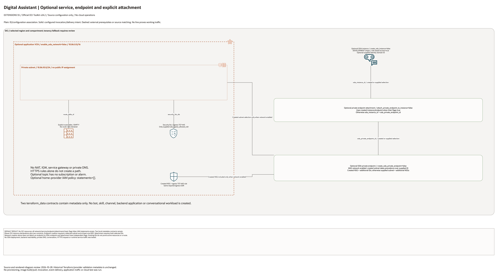

# Oracle Digital Assistant Architecture

This page is the deployment architecture for
`blueprints/extensions/digital-assistant`. It is intentionally Architecture-first
so it is easy to review in GitHub, terminals, pull requests, runbooks, and
customer-safe notes without a diagramming tool.

## Deployment Purpose

Implements Oracle Digital Assistant with private endpoint-capable networking,
optional endpoint attachment, and clear operational hand-off contracts.

## Architecture At A Glance

| Item | Details |
| --- | --- |
| Boundary | `blueprints/extensions/digital-assistant` owns this deployment folder and its Terraform + Ansible runners. |
| Purpose | Deploy ODA instance resources and private endpoint wiring with reusable network/IAM guardrails. |
| Terraform components | `oci_core_vcn.oda`, `oci_core_route_table.oda`, `oci_core_security_list.oda`, `oci_core_subnet.oda`, `oci_core_network_security_group.oda`, `oci_core_network_security_group_security_rule.oda_egress_all`, `oci_oda_oda_instance.this`, `oci_oda_oda_private_endpoint.this`, `oci_oda_oda_private_endpoint_attachment.this`, `oci_ons_notification_topic.alert`, `terraform_data.oda_network_contract`, `terraform_data.oda_contract` |
| Primary architecture view | The Architecture diagram below shows ODA components, endpoint path, and contract outputs for this deployment. |

## Architecture

[Editable draw.io overview and native detail pages](architecture.drawio) · [Resource inventory](resource-inventory.json)

Native pages cover every conditional declaration and existing-reference input. Counts describe declarations, not deployed resource counts.

## Terraform Components

| Kind | Name | Source Or Role |
| --- | --- | --- |
| Resource | `oci_core_vcn.oda`, `oci_core_route_table.oda`, `oci_core_security_list.oda`, `oci_core_subnet.oda` | Optional deploy-and-use network foundation for ODA private endpoint placement. |
| Resource | `oci_core_network_security_group.oda` | NSG boundary for ODA private endpoint traffic. |
| Resource | `oci_core_network_security_group_security_rule.oda_egress_all` | Stateful HTTPS egress to an approved backend CIDR. |
| Resource | `oci_oda_oda_instance.this` | ODA instance for conversational platform workloads. |
| Resource | `oci_oda_oda_private_endpoint.this` | ODA private endpoint for controlled channel integration. |
| Resource | `oci_oda_oda_private_endpoint_attachment.this` | Optional attachment between ODA instance and private endpoint. |
| Resource | `oci_ons_notification_topic.alert` | Optional alert topic for operational events and channel notifications. |
| Resource | `oci_identity_policy.access` | Optional policy shell for ODA administrators and integration callers. |
| Resource | `terraform_data.oda_network_contract` | Network output contract for downstream wiring. |
| Resource | `terraform_data.oda_contract` | ODA operational contract for access and endpoint metadata. |

## Request And Deployment Flow

- Operator chooses whether to create ODA instance, private endpoint, and attachment in this run.
- Terraform creates optional network resources and NSG controls.
- Terraform creates ODA instance and optional private endpoint resources.
- Terraform attaches endpoint to instance when requested.
- Outputs publish instance URLs, endpoint IDs, and network contracts for integration teams.

## Traffic And Trust Boundaries

- Control plane traffic is local/CI authentication into OCI provider via Terraform runner.
- Data plane traffic originates from ODA through the private endpoint toward approved private backends. This endpoint does not provide private inbound access for channels or users.
- Trust boundaries include tenancy compartment ownership, endpoint subnet ownership, and optional policy ownership.
- Secrets and tenancy identifiers remain in ignored local tfvars or approved pipeline secret stores.

## Detailed Architecture Notes

- Eleven OCI declarations and two local metadata contracts are enumerated. Network, service, endpoint, attachment and topic flags default false; IAM statements are empty.
- The optional private subnet binds an empty route table and a security list with TCP 443 egress to an explicit CIDR. The created NSG has matching egress intent. No NAT, IGW, service gateway or private DNS is created; an allowed rule alone is not a path.
- ODA instance, private endpoint and attachment flags are independent. Attachment selects created instance/endpoint IDs when their flags are enabled, otherwise supplied IDs. Both IDs are required.
- With network creation enabled, the created subnet takes precedence over a supplied endpoint subnet, and the created NSG is included alongside additional NSGs. Without it, supplied subnet and additional NSGs are used. Endpoint creation requires a subnet and at least one NSG.
- The optional topic has no alarm or subscription. No skill, bot, channel, backend application or conversational workload is deployed.

## Operational Boundaries

- Supports extension-only and base-plus-extension operating models.
- Apply and destroy are approval-gated operations through guarded Ansible workflows.
- Keep tenancy-specific IDs, endpoint values, and policy statements in local ignored tfvars.
- Re-run plan when shape, endpoint subnet, NSG list, or attachment mode changes.
- Use outputs as the source of truth for integration onboarding and runbook updates.

## Review Checklist

- Confirm the diagram matches `main.tf`: `oci_core_vcn.oda`, `oci_core_route_table.oda`, `oci_core_security_list.oda`, `oci_core_subnet.oda`, `oci_core_network_security_group.oda`, `oci_core_network_security_group_security_rule.oda_egress_all`, `oci_oda_oda_instance.this`, `oci_oda_oda_private_endpoint.this`, `oci_oda_oda_private_endpoint_attachment.this`, `oci_ons_notification_topic.alert`, `terraform_data.oda_network_contract`, `terraform_data.oda_contract`.
- Confirm ODA shape/edition and role-based-access choices align with platform policy.
- Confirm private endpoint subnet, NSG IDs, and allowed CIDR values are correct.
- Confirm attachment mode and sequencing are intentional for this environment.
- Confirm policy statements align with intended ODA operator and caller groups.
- Confirm `ansible/plan.yml`, `ansible/apply.yml`, and `ansible/destroy.yml` still point at the shared runner.

## Diagram Review - 2026-10-28

Source, connector direction, creation conditions, native detail pages and PNGs were reviewed locally. Plain lines show ID/configuration associations; solid arrows show declared request/route intent; dashed lines show external prerequisites. No cloud resources were created and no runtime traffic was tested in this review. Historical provider and live-validation evidence remains limited to its original stated scope.
