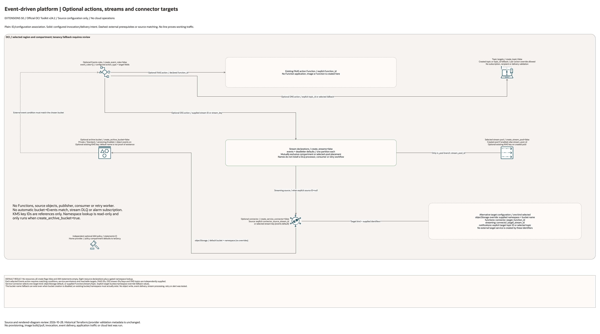

# Event-Driven Application Platform Architecture

## Deployment Purpose

Create a reusable event-driven foundation for asynchronous applications and AI
automation. The blueprint wires event sources, stream buffers, notification
targets, archive storage, service connectors, and IAM hand-offs in one extension
folder.

## Architecture At A Glance

| Layer | Responsibility |
| --- | --- |
| Events rules | Match OCI events and dispatch actions. |
| Streaming | Durable event buffers and dead-letter style topics. |
| Service Connector | Moves stream events to archive, function, stream, or topic target. |
| Notification topic | Alerting and human notification hand-off. |
| Archive bucket | Long-term event payload storage. |
| IAM policy | Service and operator permissions. |

## Architecture

[Editable overview and native detail pages](architecture.drawio) · [Source resource inventory](resource-inventory.json)

Native pages enumerate every conditional declaration and existing identifier input.
They describe declaration coverage, not expanded deployed resource counts.

## Terraform Components

| File | Purpose |
| --- | --- |
| `main.tf` | Archive bucket, streams, topic, Events rules, Service Connector, IAM. |
| `variables.tf` | Event, stream, connector, topic, bucket, and policy inputs. |
| `outputs.tf` | Stream, topic, event rule, connector, bucket, and policy outputs. |
| `terraform.tfvars.example` | Example rule and disabled create flags. |
| `ansible/*.yml` | Standard local runners. |

Declared resource addresses:

| Kind | Name | Source Or Role |
| --- | --- | --- |
| Resource | `oci_objectstorage_bucket.archive` | Declared in this blueprint; creation depends on its count or for_each inputs. |
| Resource | `oci_streaming_stream_pool.this` | Declared in this blueprint; creation depends on its count or for_each inputs. |
| Resource | `oci_streaming_stream.this` | Declared in this blueprint; creation depends on its count or for_each inputs. |
| Resource | `oci_streaming_stream.in_pool` | Declared in this blueprint; creation depends on its count or for_each inputs. |
| Resource | `oci_ons_notification_topic.this` | Declared in this blueprint; creation depends on its count or for_each inputs. |
| Resource | `oci_events_rule.this` | Declared in this blueprint; creation depends on its count or for_each inputs. |
| Resource | `oci_sch_service_connector.this` | Declared in this blueprint; creation depends on its count or for_each inputs. |
| Resource | `oci_identity_policy.access` | Declared in this blueprint; creation depends on its count or for_each inputs. |

## Request And Deployment Flow

1. Supply the required compartment, service/network identifiers and per-resource configuration.
2. Review each conditional resource and the disabled default result before enabling creation.
3. Review source-defined ID bindings and optional action/target selections against existing dependencies.
4. Implement external image, application, producer/consumer and permissions work where applicable.
5. Test actual service access, data handling and runtime behavior separately from this diagram review.

## Traffic And Trust Boundaries

- Plain lines represent declared IDs or nested configuration. Solid arrows represent configured invocation/delivery intent only.
- Dashed lines identify external work or conditional event-source matching. No connector proves a successful request or working network path.
- Existing network and service identifiers do not imply ownership adoption, permission grants, private DNS, Internet egress or end-to-end connectivity.
- IAM policies use supplied statements; their provider and compartment/tenancy scope require separate review where present.
- Keep credentials, secrets, OCIDs and customer-specific configurations in ignored local inputs or approved secure pipeline stores.

## Detailed Architecture Notes

- No cloud resources by default: all create flags are false and policy statements empty. Eight resource declarations and one gated read-only Object Storage namespace lookup are enumerated.
- The private Standard archive bucket defaults to versioning Enabled and object events enabled. A rule must still explicitly match relevant events; enabling bucket events does not bind an Events condition.
- The `events` and `deadletter` map defaults each have one partition. Pool-bound and compartment-scoped declarations are mutually exclusive. The name `deadletter` does not create a DLQ processor, retry policy or consumer.
- The selected pool is created when `create_stream_pool=true`, otherwise `stream_pool_id` is used. An existing KMS key can be supplied for the bucket and created pool; no key is created.
- Events actions use caller-supplied action types and independent Function, stream or topic selections. The optional selected topic has no subscription or recipient configured.
- The Service Connector source uses an explicit stream ID before its selected created-stream key (`events` by default). Enabling the connector requires an effective source and valid target fields, not only an enable flag.
- Exactly one connector target kind is selected: objectStorage by default, or functions, streaming or notifications. Explicit namespace/bucket and target IDs override their respective fallbacks; different target IDs can identify different existing services.
- The Object Storage name fallback can be computed with bucket creation disabled. That does not create the bucket or establish a valid namespace; external target existence and service permissions must be supplied and reviewed.
- The IAM policy uses the home provider and policy-compartment/tenancy fallback. No producers, consumers, Function code, source objects, retry workers, subscriptions or working notification delivery are created.

Diagram/source review: 2026-10-28. Historical infrastructure/provider validation metadata is unchanged. No provisioning or runtime test was run for this conversion.

## Operational Boundaries

- Do not commit customer event payloads or private function IDs.
- Keep rule conditions and target IDs in ignored tfvars.
- Check policy statement quota before creating Service Connector access policies.
- Use `genai-guardrails` when event payloads contain prompt or model metadata.
- Use Functions and Streaming extensions for service-specific runtime details.

## Review Checklist

- [ ] Event conditions match only intended producers.
- [ ] Stream retention and partition count are approved.
- [ ] Connector target and archive prefix are reviewed.
- [ ] Notification topic ownership is clear.
- [ ] IAM statements are scoped to producer and consumer teams.
- [ ] Outputs are handed to approved application owners.
