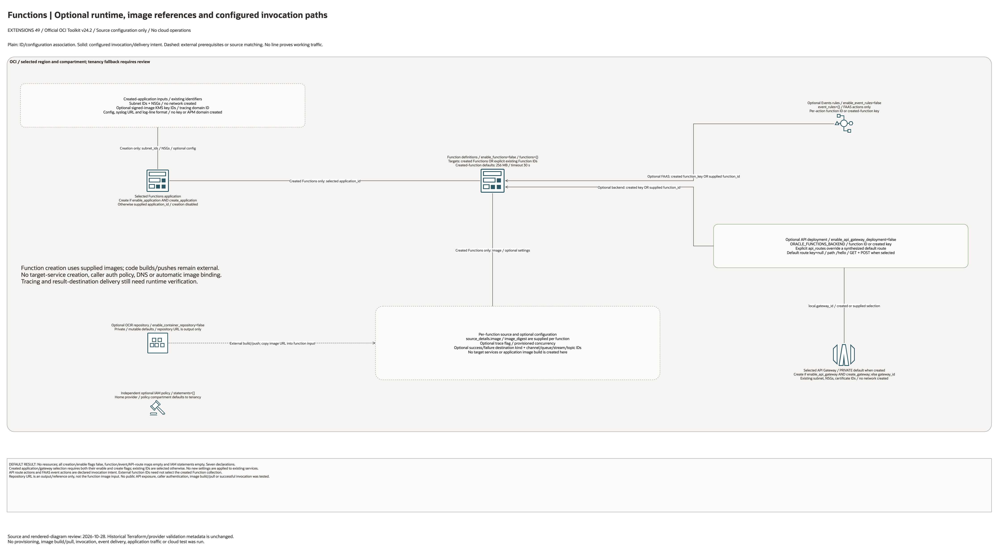

# Oracle Functions Extension Architecture

This page is the deployment architecture for `blueprints/extensions/functions`.
It is intentionally Architecture-first so it is easy to review in GitHub, terminals,
pull requests, runbooks, and customer-safe notes without a diagramming tool.

## Deployment Purpose

Deploys an OCI Functions extension with optional image repository, private
Functions application, function resources, API Gateway routes, Events triggers,
and scoped IAM policy hand-offs.

## Architecture At A Glance

| Item | Details |
|---|---|
| Boundary | `blueprints/extensions/functions` owns this deployment folder and its Terraform + Ansible runners. |
| Purpose | Runs OCI-native serverless functions from approved container images, with optional HTTP and event-driven invocation paths. |
| Terraform components | `oci_artifacts_container_repository.this`, `oci_functions_application.this`, `oci_functions_function.this`, `oci_apigateway_gateway.this`, `oci_apigateway_deployment.this`, `oci_events_rule.this`, `oci_identity_policy.access` |
| Primary architecture view | The diagram shows source-defined components, ID associations and optional configured invocation intent. |

## Architecture

[Editable overview and native detail pages](architecture.drawio) · [Source resource inventory](resource-inventory.json)

Native pages enumerate every conditional declaration and existing identifier input.
They describe declaration coverage, not expanded deployed resource counts.

## Terraform Components

| Kind | Name | Source Or Role |
|---|---|---|
| Resource | `oci_artifacts_container_repository.this` | Optional image repository for the function image hand-off. |
| Resource | `oci_functions_application.this` | Optional Functions application attached to supplied subnets and NSGs. |
| Resource | `oci_functions_function.this` | Functions created from approved image URLs. |
| Resource | `oci_apigateway_gateway.this` | Optional gateway for HTTP ingress. |
| Resource | `oci_apigateway_deployment.this` | Optional route table using Oracle Functions backends. |
| Resource | `oci_events_rule.this` | Optional event rules with FAAS actions. |
| Resource | `oci_identity_policy.access` | Optional IAM policy for deploy, invoke, repository, and service permissions. |

## Request And Deployment Flow

1. Supply the required compartment, service/network identifiers and per-resource configuration.
2. Review each conditional resource and the disabled default result before enabling creation.
3. Review source-defined ID bindings and optional action/target selections against existing dependencies.
4. Implement external image, application, producer/consumer and permissions work where applicable.
5. Test actual service access, data handling and runtime behavior separately from this diagram review.

## Traffic And Trust Boundaries

- Plain lines represent declared IDs or nested configuration. Solid arrows represent configured invocation/delivery intent only.
- Dashed lines identify external work or conditional event-source matching. No connector proves a successful request or working network path.
- Existing network and service identifiers do not imply ownership adoption, permission grants, private DNS, Internet egress or end-to-end connectivity.
- IAM policies use supplied statements; their provider and compartment/tenancy scope require separate review where present.
- Keep credentials, secrets, OCIDs and customer-specific configurations in ignored local inputs or approved secure pipeline stores.

## Detailed Architecture Notes

- No cloud resources by default: all creation/enablement flags are false, function/API-route/event maps empty and IAM statements empty. Seven resource declarations are fully enumerated in the native detail page.
- Functions select the created application only when both application enable/create flags are true; otherwise `application_id` is selected. API deployment uses the analogous created/supplied gateway selection. New settings are not applied to existing services.
- The created application consumes existing subnets/NSGs and optional signed-image KMS key IDs, APM domain, log format and syslog endpoint. No network, key, domain or logging service is created.
- Every created function requires its own image URL; optional digest, memory, timeout, tracing, concurrency and success/failure destination IDs are per-function settings. Destination services remain external.
- The optional repository is private and mutable by default. Its output URL is not automatically passed into function source details; image build, push, signing and reference selection remain external.
- API routes use `ORACLE_FUNCTIONS_BACKEND` and either a created function key or an explicit existing Function ID. User `api_routes` entries override the synthesized default route. The default route is absent until its function key is selected.
- Events rules configure FAAS actions only, per action choosing a created Function key or explicit existing Function ID. Rule/action enablement and event matching must be reviewed; no successful invocation is claimed.
- The default created gateway endpoint is PRIVATE. This source does not configure caller authentication policies, public client access, DNS or successful Function/image/trace/destination delivery.
- The optional IAM policy uses the home provider and policy-compartment/tenancy fallback. Statements are supplied; no automatic invoke/image/target permission is inferred.

Diagram/source review: 2026-10-28. Historical infrastructure/provider validation metadata is unchanged. No provisioning or runtime test was run for this conversion.

## Operational Boundaries

- This extension can run extension-only with supplied brownfield OCI IDs, or as
  base-plus-extension using outputs from core, networking, ownership, or
  operations blueprints.
- Keep customer-specific OCIDs, DNS names, event filters, image URLs, IAM group
  names, contacts, and secrets in ignored local tfvars or approved pipeline
  variables.
- Run plan from this blueprint folder so provider files and local Ansible
  runners resolve predictably.
- Treat apply and destroy as approval-gated operations; use the guarded Ansible
  playbooks or a reviewed Terraform workflow.
- Re-check image tags, route exposure, event trigger conditions, IAM scopes,
  subnet egress, and output hand-offs whenever inputs change.
- Build and push functions before Terraform apply when creating or updating
  function resources.
- Keep generated `.terraform` directories, lock files, tfstate, plans, local
  tfvars, and registry credentials out of git.

## Review Checklist

- Confirm the diagram matches `main.tf`: repository, application, function, API
  Gateway, deployment, Events rule, and IAM policy resources.
- Confirm every function image exists in the target registry and is approved for
  the environment.
- Confirm the Functions application subnets and NSGs match the private runtime
  design.
- Confirm API Gateway endpoint type, route path, method list, backend function,
  certificate, and authentication model are intentional.
- Confirm Events conditions are scoped to the exact service, compartment,
  bucket, topic, or resource signals expected.
- Confirm IAM statements grant only the deploy, invoke, network, and repository
  access required.
- Confirm tracing, syslog, async destinations, and provisioned concurrency match
  the workload support model.
- Confirm `ansible/plan.yml`, `ansible/apply.yml`, and `ansible/destroy.yml`
  still point at the shared Terraform runner.
