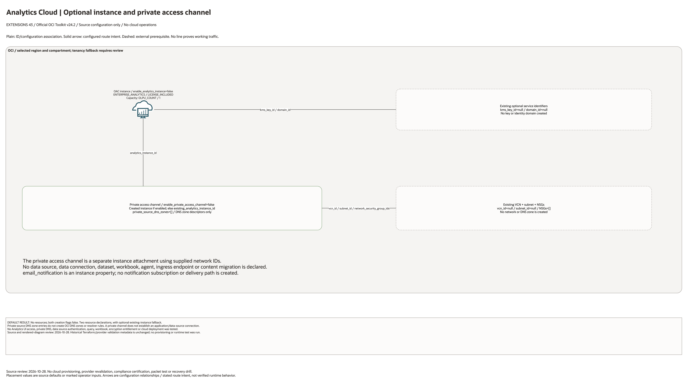

# Oracle Analytics Cloud Architecture

This is the deployment architecture for `blueprints/extensions/oac`. It keeps the design reviewable in GitHub, terminals, pull requests, runbooks, and customer-safe notes without a diagramming tool.

## Deployment Purpose

Deploys an Oracle Analytics Cloud instance with optional private access channel.

## Architecture At A Glance

| Item | Details |
|---|---|
| Boundary | `blueprints/extensions/oac` owns this deployment folder and its Terraform + Ansible runners. |
| Purpose | Deploys an Oracle Analytics Cloud instance with optional private access channel. |
| Terraform components | `oci_analytics_analytics_instance.this`, `oci_analytics_analytics_instance_private_access_channel.this` |
| Primary architecture view | The diagram shows source-defined components and configuration associations; it is not runtime evidence. |

## Architecture

[Edit the overview and native detail pages](architecture.drawio) · [Source resource inventory](resource-inventory.json)

The main draw.io document includes declaration-detail and existing-resource input pages.
These enumerate source declarations and references, not deployed instance counts.

## Terraform Components

| Kind | Name | Source Or Role |
|---|---|---|
| Resource | `oci_analytics_analytics_instance.this` | Declared directly in `main.tf` |
| Resource | `oci_analytics_analytics_instance_private_access_channel.this` | Declared directly in `main.tf` |

## Request And Deployment Flow

- Operator supplies the existing network, compartment, service, or backend IDs required by the deployment.
- Terraform creates the optional service resource graph declared in `main.tf`.
- Outputs expose only the IDs, names or endpoints declared in `outputs.tf`; they do not establish downstream application connectivity.

## Traffic And Trust Boundaries

- Control plane traffic is local operator or CI authentication into the OCI provider and the Ansible Terraform runner.
- Plain lines show declared ID/configuration associations; no application data flow is configured by this entry point.
- Resources use the selected compartment, with a tenancy fallback that requires review. Existing networks and service identities are operator inputs only where declared.
- Secrets, OCIDs, customer CIDRs, endpoint URLs, and contact data belong in ignored local tfvars or a secure pipeline variable store, not in committed files.

## Detailed Architecture Notes

- No resources are created by default: both instance and private-channel flags are false.
- The channel selects the created instance when instance creation is enabled, otherwise `existing_analytics_instance_id`. Plain connectors show instance and existing network bindings.
- Defaults are `ENTERPRISE_ANALYTICS`, `LICENSE_INCLUDED`, and one `OLPU_COUNT`; these are source parameters, not availability or entitlement verification.
- `private_source_dns_zones` are channel descriptors. No OCI DNS zone, resolver rule, data source, connection, dataset or workbook is created.
- KMS key and identity domain IDs are optional existing references. Neither resource is created here.

- Diagram/source review: 2026-10-28. Historical provider and infrastructure validation evidence remains unchanged. No cloud operation or runtime test was run for this conversion.

## Operational Boundaries

- This extension can run extension-only with supplied brownfield OCI IDs, or as
  base-plus-extension using outputs from core, networking, ownership, or
  operations blueprints.
- Keep customer-specific OCIDs, CIDRs, DNS names, endpoints, contacts, and secrets in ignored local tfvars or approved pipeline variables.
- Run plan from this blueprint folder so relative module paths, provider files, and local Ansible runners resolve predictably.
- Treat apply and destroy as approval-gated operations; use the guarded Ansible playbooks or a reviewed Terraform workflow.
- Re-check route exposure, IAM scope, compartment boundaries, tags, and output hand-offs whenever inputs change.

## Review Checklist

- Confirm the diagram matches `main.tf`: `oci_analytics_analytics_instance.this`, `oci_analytics_analytics_instance_private_access_channel.this`.
- Confirm the described traffic or control path is the path you want in OCI before apply.
- Confirm public exposure, private endpoint access, DNS behavior, DRG routing, and inspection points are intentional where present.
- Confirm IAM scopes, compartment boundaries, tags, and operational outputs match the deployment README.
- Confirm `ansible/plan.yml`, `ansible/apply.yml`, and `ansible/destroy.yml` still point at the shared Terraform runner.
