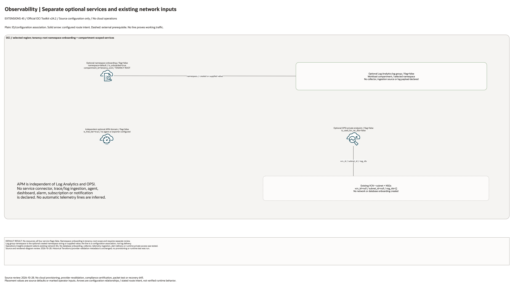

# Observability Platform Architecture

This is the deployment architecture for `blueprints/extensions/observability`. It keeps the design reviewable in GitHub, terminals, pull requests, runbooks, and customer-safe notes without a diagramming tool.

## Deployment Purpose

Deploys an observability layer with optional Log Analytics namespace and group, APM domain, and Operations Insights private endpoint.

## Architecture At A Glance

| Item | Details |
|---|---|
| Boundary | `blueprints/extensions/observability` owns this deployment folder and its Terraform + Ansible runners. |
| Purpose | Deploys an observability layer with optional Log Analytics namespace and group, APM domain, and Operations Insights private endpoint. |
| Terraform components | `oci_log_analytics_namespace.this`, `oci_log_analytics_log_analytics_log_group.this`, `oci_apm_apm_domain.this`, `oci_opsi_operations_insights_private_endpoint.this` |
| Primary architecture view | The diagram shows source-defined components and configuration associations; it is not runtime evidence. |

## Architecture

[Edit the overview and native detail pages](architecture.drawio) · [Source resource inventory](resource-inventory.json)

The main draw.io document includes declaration-detail and existing-resource input pages.
These enumerate source declarations and references, not deployed instance counts.

## Terraform Components

| Kind | Name | Source Or Role |
|---|---|---|
| Resource | `oci_log_analytics_namespace.this` | Declared directly in `main.tf` |
| Resource | `oci_log_analytics_log_analytics_log_group.this` | Declared directly in `main.tf` |
| Resource | `oci_apm_apm_domain.this` | Declared directly in `main.tf` |
| Resource | `oci_opsi_operations_insights_private_endpoint.this` | Declared directly in `main.tf` |

## Request And Deployment Flow

- Operator supplies the existing network, compartment, service, or backend IDs required by the deployment.
- Terraform creates the optional service resource graph declared in `main.tf`.
- Outputs expose only the IDs, names or endpoints declared in `outputs.tf`; they do not establish downstream application connectivity.

## Traffic And Trust Boundaries

- Control plane traffic is local operator or CI authentication into the OCI provider and the Ansible Terraform runner.
- Plain lines show declared ID/configuration associations; no application data flow is configured by this entry point.
- Existing network boundaries and service identities are operator inputs where declared. Namespace onboarding in Observability uses tenancy-root scope.
- Secrets, OCIDs, customer CIDRs, endpoint URLs, and contact data belong in ignored local tfvars or a secure pipeline variable store, not in committed files.

## Detailed Architecture Notes

- No resources are created by default: all four enablement flags are false.
- Optional Log Analytics namespace onboarding uses `compartment_id=var.tenancy_ocid`, a tenancy-root operation. Its default namespace is `default`; `is_onboarded=true` only applies when namespace creation is enabled.
- The Log Analytics group remains in the selected workload compartment and selects the optional created namespace string or supplied namespace. Its plain connector does not represent ingestion.
- The APM domain is independent and defaults to the free-tier setting. No agent, exporter, trace ingestion, alarm, dashboard or notification resource is declared.
- Operations Insights private endpoint uses existing VCN/subnet/NSG IDs and defaults to `is_used_for_rac_dbs=false`. There is no database onboarding or automatic link to APM or Log Analytics.

- Diagram/source review: 2026-10-28. Historical provider and infrastructure validation evidence remains unchanged. No cloud operation or runtime test was run for this conversion.

## Operational Boundaries

- This extension can run extension-only with supplied brownfield OCI IDs, or as
  base-plus-extension using outputs from core, networking, ownership, or
  operations blueprints.
- Keep customer-specific OCIDs, CIDRs, DNS names, endpoints, contacts, and secrets in ignored local tfvars or approved pipeline variables.
- Run plan from this blueprint folder so relative module paths, provider files, and local Ansible runners resolve predictably.
- Treat apply and destroy as approval-gated operations; use the guarded Ansible playbooks or a reviewed Terraform workflow.
- Re-check route exposure, IAM scope, compartment boundaries, tags, and output hand-offs whenever inputs change.

## Review Checklist

- Confirm the diagram matches `main.tf`: `oci_log_analytics_namespace.this`, `oci_log_analytics_log_analytics_log_group.this`, `oci_apm_apm_domain.this`, `oci_opsi_operations_insights_private_endpoint.this`.
- Confirm the described traffic or control path is the path you want in OCI before apply.
- Confirm public exposure, private endpoint access, DNS behavior, DRG routing, and inspection points are intentional where present.
- Confirm IAM scopes, compartment boundaries, tags, and operational outputs match the deployment README.
- Confirm `ansible/plan.yml`, `ansible/apply.yml`, and `ansible/destroy.yml` still point at the shared Terraform runner.
