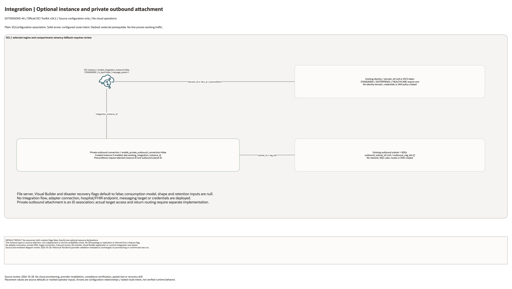

# Oracle Integration Cloud Architecture

This is the deployment architecture for `blueprints/extensions/oic`. It keeps the design reviewable in GitHub, terminals, pull requests, runbooks, and customer-safe notes without a diagramming tool.

## Deployment Purpose

Deploys an Oracle Integration Cloud instance with optional private outbound connection.

## Architecture At A Glance

| Item | Details |
|---|---|
| Boundary | `blueprints/extensions/oic` owns this deployment folder and its Terraform + Ansible runners. |
| Purpose | Deploys an Oracle Integration Cloud instance with optional private outbound connection. |
| Terraform components | `oci_integration_integration_instance.this`, `oci_integration_private_endpoint_outbound_connection.this` |
| Primary architecture view | The diagram shows source-defined components and configuration associations; it is not runtime evidence. |

## Architecture

[Edit the overview and native detail pages](architecture.drawio) · [Source resource inventory](resource-inventory.json)

The main draw.io document includes declaration-detail and existing-resource input pages.
These enumerate source declarations and references, not deployed instance counts.

## Terraform Components

| Kind | Name | Source Or Role |
|---|---|---|
| Resource | `oci_integration_integration_instance.this` | Declared directly in `main.tf` |
| Resource | `oci_integration_private_endpoint_outbound_connection.this` | Declared directly in `main.tf` |
| Samples | `samples/basic-instance.tfvars.example` | Minimal public-safe OIC instance input set |
| Samples | `samples/private-outbound-existing-network.tfvars.example` | Brownfield private outbound connection input shape |
| Test runner | `scripts/test-oic-lifecycle.sh` | Real create attempt, OCI CLI verification when created, destroy, and state cleanup |

## Request And Deployment Flow

- Operator supplies the existing network, compartment, service, or backend IDs required by the deployment.
- Terraform creates the optional service resource graph declared in `main.tf`.
- Outputs expose only the IDs, names or endpoints declared in `outputs.tf`; they do not establish downstream application connectivity.

## Traffic And Trust Boundaries

- Control plane traffic is local operator or CI authentication into the OCI provider and the Ansible Terraform runner.
- Plain lines show declared ID/configuration associations; no application data flow is configured by this entry point.
- Resources use the selected compartment, with a tenancy fallback that requires review. Existing networks and service identities are operator inputs only where declared.
- Secrets, OCIDs, customer CIDRs, endpoint URLs, and contact data belong in ignored local tfvars or a secure pipeline variable store, not in committed files.

## Detailed Architecture Notes

- No resources are created by default: both instance and private-outbound flags are false.
- The outbound connection selects the created instance when enabled, otherwise `existing_integration_instance_id`. Preconditions require a selected instance ID and `outbound_subnet_id`.
- Plain connectors show instance, identity and existing outbound subnet/NSG bindings. No adapter connection, integration flow, application endpoint or working network path is created.
- The default type is `STANDARDX` with one message pack and BYOL disabled. STANDARDX, ENTERPRISEX and HEALTHCARE require `domain_id` or `idcs_access_token` when creating the instance.
- File server, Visual Builder and disaster-recovery feature flags default to false; no DR topology, replication or workload is inferred.

- Diagram/source review: 2026-10-28. Historical provider and infrastructure validation evidence remains unchanged. No cloud operation or runtime test was run for this conversion.

## Operational Boundaries

- This extension can run extension-only with supplied brownfield OCI IDs, or as
  base-plus-extension using outputs from core, networking, ownership, or
  operations blueprints.
- Keep customer-specific OCIDs, CIDRs, DNS names, endpoints, contacts, and secrets in ignored local tfvars or approved pipeline variables.
- Run plan from this blueprint folder so relative module paths, provider files, and local Ansible runners resolve predictably.
- Treat apply and destroy as approval-gated operations; use the guarded Ansible playbooks or a reviewed Terraform workflow.
- Use `scripts/test-oic-lifecycle.sh` for approved disposable OIC lifecycle
  tests; newer OIC types need `domain_id` or `idcs_access_token`, while legacy
  types need tenancy entitlement. Regional OIC limits must be non-zero, and
  required tag defaults or policies must be accepted by the Integration
  service. If OCI rejects creation before provisioning, the runner still
  destroys any tracked resources and checks cleanup.
- The 2026-06-02 disposable OIC3 lifecycle test created a `STANDARDX` instance,
  verified it as `ACTIVE` with OCI CLI, destroyed it, and confirmed no managed
  resources remained in local tracking.
- Re-check route exposure, IAM scope, compartment boundaries, tags, and output hand-offs whenever inputs change.

## Review Checklist

- Confirm the diagram matches `main.tf`: `oci_integration_integration_instance.this`, `oci_integration_private_endpoint_outbound_connection.this`.
- Confirm the described traffic or control path is the path you want in OCI before apply.
- Confirm public exposure, private endpoint access, DNS behavior, DRG routing, and inspection points are intentional where present.
- Confirm IAM scopes, compartment boundaries, tags, and operational outputs match the deployment README.
- Confirm `ansible/plan.yml`, `ansible/apply.yml`, and `ansible/destroy.yml` still point at the shared Terraform runner.
- Confirm sample tfvars and lifecycle-test docs stay aligned with OIC quota,
  entitlement, identity domain, tag policy, and licensing decisions.
