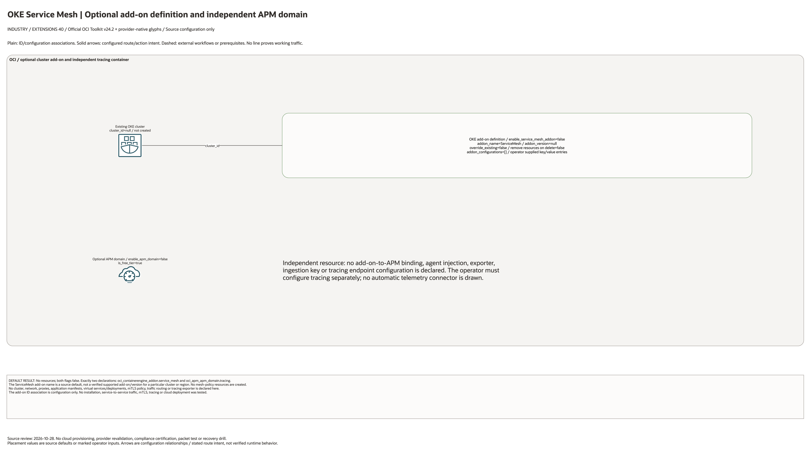

# OKE Service Mesh Architecture

This is the deployment architecture for `blueprints/extensions/oke-service-mesh`. It keeps the design reviewable in GitHub, terminals, pull requests, runbooks, and customer-safe notes without a diagramming tool.

## Deployment Purpose

Deploys the OKE service mesh add-on shell with optional APM domain for distributed tracing hand-off.

## Architecture At A Glance

| Item | Details |
|---|---|
| Boundary | `blueprints/extensions/oke-service-mesh` owns this deployment folder and its Terraform + Ansible runners. |
| Purpose | Deploys the OKE service mesh add-on shell with optional APM domain for distributed tracing hand-off. |
| Terraform components | `oci_containerengine_addon.service_mesh`, `oci_apm_apm_domain.tracing` |
| Primary architecture view | The Architecture diagram below shows the OCI components, dependency order, and traffic or control flow for this exact deployment. |

## Architecture

[Edit the multi-page draw.io diagram](architecture.drawio). Companion pages
enumerate every declared resource, creation condition and existing identifier
input; see the [source inventory](resource-inventory.json). Provider-native
icons identify mapped services; exact types without a matching glyph retain
labelled boxes. No resources are inferred from those inputs.

Plain lines show ID/configuration associations; solid arrows show declared
route/action intent. Dashed lines mark external workflows or prerequisites.
No connector proves successful deployment or runtime traffic.

## Terraform Components

| Kind | Name | Source Or Role |
|---|---|---|
| Resource | `oci_containerengine_addon.service_mesh` | Declared directly in `main.tf` |
| Resource | `oci_apm_apm_domain.tracing` | Declared directly in `main.tf` |

## Request And Deployment Flow

- Operator supplies the existing network, compartment, service, or backend IDs required by the deployment.
- Terraform creates the optional service resource graph declared in `main.tf`.
- Outputs expose service IDs, endpoint names, or attachment IDs for applications and runbooks.

## Traffic And Trust Boundaries

- Control plane traffic is local operator or CI authentication into the OCI provider and the Ansible Terraform runner.
- Data plane traffic is the packet or service path shown in the Architecture diagram; if this deployment only creates identity or governance resources, the data plane is permission and signal flow.
- Trust boundaries are the tenancy, compartment, VCN, subnet, private endpoint, identity domain, or managed service edges shown in the diagram.
- Secrets, OCIDs, customer CIDRs, endpoint URLs, and contact data belong in ignored local tfvars or a secure pipeline variable store, not in committed files.

## Detailed Architecture Notes

- Confirm cluster ID and add-on name/version match the target OKE release.
- Confirm remove_addon_resources_on_delete behavior before destroy.
- Confirm APM domain ownership and tracing data retention.

## Operational Boundaries

- This extension can run extension-only with supplied brownfield OCI IDs, or as
  base-plus-extension using outputs from core, networking, ownership, or
  operations blueprints.
- Keep customer-specific OCIDs, CIDRs, DNS names, endpoints, contacts, and secrets in ignored local tfvars or approved pipeline variables.
- Run plan from this blueprint folder so relative module paths, provider files, and local Ansible runners resolve predictably.
- Treat apply and destroy as approval-gated operations; use the guarded Ansible playbooks or a reviewed Terraform workflow.
- Re-check route exposure, IAM scope, compartment boundaries, tags, and output hand-offs whenever inputs change.

## Review Checklist

- Confirm the diagram matches `main.tf`: `oci_containerengine_addon.service_mesh`, `oci_apm_apm_domain.tracing`.
- Confirm the described traffic or control path is the path you want in OCI before apply.
- Confirm public exposure, private endpoint access, DNS behavior, DRG routing, and inspection points are intentional where present.
- Confirm IAM scopes, compartment boundaries, tags, and operational outputs match the deployment README.
- Confirm `ansible/plan.yml`, `ansible/apply.yml`, and `ansible/destroy.yml` still point at the shared Terraform runner.

## October 28, 2026 Diagram Source Review

Only an optional cluster add-on definition and an independent APM domain are
declared; both flags default false. ServiceMesh is the source add-on-name
default, not evidence of a supported add-on/version for a particular cluster.
No cluster, network, workload manifests, proxies, mTLS policy or mesh virtual
services/deployments are created. APM domain creation does not configure agents,
ingestion keys, instrumentation or telemetry export; no automatic add-on-to-APM
connector is shown.

This batch reviews source code, native pages and rendered diagrams only.
Historical Terraform/provider and earlier runtime evidence is unchanged. No
cloud provisioning, user session, Kubernetes execution, mesh traffic or failover
test was performed.
