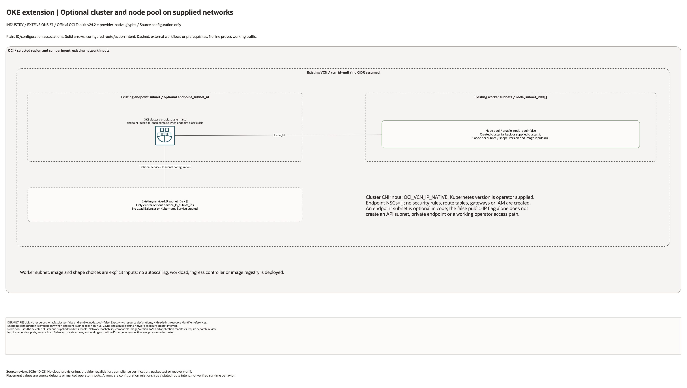

# OKE Extension Architecture

This is the deployment architecture for `blueprints/extensions/oke`. It keeps the design reviewable in GitHub, terminals, pull requests, runbooks, and customer-safe notes without a diagramming tool.

## Deployment Purpose

Creates an OCI Container Engine for Kubernetes cluster and optional node pool attached to supplied VCN and subnet IDs.

## Architecture At A Glance

| Item | Details |
| --- | --- |
| Boundary | `blueprints/extensions/oke` owns this deployment folder and its Terraform + Ansible runners. |
| Purpose | Creates an OCI Container Engine for Kubernetes cluster and optional node pool attached to supplied VCN and subnet IDs. |
| Terraform components | `oci_containerengine_cluster.this`, `oci_containerengine_node_pool.this` |
| Primary architecture view | The Architecture diagram below shows the OCI components, dependency order, and traffic flow for this exact deployment. |

## Architecture

[Edit the multi-page draw.io diagram](architecture.drawio). Companion pages
enumerate every declared resource, creation condition and existing identifier
input; see the [source inventory](resource-inventory.json). Provider-native
icons identify mapped services; exact types without a matching glyph retain
labelled boxes. No resources are inferred from those inputs.

Plain lines show ID/configuration associations; solid arrows show declared
route/action intent. Dashed lines mark external workflows or prerequisites.
No connector proves successful deployment or runtime traffic.

## Terraform Components

| Kind | Name | Source Or Role |
| --- | --- | --- |
| Resource | `oci_containerengine_cluster.this` | `Declared directly in main.tf` |
| Resource | `oci_containerengine_node_pool.this` | `Declared directly in main.tf` |

## Request And Deployment Flow

- Operator supplies the existing network, compartment, service, or backend IDs required by the extension.
- Terraform creates the optional service resource graph declared in main.tf.
- Outputs expose service IDs, endpoint names, or attachment IDs for applications and runbooks.

## Traffic And Trust Boundaries

- Control plane traffic is local operator or CI authentication into the OCI provider and the Ansible Terraform runner.
- Data plane traffic is the packet or service path shown in the Architecture diagram; if this deployment only creates identity or governance resources, the data plane is intentionally permission and signal flow instead of network packets.
- Trust boundaries are the tenancy, compartment, VCN, subnet, DRG, private endpoint, identity domain, or managed service edges shown in the diagram.
- Secrets, OCIDs, customer CIDRs, endpoint URLs, and contact data belong in ignored local tfvars or a secure pipeline variable store, not in committed files.

## Detailed Architecture Notes

These notes expand the diagram with the design details that usually matter during review, plan, and hand-off.

- The cluster depends on an existing VCN ID and optional endpoint/service load balancer subnet IDs supplied by the caller.
- Endpoint subnet, public endpoint flag, and endpoint NSGs define the operator access path to the Kubernetes API.
- Node pools depend on the created or referenced cluster ID and use the supplied node subnet IDs, shape, image, SSH key, and sizing inputs.
- Service-LB subnet IDs configure eligible placement; no Load Balancer, Kubernetes Service or ingress traffic is created.

## Operational Boundaries

- This extension can run extension-only with supplied brownfield OCI IDs, or as
  base-plus-extension using outputs from core, networking, ownership, or
  operations blueprints.
- Keep customer-specific OCIDs, CIDRs, DNS names, endpoints, contacts, and secrets in ignored local tfvars or approved pipeline variables.
- Run plan from this blueprint folder so relative module paths, provider files, and local Ansible runners resolve predictably.
- Treat apply and destroy as approval-gated operations; use the guarded Ansible playbooks or a reviewed Terraform workflow.
- Re-check route exposure, IAM scope, compartment boundaries, tags, and output hand-offs whenever inputs change.

## Review Checklist

- Confirm the diagram matches `main.tf`: `oci_containerengine_cluster.this`, `oci_containerengine_node_pool.this`.
- Confirm the described traffic path is the path you want in OCI before apply.
- Confirm public exposure, private endpoint access, DNS behavior, DRG routing, and inspection points are intentional where present.
- Confirm IAM scopes, compartment boundaries, tags, and operational outputs match the deployment README.
- Confirm `ansible/plan.yml`, `ansible/apply.yml`, and `ansible/destroy.yml` still point at the shared Terraform runner.

## October 28, 2026 Diagram Source Review

Only a cluster and node pool are declared, both disabled by default. The VCN,
API/worker/service-LB subnets, NSGs and image are operator-supplied resources.
The endpoint block is added only with a non-null endpoint_subnet_id; a false
public-IP input alone does not create a private API access path. Service-LB
subnet configuration does not create a Load Balancer or Kubernetes Service.
No gateways, routes, NSG rules, IAM, autoscaling or application manifests are
declared. CIDRs and actual existing network exposure remain unspecified.

This batch reviews source code, native pages and rendered diagrams only.
Historical Terraform/provider and earlier runtime evidence is unchanged. No
cloud provisioning, user session, Kubernetes execution, mesh traffic or failover
test was performed.
