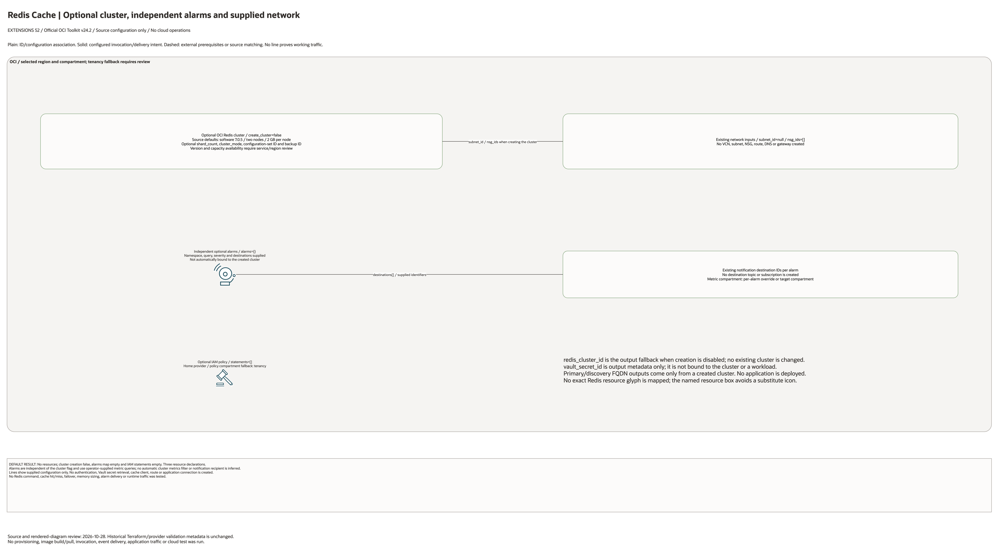

# Redis Cache Landing Zone Architecture

## Deployment Purpose

This blueprint gives application teams a consistent private Redis cache pattern.
It documents subnet placement, NSG access, capacity choices, alarm hooks, IAM,
and secret hand-offs so Redis does not become an unmanaged side component.

## Architecture At A Glance

| Layer | Components |
| --- | --- |
| App access | Private application subnets and NSG-approved Redis flows. |
| Cache | OCI Cache with Redis cluster, node count, memory, and optional sharding. |
| Security | No public endpoint by default, optional Vault secret reference, group-scoped IAM. |
| Operations | Monitoring alarms for memory, connections, failover, and saturation. |
| Handoff | Endpoint, cluster ID, secret ID, and alarm IDs. |

## Architecture

[Editable draw.io overview and native detail pages](architecture.drawio) · [Resource inventory](resource-inventory.json)

Native pages cover every conditional declaration and existing-reference input. Counts describe declarations, not deployed resource counts.

## Terraform Components

| File | Purpose |
| --- | --- |
| `main.tf` | Creates the Redis cluster, optional alarms, and IAM policy shell. |
| `variables.tf` | Defines create/reference inputs, network placement, sizing, alarms, and policy statements. |
| `outputs.tf` | Exposes cluster, endpoint, alarm, secret, and policy values. |
| `terraform.tfvars.example` | Shows safe placeholder inputs for private deployments. |

Declared resource addresses:

| Kind | Name | Source Or Role |
| --- | --- | --- |
| Resource | `oci_redis_redis_cluster.this` | Declared in this blueprint; creation depends on its count or for_each inputs. |
| Resource | `oci_monitoring_alarm.this` | Declared in this blueprint; creation depends on its count or for_each inputs. |
| Resource | `oci_identity_policy.access` | Declared in this blueprint; creation depends on its count or for_each inputs. |

## Request And Deployment Flow

1. App owner defines the cache role and durability expectations.
2. Network owner supplies subnet and NSG identifiers.
3. Platform owner sets node count, memory, software version, and cluster mode.
4. Security owner confirms Vault and IAM hand-off requirements.
5. Terraform creates the cluster and alarms.
6. App team consumes endpoint and secret references from outputs.

## Traffic And Trust Boundaries

- Redis remains in private subnet placement.
- NSGs should allow only app-tier callers and approved operator paths.
- Cache contents can include sensitive session or token data and must follow
  application security expectations.
- Vault secret references are hand-offs; this blueprint does not store secret values.
- Monitoring alarm destinations should be owned by the app or platform SRE team.

## Detailed Architecture Notes

- Three OCI declarations: optional Redis cluster, independent per-entry alarms and optional IAM policy. Default cluster flag is false; alarms and policy statements are empty.
- Cluster source defaults are Redis version 7.0.5, two nodes and 2 GB per node; service/region availability is a separate check. Existing subnet and NSG IDs are configuration inputs; no network is created.
- Alarms use explicitly supplied namespace, query and destination IDs. They are independent of cluster creation and have no automatically installed cluster-specific metric filter or subscription.
- An existing redis_cluster_id is an output fallback only. vault_secret_id is output metadata, not an authentication binding or an application secret retrieval workflow.
- No exact Redis resource glyph is mapped in the installed toolkit; the diagram uses a named resource box rather than a substitute service icon.

## Operational Boundaries

- Terraform does not create application keys or rotate auth material.
- Terraform does not migrate cached data between clusters.
- Cache warm-up, TTL strategy, and eviction policy remain application decisions.
- Cross-region cache replication is outside this simple landing-zone pattern.
- Load testing should be completed before production cutover.

## Review Checklist

- Cache purpose and data sensitivity are documented.
- App subnet and NSG access are approved.
- Node count and memory match expected concurrency.
- Vault secret owner is known.
- Alarm queries and destinations are defined for production.
- IAM policy statements are group-scoped.
- Terraform plan shows no unintended public exposure.

## Diagram Review - 2026-10-28

Source, connector direction, creation conditions, native detail pages and PNGs were reviewed locally. Plain lines show ID/configuration associations; solid arrows show declared request/route intent; dashed lines show external prerequisites. No cloud resources were created and no runtime traffic was tested in this review. Historical provider and live-validation evidence remains limited to its original stated scope.
