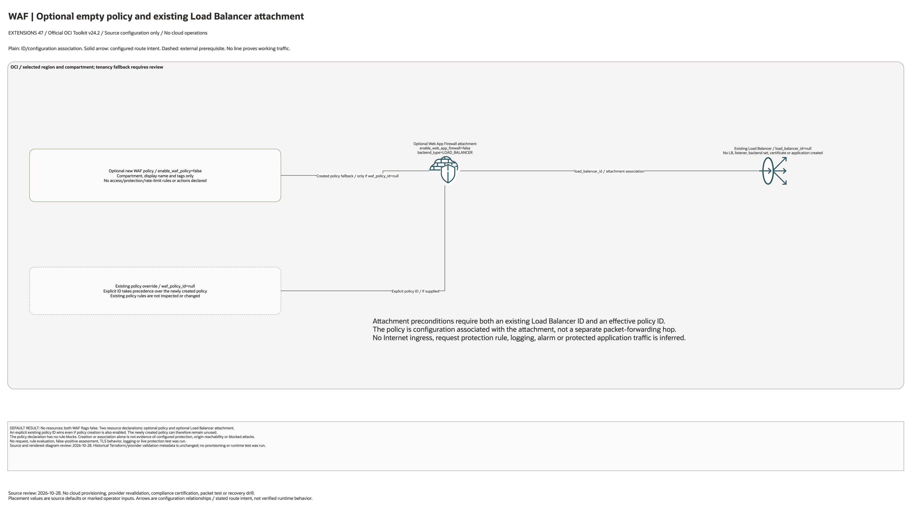

# WAF Extension Architecture

This is the deployment architecture for `blueprints/extensions/waf`. It keeps the design reviewable in GitHub, terminals, pull requests, runbooks, and customer-safe notes without a diagramming tool.

## Deployment Purpose

Creates or attaches an OCI Web Application Firewall policy and binds WAF enforcement to an existing load balancer backend.

## Architecture At A Glance

| Item | Details |
| --- | --- |
| Boundary | `blueprints/extensions/waf` owns this deployment folder and its Terraform + Ansible runners. |
| Purpose | Creates or attaches an OCI Web Application Firewall policy and binds WAF enforcement to an existing load balancer backend. |
| Terraform components | `oci_waf_web_app_firewall_policy.this`, `oci_waf_web_app_firewall.this` |
| Primary architecture view | The diagram shows source-defined components and configuration associations; it is not runtime evidence. |

## Architecture

[Editable overview and native detail pages](architecture.drawio) · [Source resource inventory](resource-inventory.json)

Native pages enumerate every conditional declaration and existing identifier input.
They describe declaration coverage, not expanded deployed resource counts.

## Terraform Components

| Kind | Name | Source Or Role |
| --- | --- | --- |
| Resource | `oci_waf_web_app_firewall_policy.this` | `Declared directly in main.tf` |
| Resource | `oci_waf_web_app_firewall.this` | `Declared directly in main.tf` |

## Request And Deployment Flow

1. Supply the required compartment, service/network identifiers and per-resource configuration.
2. Review each conditional resource and the disabled default result before enabling creation.
3. Review source-defined ID bindings and optional action/target selections against existing dependencies.
4. Implement external image, application, producer/consumer and permissions work where applicable.
5. Test actual service access, data handling and runtime behavior separately from this diagram review.

## Traffic And Trust Boundaries

- Plain lines represent declared IDs or nested configuration. Solid arrows represent configured invocation/delivery intent only.
- Dashed lines identify external work or conditional event-source matching. No connector proves a successful request or working network path.
- Existing network and service identifiers do not imply ownership adoption, permission grants, private DNS, Internet egress or end-to-end connectivity.
- IAM policies use supplied statements; their provider and compartment/tenancy scope require separate review where present.
- Keep credentials, secrets, OCIDs and customer-specific configurations in ignored local inputs or approved secure pipeline stores.

## Detailed Architecture Notes

- No cloud resources by default: `enable_waf_policy=false` and `enable_web_app_firewall=false`.
- The optional new policy declares only compartment, display name and tags. No access rules, protection rules, rate limits or actions are configured by this source.
- An explicit `waf_policy_id` overrides a newly created policy. Attachment preconditions require both an effective policy ID and `load_balancer_id`.
- The firewall resource associates that policy with an existing Load Balancer using the `LOAD_BALANCER` backend default. No Load Balancer, listener, backend set, certificate or application is created.
- The policy is an ID/configuration association, not a separate packet-forwarding hop. No Internet ingress, protection effectiveness, logging, monitoring or request-blocking result is inferred.

Diagram/source review: 2026-10-28. Historical infrastructure/provider validation metadata is unchanged. No provisioning or runtime test was run for this conversion.

## Operational Boundaries

- This extension can run extension-only with supplied brownfield OCI IDs, or as
  base-plus-extension using outputs from core, networking, ownership, or
  operations blueprints.
- Keep customer-specific OCIDs, CIDRs, DNS names, endpoints, contacts, and secrets in ignored local tfvars or approved pipeline variables.
- Run plan from this blueprint folder so relative module paths, provider files, and local Ansible runners resolve predictably.
- Treat apply and destroy as approval-gated operations; use the guarded Ansible playbooks or a reviewed Terraform workflow.
- Re-check route exposure, IAM scope, compartment boundaries, tags, and output hand-offs whenever inputs change.

## Review Checklist

- Confirm the diagram matches `main.tf`: `oci_waf_web_app_firewall_policy.this`, `oci_waf_web_app_firewall.this`.
- Confirm the described traffic path is the path you want in OCI before apply.
- Confirm public exposure, private endpoint access, DNS behavior, DRG routing, and inspection points are intentional where present.
- Confirm IAM scopes, compartment boundaries, tags, and operational outputs match the deployment README.
- Confirm `ansible/plan.yml`, `ansible/apply.yml`, and `ansible/destroy.yml` still point at the shared Terraform runner.
