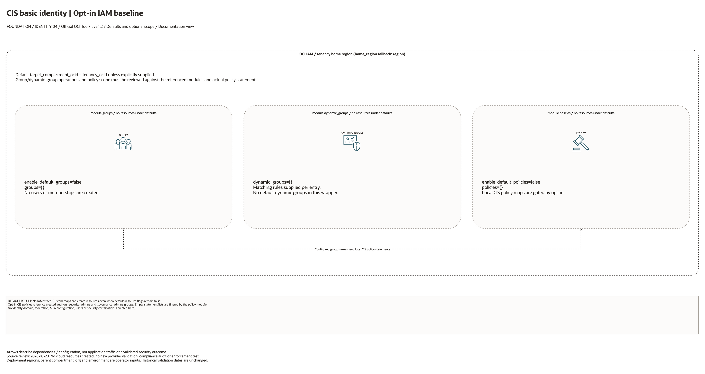

# CIS Basic Identity Architecture

This is the deployment architecture for `blueprints/identity/cis-basic`. The PNG provides a GitHub-readable preview; the draw.io source preserves editable shapes and official OCI icons.

## Deployment Purpose

Creates baseline IAM groups, dynamic groups, and policies suitable for CIS-aligned landing-zone administration.

## Architecture At A Glance

| Item | Details |
| --- | --- |
| Boundary | `blueprints/identity/cis-basic` owns this deployment folder and its Terraform + Ansible runners. |
| Purpose | Creates baseline IAM groups, dynamic groups, and policies suitable for CIS-aligned landing-zone administration. |
| Terraform components | `groups`, `dynamic_groups`, `policies` |
| Primary architecture view | The diagram shows default enablement, tenancy/compartment scope and configuration dependencies; it is not runtime evidence. |

## Architecture

[Editable draw.io source](architecture.drawio). Keep this source aligned with the
PNG documentation preview after diagram changes.

Generated with the [oci-architecture-diagrams skill](https://github.com/leandro-michelino/oci-architecture-diagrams)
and Oracle OCI Architecture Diagram Toolkit v24.2. Regenerate from the repository
root with `python3 scripts/diagrams/foundation-batch-01.py --render`, after
installing the skill and official toolkit. The toolkit is not redistributed here.

The diagram identifies source-default enablement, conditional services,
compartment/tenancy scope and provider-region selection. Arrows describe
configuration dependencies or explicit notification actions, not workload traffic.

Diagram documentation reviewed on 2026-10-28 against root Terraform, variables,
locals, providers and the referenced module definitions. No cloud resources were
created and no Terraform/provider validation date was updated. The diagram does
not establish compliance certification, identity enforcement or runtime behavior.

## Terraform Components

| Kind | Name | Source Or Role |
| --- | --- | --- |
| Module | `groups` | `../../../modules/iam/groups` |
| Module | `dynamic_groups` | `../../../modules/iam/dynamic-groups` |
| Module | `policies` | `../../../modules/iam/policies` |

## Request And Deployment Flow

- Provider authentication uses the home-region IAM plane.
- Terraform creates domains, groups, dynamic groups, or policies in dependency order.
- Outputs expose identity IDs, names, URLs, and policy IDs for operators and downstream blueprints.

## Traffic And Trust Boundaries

- Control plane traffic is local operator or CI authentication into the OCI provider and the Ansible Terraform runner.
- Data plane traffic is the packet or service path shown in the Architecture diagram; if this deployment only creates identity or governance resources, the data plane is intentionally permission and signal flow instead of network packets.
- Trust boundaries are the tenancy, compartment, VCN, subnet, DRG, private endpoint, identity domain, or managed service edges shown in the diagram.
- Secrets, OCIDs, customer CIDRs, endpoint URLs, and contact data belong in ignored local tfvars or a secure pipeline variable store, not in committed files.

## Detailed Architecture Notes

These notes expand the diagram with the design details that usually matter during review, plan, and hand-off.

- Groups and dynamic groups are created before policies so policy statements can reference stable principal names.
- This deployment lives in the IAM control plane and does not create data-plane traffic, but it gates who can operate the landing zone.
- Policy scope should be reviewed against target compartments and least-privilege requirements before apply.
- Outputs expose group, dynamic group, and policy identifiers for governance review and downstream automation.

## Operational Boundaries

- Keep customer-specific OCIDs, CIDRs, DNS names, endpoints, contacts, and secrets in ignored local tfvars or approved pipeline variables.
- Run plan from this blueprint folder so relative module paths, provider files, and local Ansible runners resolve predictably.
- Treat apply and destroy as approval-gated operations; use the guarded Ansible playbooks or a reviewed Terraform workflow.
- Re-check route exposure, IAM scope, compartment boundaries, tags, and output hand-offs whenever inputs change.

## Review Checklist

- Confirm the diagram matches `main.tf`: `groups`, `dynamic_groups`, `policies`.
- Confirm the described traffic path is the path you want in OCI before apply.
- Confirm public exposure, private endpoint access, DNS behavior, DRG routing, and inspection points are intentional where present.
- Confirm IAM scopes, compartment boundaries, tags, and operational outputs match the deployment README.
- Confirm `ansible/plan.yml`, `ansible/apply.yml`, and `ansible/destroy.yml` still point at the shared Terraform runner.
