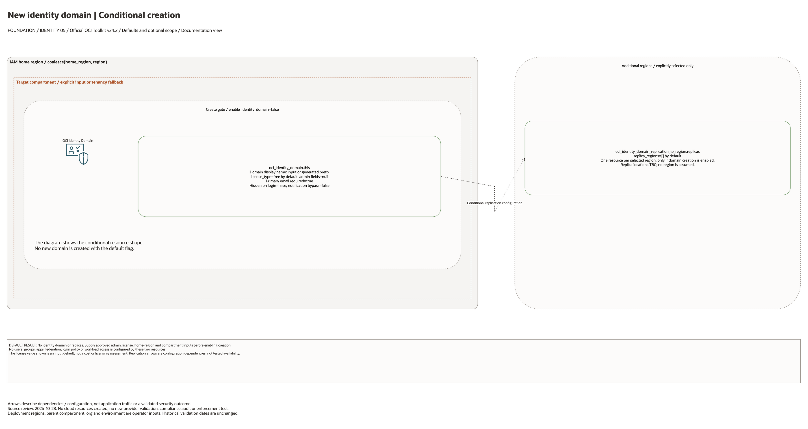

# New Identity Domain Architecture

This is the deployment architecture for `blueprints/identity/new-identity-domain`. The PNG provides a GitHub-readable preview; the draw.io source preserves editable shapes and official OCI icons.

## Deployment Purpose

Creates a single OCI IAM identity domain with optional regional replication.

## Architecture At A Glance

| Item | Details |
| --- | --- |
| Boundary | `blueprints/identity/new-identity-domain` owns this deployment folder and its Terraform + Ansible runners. |
| Purpose | Creates a single OCI IAM identity domain with optional regional replication. |
| Terraform components | `oci_identity_domain.this`, `oci_identity_domain_replication_to_region.replicas` |
| Primary architecture view | The diagram shows default enablement, tenancy/compartment scope and configuration dependencies; it is not runtime evidence. |


## Architecture



[Editable draw.io source](architecture.drawio). Keep this source aligned with the
PNG documentation preview after diagram changes.

Generated with the [oci-architecture-diagrams skill](https://github.com/leandro-michelino/oci-architecture-diagrams)
and Oracle OCI Architecture Diagram Toolkit v24.2. Regenerate from the repository
root with `python3 scripts/diagrams/foundation-batch-01.py --render`, after
installing the skill and official toolkit. The toolkit is not redistributed here.

The diagram identifies source-default enablement, conditional services,
compartment/tenancy scope and provider-region selection. Arrows describe
configuration dependencies or explicit notification actions, not workload traffic.

Diagram documentation reviewed on 2026-10-28 against root Terraform, variables,
locals, providers and the referenced module definitions. No cloud resources were
created and no Terraform/provider validation date was updated. The diagram does
not establish compliance certification, identity enforcement or runtime behavior.

## Resource Detail And Coverage

Reviewed against the updated diagram standard on October 28, 2026. The main
draw.io document contains the topology overview plus every resource-detail and
existing-resource-reference page below. Source declarations include disabled and
collection-based resources from root Terraform, recursively pinned modules and
companion cloud templates. Counts are declarations, not resolved instance counts.

OCI uses Oracle Toolkit icons; Azure and AWS use their respective draw.io icons.
Types without a specific mapped icon retain their exact name and type in a box.
No GCP declarations were found in this fixed 39-blueprint scope.

| Detail page | Declarations | PNG | Editable source |
| --- | --- | --- | --- |
| OCI resources | 2 | [PNG](oci-resources.png) | [draw.io](oci-resources.drawio) |

[Existing resources and override inputs](existing-resources.png) | [Editable reference page](existing-resources.drawio)

[Source inventory](resource-inventory.json) records exact declarations, full
creation expressions, module call-site gates/enablement inputs, pinned revisions,
source hashes and diagram node mappings. Identifier-input references are listed
separately from managed resources. Null/empty inputs do not prove an external
resource exists; collection schemas may contain additional resource identifiers.

The overview explains default enablement. Resource cards enumerate all declaration
branches and do not imply deployment, ownership adoption, packet flow, security
enforcement or recovery success. No historical Terraform validation date changed.

```bash
python3 scripts/diagrams/multicloud-resource-coverage.py --blueprint identity/new-identity-domain --render
python3 scripts/diagrams/multicloud-resource-coverage.py --blueprint identity/new-identity-domain --check
```

If regenerating the overview first, rebuild these detail pages afterward.
See [the fixed first-39 review](../../../../docs/diagrams/FIRST-39-REVIEW.md) and [provider icon sources](../../../../scripts/diagrams/assets/README.md).

## Terraform Components

| Kind | Name | Source Or Role |
| --- | --- | --- |
| Resource | `oci_identity_domain.this` | `Declared directly in main.tf` |
| Resource | `oci_identity_domain_replication_to_region.replicas` | `Declared directly in main.tf` |

## Request And Deployment Flow

- Provider authentication uses the home-region IAM plane.
- Terraform creates domains, groups, dynamic groups, or policies in dependency order.
- Outputs expose identity IDs, names, URLs, and policy IDs for operators and downstream blueprints.

## Traffic And Trust Boundaries

- Control plane traffic is local operator or CI authentication into the OCI provider and the Ansible Terraform runner.
- Data plane traffic is the packet or service path shown in the Architecture diagram; if this deployment only creates identity or governance resources, the data plane is intentionally permission and signal flow instead of network packets.
- Trust boundaries are the tenancy, compartment, VCN, subnet, DRG, private endpoint, identity domain, or managed service edges shown in the diagram.
- Secrets, OCIDs, customer CIDRs, endpoint URLs, and contact data belong in ignored local tfvars or a secure pipeline variable store, not in committed files.

## Detailed Architecture Notes

These notes expand the diagram with the design details that usually matter during review, plan, and hand-off.

- This deployment creates one identity domain when enable_identity_domain is true.
- Replica regions are created after the domain exists and should be aligned with regional availability and recovery needs.
- Admin user fields, notification behavior, login visibility, and primary email requirements should be reviewed before apply.
- The identity domain ID and URL are the primary hand-offs for identity operations, federation, and application onboarding.

## Operational Boundaries

- Keep customer-specific OCIDs, CIDRs, DNS names, endpoints, contacts, and secrets in ignored local tfvars or approved pipeline variables.
- Run plan from this blueprint folder so relative module paths, provider files, and local Ansible runners resolve predictably.
- Treat apply and destroy as approval-gated operations; use the guarded Ansible playbooks or a reviewed Terraform workflow.
- Re-check route exposure, IAM scope, compartment boundaries, tags, and output hand-offs whenever inputs change.

## Review Checklist

- Confirm the diagram matches `main.tf`: `oci_identity_domain.this`, `oci_identity_domain_replication_to_region.replicas`.
- Confirm the described traffic path is the path you want in OCI before apply.
- Confirm public exposure, private endpoint access, DNS behavior, DRG routing, and inspection points are intentional where present.
- Confirm IAM scopes, compartment boundaries, tags, and operational outputs match the deployment README.
- Confirm `ansible/plan.yml`, `ansible/apply.yml`, and `ansible/destroy.yml` still point at the shared Terraform runner.
