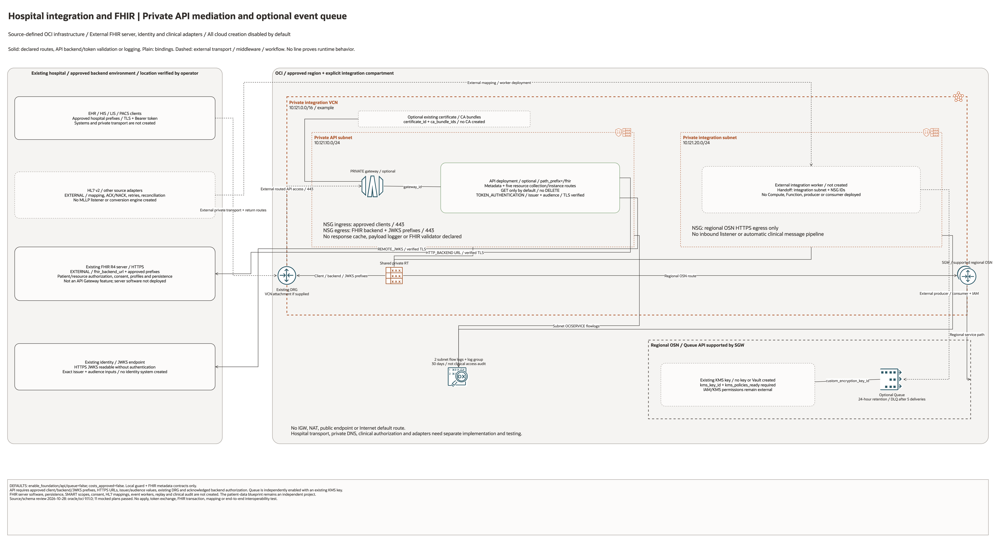

# Hospital Integration And FHIR Architecture

## Deployment Purpose

Provide private API mediation and optional asynchronous-event infrastructure for
an existing hospital FHIR R4 service. Clinical server software, source adapters,
patient records and record-level authorization remain separately managed.

## Architecture At A Glance

| Layer | Declared resources or explicit prerequisite |
| --- | --- |
| Hospital | Existing clients, EHR/HIS/LIS/PACS, FHIR server and identity issuer/JWKS. |
| Network | Private integration VCN, API and integration subnets, empty list and explicit NSGs. |
| Transport | Optional new VCN attachment to an existing DRG; hospital/backend/JWKS routes. |
| API | PRIVATE API Gateway, `/fhir` deployment, token/JWKS validation and HTTPS backends. |
| Events | Optional encrypted Queue with finite retention and native dead-letter settings. |
| Workers | External producer/consumer/HL7 adapters; no Compute, Function or listener created. |
| Operations | Two subnet flow logs; local guard and integration metadata contracts. |

## Architecture

[Editable draw.io source](architecture.drawio). Solid arrows show declared route,
HTTP backend, token-validation or logging intent. Plain lines show associations.
Dashed arrows show external hospital transport, middleware or workflow. No line
establishes runtime traffic, a working FHIR server or clinical interoperability.

## Terraform Components

- `main.tf`: private network, optional API/deployment/Queue, NSGs and flow logs.
- `locals.tf`: creation gates, address checks and FHIR route subset.
- `variables.tf`: approved private endpoints, prefixes, identity and queue inputs.
- `outputs.tf`: created IDs, private gateway URL and integration-worker handoffs.
- `integration/README.md`: externally implemented clinical integration boundaries.
- `tests/configuration-regressions.tftest.hcl`: local mocked configuration checks.

## Request And Deployment Flow

1. Review source/target FHIR profiles, authorization and clinical interface owners.
2. Leave all creation disabled until private connectivity and costs are approved.
3. Enable the private network; verify addressing and existing-DRG route intent.
4. Provide FHIR backend/JWKS HTTPS URLs, trusted issuer/audience and explicit CIDRs.
5. Enable the private API, initially with GET-only resource routes.
6. Enable Queue separately only after KMS, payload and worker ownership review.
7. Test token denial, backend authorization, proxy behavior, adapters and recovery.

## Traffic And Trust Boundaries

Hospital transport and DRG import/export/return routing are external. There is no
IGW, NAT, public API endpoint or Internet default route. API ingress is 443 from
approved client prefixes. API egress is 443 to approved backend/JWKS prefixes.
The backend and JWKS endpoint must be reachable through the selected private path.

TOKEN_AUTHENTICATION rejects anonymous access and verifies remote JWKS TLS,
issuer and audience. Backend HTTPS verification stays enabled. Patient/resource
permissions, SMART scopes, consent and identity-context propagation require
backend/application implementation and tests; the acknowledgement flag is not proof.

The integration-worker NSG permits only regional OSN HTTPS egress. Workers must
be deployed and authorized separately. Queue creation does not connect the API,
FHIR server or hospital message bus automatically.

## Detailed Architecture Notes

The default route subset covers metadata and five resources, using GET only.
POST/PUT/PATCH are explicit opt-ins scoped to collection/instance interactions;
DELETE is excluded. FHIR validation and CapabilityStatement correctness belong
to the actual backend. Reserved path values must be validated by that backend.

KMS key, DRG, certificate, optional private-PKI CA bundles, JWKS and FHIR server are existing inputs or external
prerequisites. No remote-cloud resource topology is guessed. The companion
patient-data blueprint is independent until routing/software/identity are wired.

## Operational Boundaries

The Queue has native dead-letter settings but no replay/consumer implementation.
No patient-data migration, clinical message processing, FHIR persistence engine,
terminology service, profile validator, clinical audit collector or DR test ran.
Network logs do not prove clinical access-audit completeness. No compliance or
clinical safety outcome is implied by schema or mocked plan validation.

## Review Checklist

- Verify private routing, DNS and TLS to FHIR and JWKS endpoints.
- Review exact resource/method allowlists and backend patient authorization.
- Test token failures, key rotation, headers, search/paging and operation behavior.
- Review event payload, retry/duplicate handling, dead-letter ownership and KMS/IAM.
- Validate mappings and profiles with synthetic data before clinical acceptance.
- Keep infrastructure configuration distinct from clinical implementation evidence.
