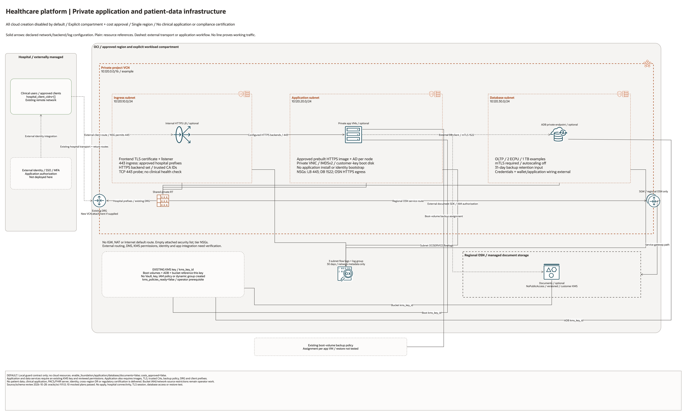

# Healthcare Platform Architecture

## Deployment Purpose

Provide a private OCI project foundation for hospital applications and data.
The assumed scope is application infrastructure built from customer-approved
images, with optional database and document services. No clinical software,
patient records, partner cloud resources or identity system is provisioned.

## Architecture At A Glance

| Area | Source-defined behavior |
| --- | --- |
| Network | One VCN, three private regional subnets, empty attached security list and tier NSGs. |
| Routing | Regional OSN prefix to SGW; approved hospital prefixes to an existing DRG when supplied. |
| Application | Internal HTTPS LB and optional private Compute instances from approved images. |
| Data | Private ADB/mTLS and versioned Object Storage with an existing KMS key. |
| Operations | Three VCN flow logs and optional application boot-volume backup-policy assignments. |
| Defaults | All cloud creation flags false; no Internet Gateway, NAT or public endpoint. |

## Architecture

[Editable draw.io source](architecture.drawio). Solid arrows show declared
network/backend/log delivery configuration; plain lines show resource bindings.
Dashed arrows show external transport or application integrations not implemented
by this Terraform root. No connector proves functioning traffic.

## Terraform Components

- `main.tf`: guard, network, NSGs, optional app/data services and flow logs.
- `locals.tf`: explicit creation gates and subnet range calculations.
- `variables.tf`: approved placement, existing IDs, TLS, image and sizing inputs.
- `outputs.tf`: created-resource identifiers, private VM addresses and DB endpoint.
- `tests/configuration-regressions.tftest.hcl`: schema/mocked-plan invariants.

## Request And Deployment Flow

1. Leave creation disabled while reviewing project classification and handoffs.
2. Enable only the approved network foundation and inspect the plan.
3. Supply an existing DRG/transport, hospital CIDRs, KMS key/permissions and TLS inputs.
4. Select approved HTTPS images and a VM backup policy before enabling Compute/LB.
5. Enable the optional ADB and document bucket independently, after sizing review.
6. Configure application identity, database clients and document access externally.
7. Test patient workflows, access audit, restore and availability separately.

## Traffic And Trust Boundaries

Hospital-to-OCI transport, remote routing and DNS are external. The created VCN
attachment does not configure the hospital router, VPN, FastConnect circuit or
DRG route distribution. Each subnet binds the shared private route table.

The internal LB accepts hospital CIDRs on 443. HTTPS backends use peer validation.
App-to-ADB NSG rules permit TCP 1522; the app still needs credentials, wallets and
client configuration. The OSN path permits regional HTTPS service access, while
application document reads/writes and IAM authorization remain external.

The bucket's `NoPublicAccess` setting prevents anonymous reads; network-source
restrictions for authenticated requests are not created. The shared empty
security list prevents default SSH/broad egress grants. Link-local OCI platform
traffic has documented filtering exceptions; guest firewall/image policy still matters.

## Detailed Architecture Notes

Existing KMS, DRG, backup policy and backend trust IDs are prerequisites, not
resources created or adopted by this project. The diagram distinguishes their
reference bindings from created resources. Source-detail pages enumerate all
conditional declarations even when disabled; they are not a live inventory.

No frontend public path, Internet default route, TLS bypass or auto database
scaling is introduced. Example CIDRs, ECPU, storage and VM allocations require
review. Network flow logs are not clinical application audit logs.

## Operational Boundaries

This is single-region infrastructure. No cross-region replication, secondary
clinical service, immutable retention policy, emergency access workflow or tested
failover is delivered. No application install, schema migration, patient-data
migration, healthcare interoperability implementation or clinical validation ran.

## Review Checklist

- Verify region, compartment, cost approval and non-overlapping addressing.
- Review hospital prefixes, DRG import/export/return routing and private DNS.
- Verify KMS policies, TLS material, trusted CAs, images and backup policy.
- Inspect all service connectors and creation conditions against the source.
- Test application authorization, audit, backup restoration and operational handoffs.
- Keep static validation, provisioning and runtime acceptance separate.
