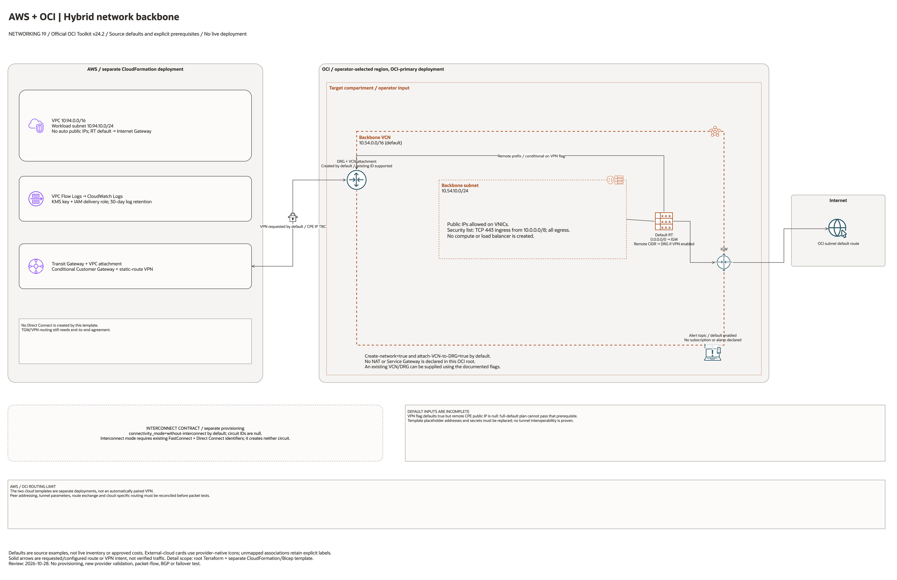

# AWS + OCI Hybrid Network Backbone Architecture

This page is the deployment architecture for
`blueprints/networking/aws-oci-hybrid-network-backbone`. It is intentionally
Architecture-first so it is easy to review in GitHub, terminals, pull
requests, runbooks, and customer-safe notes without a diagramming tool.

## Deployment Purpose

Implements an OCI-primary hybrid backbone where OCI DRG is the primary routing
hub, with AWS connectivity through site-to-site VPN first and optional partner
Direct Connect + FastConnect interconnect contract metadata for final cutover.

## Architecture At A Glance

| Item | Details |
| --- | --- |
| Boundary | `blueprints/networking/aws-oci-hybrid-network-backbone` owns this deployment folder and its Terraform + Ansible runners. |
| Purpose | Build OCI DRG-primary backbone networking and publish IPSec-first, interconnect-ready routing contracts for AWS + OCI operations. |
| Terraform components | `oci_core_vcn.backbone`, `oci_core_route_table.backbone`, `oci_core_security_list.backbone`, `oci_core_subnet.backbone`, `oci_core_drg.primary`, `oci_core_drg_attachment.backbone`, `oci_core_cpe.aws`, `oci_core_ipsec.aws`, `terraform_data.connectivity_contract`, `terraform_data.routing_contract` |
| Primary architecture view | The Architecture diagram below shows the OCI hub, AWS side connectivity assumptions, and contract outputs for this deployment. |

## Architecture



[Editable draw.io source](architecture.drawio). Keep this source and the PNG preview
aligned after every diagram change.

Generated with the [oci-architecture-diagrams skill](https://github.com/leandro-michelino/oci-architecture-diagrams)
and Oracle OCI Architecture Diagram Toolkit v24.2. Regenerate from the repository
root with `python3 scripts/diagrams/networking-batch-04.py --render`, after
installing the skill and its official toolkit. The toolkit is not redistributed here.

The diagram uses source-default CIDRs, explicitly identifies incomplete inputs,
and distinguishes network resources from external dependencies and metadata
contracts. Placement labels are defaults or operator inputs, not live inventory.

Diagram documentation reviewed on 2026-10-28 against root Terraform, referenced
modules, and any accompanying CloudFormation/Bicep template. No cloud resources
were provisioned and no Terraform/provider validation date was changed.
This diagram is not evidence of connectivity, BGP, failover or DR readiness.

## Resource Detail And Coverage

The main draw.io document includes the overview and a resource-detail page for
each cloud below. Every root/transitive OCI declaration and companion-template
declaration is mapped to a named resource card, including conditional resources.
Collection cards represent source declarations, not resolved deployment counts.

| Scope | Source declarations | PNG detail | Editable detail |
| --- | --- | --- | --- |
| AWS | 17 | [PNG](aws-resources.png) | [draw.io](aws-resources.drawio) |
| Contracts | 3 | [PNG](contracts-resources.png) | [draw.io](contracts-resources.drawio) |
| OCI | 10 | [PNG](oci-resources.png) | [draw.io](oci-resources.drawio) |

[Resource inventory and source-to-node coverage](resource-inventory.json).
Contracts are local Terraform metadata resources, not deployed cloud services.
Data lookups are recorded separately. Pinned module sources and source hashes
are retained in the inventory; the overview describes default enablement.

After regenerating the overview, rebuild all resource pages and verify coverage:

```bash
python3 scripts/diagrams/multicloud-resource-coverage.py --blueprint networking/aws-oci-hybrid-network-backbone --render
python3 scripts/diagrams/multicloud-resource-coverage.py --blueprint networking/aws-oci-hybrid-network-backbone --check
```

## Terraform Components

| Kind | Name | Source Or Role |
| --- | --- | --- |
| Resource | `oci_core_vcn.backbone`, `oci_core_route_table.backbone`, `oci_core_security_list.backbone`, `oci_core_subnet.backbone` | Optional OCI backbone network foundation. |
| Resource | `oci_core_drg.primary` | OCI DRG primary backbone hub. |
| Resource | `oci_core_drg_attachment.backbone` | Optional DRG attachment to OCI backbone VCN. |
| Resource | `oci_core_cpe.aws`, `oci_core_ipsec.aws` | Optional VPN path resources for AWS connectivity. |
| Resource | `oci_ons_notification_topic.backbone_alert` | Optional operations topic for backbone alerts. |
| Resource | `terraform_data.oci_network_contract` | OCI network IDs and subnet/route/security contract output. |
| Resource | `terraform_data.connectivity_contract` | IPSec-first and optional interconnect mode contract output. |
| Resource | `terraform_data.routing_contract` | Route governance contract output. |
| Resource | `oci_core_internet_gateway.backbone` | Declared in this blueprint; creation depends on its count or for_each inputs. |

## Request And Deployment Flow

- Operator decides backbone mode: interconnect, without interconnect, and VPN path usage.
- Terraform creates optional OCI VCN route/security components for deploy-and-use backbone networking.
- Terraform creates OCI DRG and optional DRG attachment, CPE, and IPSec resources.
- Terraform publishes connectivity and routing contracts for cross-cloud operations runbooks.
- AWS-side stack outputs from `aws/main.yaml` are paired with these contracts.

## Traffic And Trust Boundaries

- Control plane traffic is local or CI execution authenticated to OCI and AWS CLI contexts.
- Data plane traffic starts through OCI DRG and IPSec tunnels, with optional interconnect path at final cutover.
- Trust boundaries include OCI tenancy ownership, AWS account ownership, and partner interconnect ownership.
- Connection IDs, public endpoint IPs, and account identifiers belong in ignored local tfvars or secure pipeline variable stores.

## Detailed Architecture Notes

- The OCI provider preserves the automatically assigned `Oracle-Tags.CreatedBy` and `Oracle-Tags.CreatedOn` provenance tags through `ignore_defined_tags`. Other defined tags remain managed. See [Oracle provider troubleshooting](https://docs.oracle.com/en-us/iaas/Content/dev/terraform/troubleshooting.htm).

- DRG attachment creation is controlled by the explicit attachment flag. Resource IDs are attachment arguments, not inputs to `count`, so a new VCN and DRG can be planned together in one step.

- OCI DRG is always created as the primary network hub for this pattern.
- Backbone VCN resources are optional so this blueprint supports extension-only and deploy-and-use models.
- Site-to-site VPN creation is optional and guarded by `aws_cpe_public_ip` preconditions.
- Interconnect mode enforces presence or absence of FastConnect and Direct Connect IDs.
- Routing contract output keeps cross-cloud CIDR expectations explicit for approvals and runbooks.
- AWS side provisioning is intentionally handled by blueprint-local CloudFormation session files in `aws/`.

## Operational Boundaries

- Apply and destroy are approval-gated through guarded Ansible workflows.
- Keep tenancy-specific OCIDs, Direct Connect IDs, and public IP endpoints in ignored local tfvars.
- Re-run plan whenever CIDR ranges, connectivity mode, or VPN enablement changes.
- Validate that AWS session outputs are synchronized with Terraform contract inputs before production changes.
- Use contract outputs as the source of truth for network operations hand-off notes.

## Review Checklist

- Confirm the diagram matches `main.tf`: `oci_core_vcn.backbone`, `oci_core_route_table.backbone`, `oci_core_security_list.backbone`, `oci_core_subnet.backbone`, `oci_core_drg.primary`, `oci_core_drg_attachment.backbone`, `oci_core_cpe.aws`, `oci_core_ipsec.aws`, `terraform_data.connectivity_contract`, `terraform_data.routing_contract`.
- Confirm OCI remains the primary backbone hub for this environment.
- Confirm connectivity mode intent and interconnect IDs are correct.
- Confirm VPN enablement and AWS endpoint public IP values are deliberate.
- Confirm route CIDR expectations across OCI and AWS are accurate.
- Confirm `ansible/plan.yml`, `ansible/apply.yml`, and `ansible/destroy.yml` still point at the shared Terraform runner.
