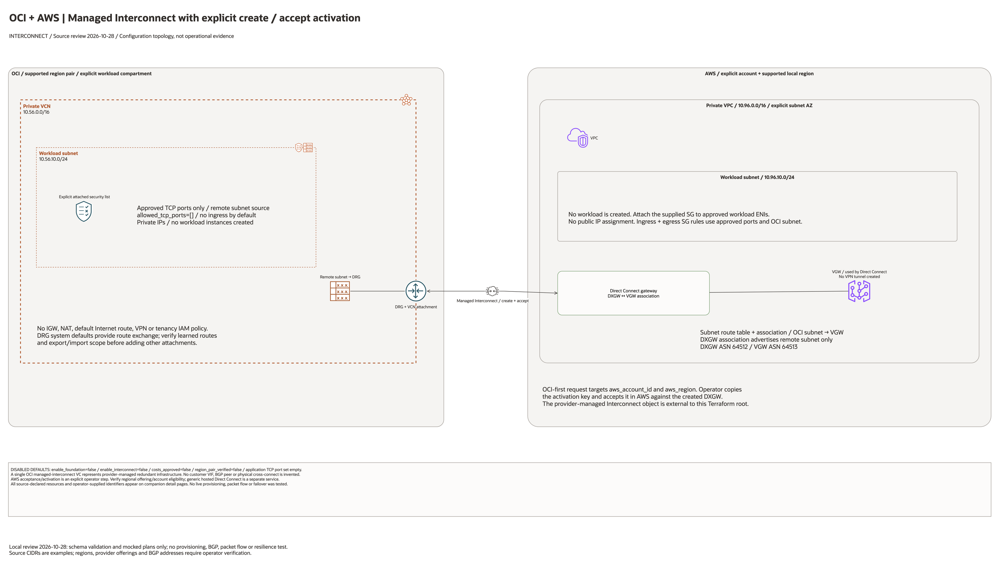

# OCI + AWS Managed Interconnect Architecture

## Deployment Purpose

Provide a source-bounded deployment topology for dedicated interconnect with
both OCI and AWS networking resources declared. Provider activation steps
remain visible and are not represented as successfully completed resources.

## Architecture At A Glance

| Layer | Components |
| --- | --- |
| OCI foundation | Explicit compartment; VCN, private subnet, attached security list, route table, DRG and VCN attachment. |
| AWS foundation | VPC, private subnet, route table/association and route to the OCI subnet. |
| AWS gateways | VGW attached to VPC; Direct Connect gateway; DXGW/VGW association advertising the remote subnet. A VGW here does not create a VPN tunnel. |
| AWS access | Empty security group and optional scoped ingress/egress rules; operator attaches the SG to approved workload ENIs. |
| OCI circuit | One OCI-first managed Interconnect request using remote AWS account and region, attached to OCI DRG. |
| External activation | AWS managed Interconnect object and acceptance against the DXGW; explicitly outside Terraform ownership. |
| Controls | Disabled creation defaults, cost/eligibility guards and approved TCP port list. |

## Architecture



[Editable draw.io diagram](architecture.drawio)

The overview uses source default CIDRs as examples. Regions and offering IDs
remain operator inputs. Connections show configuration intent, not tested
traffic. All detail pages are included in the main editable document.

## Resource Detail And Coverage

Resource maps enumerate root declarations, including disabled and collection
resources. Counts are declarations, not expanded resource instances. Existing
identifiers and override inputs are documented separately from created assets.
The [inventory](resource-inventory.json) records source hashes and node mappings.

| Scope | Declarations / references | PNG | Editable source |
| --- | --- | --- | --- |
| AWS resources | 11 | [PNG](aws-resources.png) | [draw.io](aws-resources.drawio) |
| Contracts resources | 1 | [PNG](contracts-resources.png) | [draw.io](contracts-resources.drawio) |
| OCI resources | 7 | [PNG](oci-resources.png) | [draw.io](oci-resources.drawio) |
| Existing identifiers | 3 | [PNG](existing-resources.png) | [draw.io](existing-resources.drawio) |


## Terraform Components

- `main.tf`: OCI and remote resources plus input guards.
- `variables.tf`: explicit provider ownership, region pair, ports and circuit inputs.
- `locals.tf`: naming and address-range checks.
- `providers.tf` / `versions.tf`: credentials through provider chains and exact tested provider versions.
- `outputs.tf`: selected resource identifiers and runbook hand-off.
- `tests/configuration-regressions.tftest.hcl`: isolated mocked plans and rejection cases.
- `ansible/*.yml`: shared guarded runner, no automatic apply.

## Request And Deployment Flow

1. Verify current OCI/AWS offering access, supported local region pair, account ownership, quota, bandwidth and charges. The disabled example's regions are placeholders, not an approved pair.
2. Set `costs_approved=true` and `enable_foundation=true`; inspect the plan before any apply. This creates both cloud networks and the VGW/DXGW association.
3. Confirm provider service selection specifically identifies the managed AWS Interconnect offering; do not substitute a generic partner connection.
4. Set `region_pair_verified=true`, the verified `provider_service_id` and `enable_interconnect=true`. Review the OCI-first private circuit request targeting the selected AWS account and region.
5. Copy the activation key securely from OCI and accept the managed multicloud Interconnect in AWS against the created Direct Connect gateway. This acceptance and the AWS managed object are operator/provider managed, outside this Terraform root.
6. Wait for provider provisioning and BGP UP. Verify the DRG and DXGW/VGW route scope and bidirectional application traffic with separately approved workloads.
7. Test provider-path resilience and capture runtime evidence before any production acceptance. No customer VIF or manually configured managed-service BGP peer is required by this blueprint.
8. Before teardown, coordinate termination of the managed object in both consoles. Remove the OCI circuit and gateway association, then the remaining foundations; verify both inventories.

## Traffic And Trust Boundaries

- OCI subnet blocks public IP assignment and attaches the explicit security list.
- Application traffic is limited to the opposite workload subnet and approved ports. Default port set is empty.
- No public workload, Internet gateway, NAT or Internet default route is created.
- Provider service, pairing/activation key and region eligibility are external contracts, not discovered account permissions.
- System DRG routing must be checked for learned prefixes and export scope before expanding the topology.
- Existing organization service perimeters, account controls and application encryption remain operator prerequisites.

## Detailed Architecture Notes

The managed service exposes one logical Interconnect across provider-operated redundant infrastructure. It is distinct from an AWS Direct Connect partner interconnect or a customer-owned physical cross-connect. The AWS managed object is activated separately with the key; no fabricated Terraform resource claims ownership of that object. The VGW serves Direct Connect; no Site-to-Site VPN exists in this blueprint.

## Operational Boundaries

Only schema validation and mocked plans were run for this change. No cloud
resource was created, no route or BGP session was observed, and no packet-flow,
resilience, latency, encryption or cleanup test was performed. Production
acceptance requires a separately approved deployment and evidence from both clouds.

Regenerate with the installed `oci-architecture-diagrams` skill and Oracle
Toolkit v24.2; external resources use mapped native provider icons. Unmapped
associations and metadata use named boxes.

```bash
python3 scripts/diagrams/interconnect-batch-01.py --render
python3 scripts/diagrams/multicloud-resource-coverage.py --blueprint networking/aws-oci-managed-interconnect --render
python3 scripts/diagrams/multicloud-resource-coverage.py --blueprint networking/aws-oci-managed-interconnect --check
```

## Review Checklist

- Confirm current region pair, offering, provider service, account/project and bandwidth.
- Review both cloud plans and cost scope before any apply.
- Verify non-overlapping CIDRs, private subnet placement and explicit application ports.
- Complete partner activation and reconcile ownership of all provider-created objects.
- Inspect effective routes and both directions of permitted traffic using approved workloads.
- Test resilience and teardown with evidence before declaring operational readiness.

## Official References

- [Oracle Interconnect for AWS](https://docs.oracle.com/en-us/iaas/Content/multicloud/interconnect-aws.htm)
- [AWS managed create/accept workflow](https://docs.aws.amazon.com/interconnect/latest/userguide/getting-started-multicloud.html)
- [AWS Direct Connect gateway association](https://registry.terraform.io/providers/hashicorp/aws/latest/docs/resources/dx_gateway_association)
