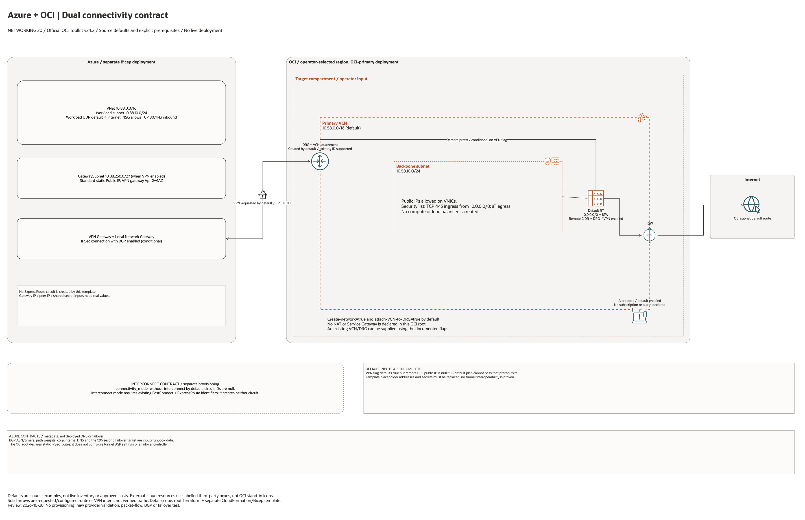

# Azure + OCI Dual Connectivity Hardening Architecture

This page is the deployment architecture for
`blueprints/networking/azure-oci-dual-connectivity`. It is Architecture-first
so the design is easy to review in GitHub, terminals, pull requests, runbooks,
and customer-safe notes without a diagramming tool.

## Deployment Purpose

Implements an OCI-primary network connectivity pattern with two explicit paths:
IPSec/BGP for first bring-up and validation, then optional Interconnect for
final cutover.

## Architecture At A Glance

| Item | Details |
| --- | --- |
| Boundary | `blueprints/networking/azure-oci-dual-connectivity` owns this deployment folder and its Terraform + Ansible runners. |
| Purpose | Build OCI-primary DRG routing baseline and publish IPSec-first, interconnect-optional, DNS, and runbook contracts for Azure + OCI operations. |
| Terraform components | `oci_core_vcn.primary`, `oci_core_route_table.primary`, `oci_core_security_list.primary_hub`, `oci_core_subnet.primary_hub`, `oci_core_drg.primary`, `oci_core_drg_attachment.primary`, `oci_core_cpe.azure`, `oci_core_ipsec.azure`, `terraform_data.connectivity_contract`, `terraform_data.ipsec_fallback_contract`, `terraform_data.routing_contract`, `terraform_data.dns_contract`, `terraform_data.runbook_contract` |
| Primary architecture view | The Architecture diagram below shows OCI control-plane ownership, Azure edge assumptions, and the route preference model. |

## Architecture



[Editable draw.io source](architecture.drawio). Keep this source and the PNG preview
aligned after every diagram change.

Generated with the [oci-architecture-diagrams skill](https://github.com/leandro-michelino/oci-architecture-diagrams)
and Oracle OCI Architecture Diagram Toolkit v24.2. Regenerate from the repository
root with `python3 scripts/diagrams/networking-batch-04.py --render`, after
installing the skill and its official toolkit. The toolkit is not redistributed here.

The diagram uses source-default CIDRs, explicitly identifies incomplete inputs,
and distinguishes network resources from external dependencies and metadata
contracts. Placement labels are defaults or operator inputs, not live inventory.

Diagram documentation reviewed on 2026-10-28 against root Terraform, referenced
modules, and any accompanying CloudFormation/Bicep template. No cloud resources
were provisioned and no Terraform/provider validation date was changed.
This diagram is not evidence of connectivity, BGP, failover or DR readiness.

## Resource Detail And Coverage

The main draw.io document includes the overview and a resource-detail page for
each cloud below. Every root/transitive OCI declaration and companion-template
declaration is mapped to a named resource card, including conditional resources.
Collection cards represent source declarations, not resolved deployment counts.

| Scope | Source declarations | PNG detail | Editable detail |
| --- | --- | --- | --- |
| Azure | 9 | [PNG](azure-resources.png) | [draw.io](azure-resources.drawio) |
| Contracts | 6 | [PNG](contracts-resources.png) | [draw.io](contracts-resources.drawio) |
| OCI | 10 | [PNG](oci-resources.png) | [draw.io](oci-resources.drawio) |

[Resource inventory and source-to-node coverage](resource-inventory.json).
Contracts are local Terraform metadata resources, not deployed cloud services.
Data lookups are recorded separately. Pinned module sources and source hashes
are retained in the inventory; the overview describes default enablement.

After regenerating the overview, rebuild all resource pages and verify coverage:

```bash
python3 scripts/diagrams/multicloud-resource-coverage.py --blueprint networking/azure-oci-dual-connectivity --render
python3 scripts/diagrams/multicloud-resource-coverage.py --blueprint networking/azure-oci-dual-connectivity --check
```

## Terraform Components

| Kind | Name | Source Or Role |
| --- | --- | --- |
| Resource | `oci_core_vcn.primary`, `oci_core_route_table.primary`, `oci_core_security_list.primary_hub`, `oci_core_subnet.primary_hub` | Optional OCI primary connectivity network with deploy-and-use routing and security controls. |
| Resource | `oci_core_drg.primary` | OCI DRG as primary route control hub. |
| Resource | `oci_core_drg_attachment.primary` | Optional DRG attachment to OCI VCN. |
| Resource | `oci_core_cpe.azure`, `oci_core_ipsec.azure` | Optional IPSec fallback tunnel resources for Azure edge failover. |
| Resource | `oci_ons_notification_topic.connectivity_alert` | Optional operations alerts topic. |
| Resource | `terraform_data.oci_network_contract` | OCI network and DRG contract output. |
| Resource | `terraform_data.connectivity_contract` | IPSec-first and optional interconnect-mode contract output. |
| Resource | `terraform_data.ipsec_fallback_contract` | Fallback IPSec/BGP contract output. |
| Resource | `terraform_data.routing_contract` | CIDR exchange and path preference contract output. |
| Resource | `terraform_data.dns_contract` | Optional DNS forwarding and probe contract output. |
| Resource | `terraform_data.runbook_contract` | Failover/failback operational sequence output. |
| Resource | `oci_core_internet_gateway.primary` | Declared in this blueprint; creation depends on its count or for_each inputs. |

## Request And Deployment Flow

- Operator defines whether interconnect is active and whether IPSec fallback is enabled.
- Terraform builds optional OCI network resources and always builds primary DRG.
- Terraform optionally builds OCI CPE and IPSec resources for fallback path.
- Terraform publishes interconnect, fallback, routing, DNS, and runbook contracts.
- Azure-side sessions (`ansible/azure-*.yml`) apply the fallback edge resources from `azure/main.bicep`.

## Traffic And Trust Boundaries

- Control plane traffic runs from local workstation/CI to OCI and Azure APIs.
- Data plane starts with IPSec and can shift to Interconnect in final cutover using operator-controlled runbook steps.
- Trust boundaries include OCI tenancy ownership, Azure subscription ownership, and partner interconnect ownership.
- Connection IDs, public IP endpoints, and circuit identifiers must stay in ignored local tfvars or secure pipeline variables.

## Detailed Architecture Notes

- The OCI provider preserves the automatically assigned `Oracle-Tags.CreatedBy` and `Oracle-Tags.CreatedOn` provenance tags through `ignore_defined_tags`. Other defined tags remain managed. See [Oracle provider troubleshooting](https://docs.oracle.com/en-us/iaas/Content/dev/terraform/troubleshooting.htm).

- DRG attachment creation is controlled by the explicit attachment flag. Resource IDs are attachment arguments, not inputs to `count`, so a new VCN and DRG can be planned together in one step.

- OCI remains primary by contract (`oci_is_primary=true`) for this blueprint variant.
- `connectivity_mode=interconnect` enforces both FastConnect and ExpressRoute IDs.
- `connectivity_mode=without-interconnect` enforces null interconnect IDs and keeps fallback logic explicit.
- Fallback IPSec creation is optional and gated by `azure_cpe_public_ip` preconditions.
- Routing contract outputs keep CIDR exchange and path preference visible for approvals and troubleshooting.
- DNS contract output keeps resolver and probe assumptions explicit for failback validation.
- Azure-side resources are provisioned from `azure/main.bicep` and consumed in operations runbooks with Terraform contract outputs.

## Operational Boundaries

- Apply and destroy are approval-gated through guarded Ansible workflows.
- Keep circuit IDs, public endpoint values, and tenancy-specific OCIDs in ignored local tfvars.
- Re-run plan whenever connectivity mode, fallback policy, CIDRs, or BGP timer assumptions change.
- Validate Azure session outputs and Terraform contract inputs stay aligned before production changes.
- Use contract outputs as the source of truth for NOC/SRE runbook handoff.

## Review Checklist

- Confirm the diagram matches `main.tf`: `oci_core_vcn.primary`, `oci_core_route_table.primary`, `oci_core_security_list.primary_hub`, `oci_core_subnet.primary_hub`, `oci_core_drg.primary`, `oci_core_drg_attachment.primary`, `oci_core_cpe.azure`, `oci_core_ipsec.azure`, `terraform_data.connectivity_contract`, `terraform_data.ipsec_fallback_contract`, `terraform_data.routing_contract`, `terraform_data.dns_contract`, `terraform_data.runbook_contract`.
- Confirm OCI remains primary for this environment.
- Confirm interconnect IDs and mode selection are intentional.
- Confirm fallback enablement, Azure endpoint public IP, and CIDR exchange are deliberate.
- Confirm DNS resolver and health-probe assumptions match operations ownership.
- Confirm `ansible/plan.yml`, `ansible/apply.yml`, and `ansible/destroy.yml` still point at the shared Terraform runner.
