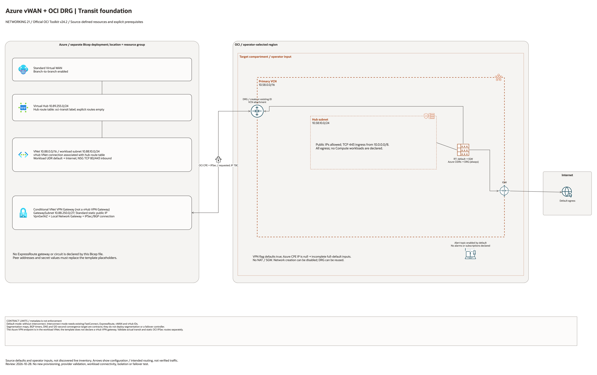

# Azure vWAN + OCI DRG Transit Architecture

This page is the deployment architecture for
`blueprints/networking/azure-vwan-oci-drg-transit`. It is Architecture-first
so the design is easy to review in GitHub, terminals, pull requests, runbooks,
and customer-safe notes without a diagramming tool.

## Deployment Purpose

Defines an OCI-primary network transit pattern with explicit paths: IPSec/BGP
for rollout and validation, then Interconnect as the default path when enabled.
Azure Virtual WAN and Virtual Hub provide centralized Azure-side transit and
route domains.

## Architecture At A Glance

| Item | Details |
| --- | --- |
| Boundary | `blueprints/networking/azure-vwan-oci-drg-transit` owns this deployment folder and its Terraform + Ansible runners. |
| Purpose | Build OCI-primary DRG routing baseline and publish IPSec-first, interconnect-default-when-present, route segmentation, DNS, and runbook contracts for Azure + OCI operations. |
| Terraform components | `oci_core_vcn.primary`, `oci_core_route_table.primary`, `oci_core_security_list.primary_hub`, `oci_core_subnet.primary_hub`, `oci_core_drg.primary`, `oci_core_drg_attachment.primary`, `oci_core_cpe.azure`, `oci_core_ipsec.azure`, `terraform_data.interconnect_contract`, `terraform_data.ipsec_fallback_contract`, `terraform_data.transit_contract`, `terraform_data.dns_contract`, `terraform_data.runbook_contract` |
| Primary architecture view | The Architecture diagram below shows OCI control-plane ownership, Azure vWAN/vHub assumptions, and route preference policy. |

## Architecture



[Editable draw.io source](architecture.drawio). Keep the PNG aligned with this
editable source after diagram changes.

Generated with the [oci-architecture-diagrams skill](https://github.com/leandro-michelino/oci-architecture-diagrams)
and Oracle OCI Architecture Diagram Toolkit v24.2. Regenerate from the repository
root with `python3 scripts/diagrams/networking-batch-05.py --render`, after
installing the skill and its official toolkit. The toolkit is not redistributed here.

The diagram distinguishes source-defined resources, conditional enablement,
supplied network references and metadata contracts. CIDRs are source defaults or
explicitly marked TBC; deployment placement remains an operator input.

Diagram documentation reviewed on 2026-10-28 against root Terraform, referenced
modules and any accompanying Bicep template. No cloud resources were provisioned
and no Terraform/provider validation date was changed. The picture is not proof
of routing, backend health, traffic isolation, BGP or failover.

## Resource Detail And Coverage

The main draw.io document includes the overview and a resource-detail page for
each cloud below. Every root/transitive OCI declaration and companion-template
declaration is mapped to a named resource card, including conditional resources.
Collection cards represent source declarations, not resolved deployment counts.

| Scope | Source declarations | PNG detail | Editable detail |
| --- | --- | --- | --- |
| Azure | 13 | [PNG](azure-resources.png) | [draw.io](azure-resources.drawio) |
| Contracts | 6 | [PNG](contracts-resources.png) | [draw.io](contracts-resources.drawio) |
| OCI | 10 | [PNG](oci-resources.png) | [draw.io](oci-resources.drawio) |

[Resource inventory and source-to-node coverage](resource-inventory.json).
Contracts are local Terraform metadata resources, not deployed cloud services.
Data lookups are recorded separately. Pinned module sources and source hashes
are retained in the inventory; the overview describes default enablement.

After regenerating the overview, rebuild all resource pages and verify coverage:

```bash
python3 scripts/diagrams/multicloud-resource-coverage.py --blueprint networking/azure-vwan-oci-drg-transit --render
python3 scripts/diagrams/multicloud-resource-coverage.py --blueprint networking/azure-vwan-oci-drg-transit --check
```

## Terraform Components

| Kind | Name | Source Or Role |
| --- | --- | --- |
| Resource | `oci_core_vcn.primary`, `oci_core_route_table.primary`, `oci_core_security_list.primary_hub`, `oci_core_subnet.primary_hub` | Optional OCI primary transit network with wired route and security controls. |
| Resource | `oci_core_drg.primary` | OCI DRG as primary route control hub. |
| Resource | `oci_core_drg_attachment.primary` | Optional DRG attachment to OCI VCN. |
| Resource | `oci_core_cpe.azure`, `oci_core_ipsec.azure` | Optional IPSec fallback tunnel resources for Azure edge failover. |
| Resource | `oci_ons_notification_topic.transit_alert` | Optional transit alerts topic. |
| Resource | `terraform_data.oci_network_contract` | OCI network and DRG contract output. |
| Resource | `terraform_data.interconnect_contract` | Interconnect and vWAN metadata contract output. |
| Resource | `terraform_data.ipsec_fallback_contract` | Fallback IPSec/BGP contract output. |
| Resource | `terraform_data.transit_contract` | CIDR segmentation and path preference contract output. |
| Resource | `terraform_data.dns_contract` | Optional DNS forwarding and probe contract output. |
| Resource | `terraform_data.runbook_contract` | Failover/failback operational sequence output. |
| Resource | `oci_core_internet_gateway.primary` | Declared in this blueprint; creation depends on its count or for_each inputs. |

## Request And Deployment Flow

- Operator selects connectivity mode and fallback behavior.
- Terraform creates optional OCI network resources and always creates primary DRG.
- Terraform optionally creates OCI CPE and IPSec resources for fallback path.
- Terraform publishes interconnect, fallback, transit, DNS, and runbook contracts.
- Azure-side sessions (`ansible/azure-*.yml`) create vWAN/vHub and transit-edge resources from `azure/main.bicep`.

## Traffic And Trust Boundaries

- Control plane traffic runs from workstation or CI to OCI and Azure APIs.
- Data plane starts with IPSec for rollout tests and can shift to Interconnect as default when dedicated circuits are enabled.
- Trust boundaries include OCI tenancy ownership, Azure subscription ownership, and partner interconnect ownership.
- Circuit IDs, public IP endpoints, and OCIDs must stay in ignored local tfvars or secure pipeline variables.

## Detailed Architecture Notes

- The OCI provider preserves the automatically assigned `Oracle-Tags.CreatedBy` and `Oracle-Tags.CreatedOn` provenance tags through `ignore_defined_tags`. Other defined tags remain managed. See [Oracle provider troubleshooting](https://docs.oracle.com/en-us/iaas/Content/dev/terraform/troubleshooting.htm).

- OCI remains primary by contract (`oci_is_primary=true`) for this blueprint variant.
- `connectivity_mode=interconnect` enforces both FastConnect and ExpressRoute IDs.
- `connectivity_mode=without-interconnect` enforces null interconnect IDs and keeps fallback logic explicit.
- For interconnect mode, contract checks require both `azure_virtual_wan_id` and `azure_virtual_hub_id`.
- Route segmentation metadata keeps prod, nonprod, and management lanes explicit for approvals and troubleshooting.
- DNS contract output keeps resolver and probe assumptions explicit for failback validation.

## Operational Boundaries

- Apply and destroy are approval-gated through guarded Ansible workflows.
- Keep circuit IDs, public endpoint values, and tenancy-specific OCIDs in ignored local tfvars.
- Re-run plan whenever connectivity mode, fallback policy, vWAN/vHub IDs, CIDRs, or BGP timer assumptions change.
- Validate Azure session outputs and Terraform contract inputs stay aligned before production changes.
- Use contract outputs as the source of truth for NOC and SRE runbook handoff.

## Review Checklist

- Confirm the diagram matches `main.tf`: `oci_core_vcn.primary`, `oci_core_route_table.primary`, `oci_core_security_list.primary_hub`, `oci_core_subnet.primary_hub`, `oci_core_drg.primary`, `oci_core_drg_attachment.primary`, `oci_core_cpe.azure`, `oci_core_ipsec.azure`, `terraform_data.interconnect_contract`, `terraform_data.ipsec_fallback_contract`, `terraform_data.transit_contract`, `terraform_data.dns_contract`, `terraform_data.runbook_contract`.
- Confirm OCI remains primary for this environment.
- Confirm interconnect IDs and mode selection are intentional.
- Confirm vWAN/vHub IDs, route table naming, and segmentation lanes are intentional.
- Confirm fallback enablement, Azure endpoint public IP, and CIDR exchange are deliberate.
- Confirm DNS resolver and health-probe assumptions match operations ownership.
- Confirm `ansible/plan.yml`, `ansible/apply.yml`, and `ansible/destroy.yml` still point at the shared Terraform runner.

Provider icons: Azure SVGs and AWS native stencils from draw.io identify mapped
external-cloud resources. Unmapped associations and local contracts retain
explicit named boxes. See [icon sources](../../../../scripts/diagrams/assets/README.md).
