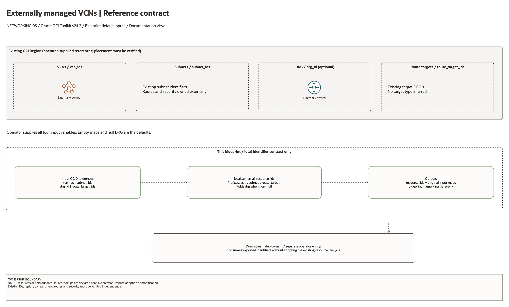

# Externally Managed VCNs Architecture

This is the deployment architecture for `blueprints/networking/externally-managed-vcns`. The PNG provides a GitHub-readable preview; the accompanying draw.io file preserves editable shapes and connectors.

## Deployment Purpose

Documents and exports existing VCN, subnet, DRG, and route target OCIDs so brownfield networks can participate in the landing-zone output contract.

## Architecture At A Glance

| Item | Details |
| --- | --- |
| Boundary | `blueprints/networking/externally-managed-vcns` owns this deployment folder and its Terraform + Ansible runners. |
| Purpose | Documents and exports existing VCN, subnet, DRG, and route target OCIDs so brownfield networks can participate in the landing-zone output contract. |
| Terraform components | `locals.external_resource_ids` only |
| Primary architecture view | The diagram below shows the default configuration, ownership boundaries, and configured routes or identifier hand-offs. |


## Architecture



[Editable draw.io source](architecture.drawio). Open the source in draw.io and export
the PNG after edits so the GitHub preview stays aligned with the editable diagram.

The diagram shows the default input configuration and distinguishes managed,
external, and optional components. Arrows describe configured routes, associations,
or identifier hand-offs; they do not establish verified packet flows.

Generated with the [oci-architecture-diagrams skill](https://github.com/leandro-michelino/oci-architecture-diagrams)
and Oracle OCI Architecture Diagram Toolkit v24.2. Regenerate with
`python3 scripts/diagrams/networking-batch-01.py --render` from the repository root
after installing the skill and its official toolkit. The toolkit itself is not stored in this repository.

Diagram documentation reviewed on 2026-10-28 against `main.tf`, `variables.tf`,
and the referenced module or output contract. No OCI resources were provisioned
and no Terraform/provider validation date was changed for this documentation update.

## Resource Detail And Coverage

Reviewed against the updated diagram standard on October 28, 2026. The main
draw.io document contains the topology overview plus every resource-detail and
existing-resource-reference page below. Source declarations include disabled and
collection-based resources from root Terraform, recursively pinned modules and
companion cloud templates. Counts are declarations, not resolved instance counts.

OCI uses Oracle Toolkit icons; Azure and AWS use their respective draw.io icons.
Types without a specific mapped icon retain their exact name and type in a box.
No GCP declarations were found in this fixed 39-blueprint scope.

| Detail page | Declarations | PNG | Editable source |
| --- | --- | --- | --- |
| No managed resource declarations | 0 | Not applicable | Not applicable |

[Existing resources and override inputs](existing-resources.png) | [Editable reference page](existing-resources.drawio)

[Source inventory](resource-inventory.json) records exact declarations, full
creation expressions, module call-site gates/enablement inputs, pinned revisions,
source hashes and diagram node mappings. Identifier-input references are listed
separately from managed resources. Null/empty inputs do not prove an external
resource exists; collection schemas may contain additional resource identifiers.

The overview explains default enablement. Resource cards enumerate all declaration
branches and do not imply deployment, ownership adoption, packet flow, security
enforcement or recovery success. No historical Terraform validation date changed.

```bash
python3 scripts/diagrams/multicloud-resource-coverage.py --blueprint networking/externally-managed-vcns --render
python3 scripts/diagrams/multicloud-resource-coverage.py --blueprint networking/externally-managed-vcns --check
```

If regenerating the overview first, rebuild these detail pages afterward.
See [the fixed first-39 review](../../../../docs/diagrams/FIRST-39-REVIEW.md) and [provider icon sources](../../../../scripts/diagrams/assets/README.md).

## Terraform Components

| Kind | Name | Source Or Role |
| --- | --- | --- |
| Local output contract | `locals.external_resource_ids` | References existing brownfield resources supplied as variables |

## Request And Deployment Flow

- No OCI network resource is created by this folder.
- Existing VCN, subnet, DRG, and route target OCIDs are normalized into resource_ids.
- Downstream deployments can consume the brownfield output contract without knowing whether the resources were created here.

## Traffic And Trust Boundaries

- The diagram shows local identifier processing only. This blueprint declares no OCI resources or network data-source lookups.
- No packet path is established here. External network owners remain responsible for routes, security, connectivity and lifecycle.
- Trust boundaries are the tenancy, compartment, VCN, subnet, DRG, private endpoint, identity domain, or managed service edges shown in the diagram.
- Secrets, OCIDs, customer CIDRs, endpoint URLs, and contact data belong in ignored local tfvars or a secure pipeline variable store, not in committed files.

## Detailed Architecture Notes

- The OCI provider preserves the automatically assigned `Oracle-Tags.CreatedBy` and `Oracle-Tags.CreatedOn` provenance tags through `ignore_defined_tags`. Other defined tags remain managed. See [Oracle provider troubleshooting](https://docs.oracle.com/en-us/iaas/Content/dev/terraform/troubleshooting.htm).

These notes expand the diagram with the design details that usually matter during review, plan, and hand-off.

- This deployment intentionally creates no OCI network resources; it normalizes existing OCIDs into the standard output contract.
- vcn_ids, subnet_ids, drg_id, and route_target_ids should be verified against the intended region and compartment before use.
- Packet paths already exist outside this folder, so the architecture review should confirm the brownfield routes and security controls separately.
- Downstream deployments can use the exported maps the same way they use outputs from resource-creating network blueprints.

## Operational Boundaries

- Keep customer-specific OCIDs, CIDRs, DNS names, endpoints, contacts, and secrets in ignored local tfvars or approved pipeline variables.
- Run plan from this blueprint folder so relative module paths, provider files, and local Ansible runners resolve predictably.
- Treat apply and destroy as approval-gated operations; use the guarded Ansible playbooks or a reviewed Terraform workflow.
- Re-check route exposure, IAM scope, compartment boundaries, tags, and output hand-offs whenever inputs change.

## Review Checklist

- Confirm the diagram matches `main.tf`: `locals.external_resource_ids`.
- Confirm the described traffic path is the path you want in OCI before apply.
- Confirm public exposure, private endpoint access, DNS behavior, DRG routing, and inspection points are intentional where present.
- Confirm IAM scopes, compartment boundaries, tags, and operational outputs match the deployment README.
- Confirm `ansible/plan.yml`, `ansible/apply.yml`, and `ansible/destroy.yml` still point at the shared Terraform runner.
